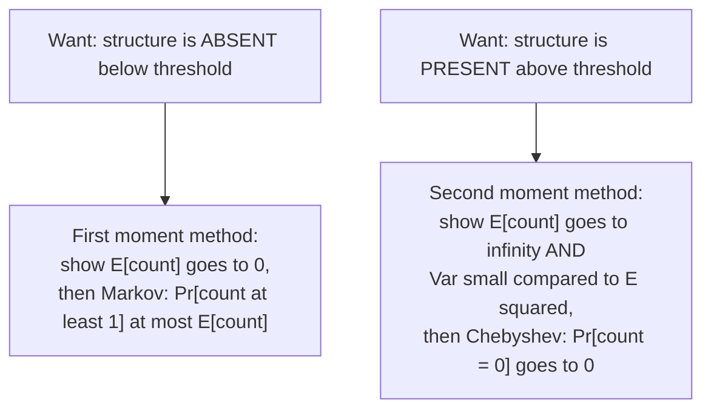
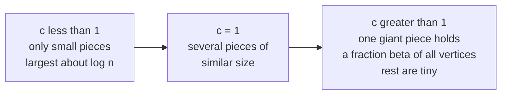
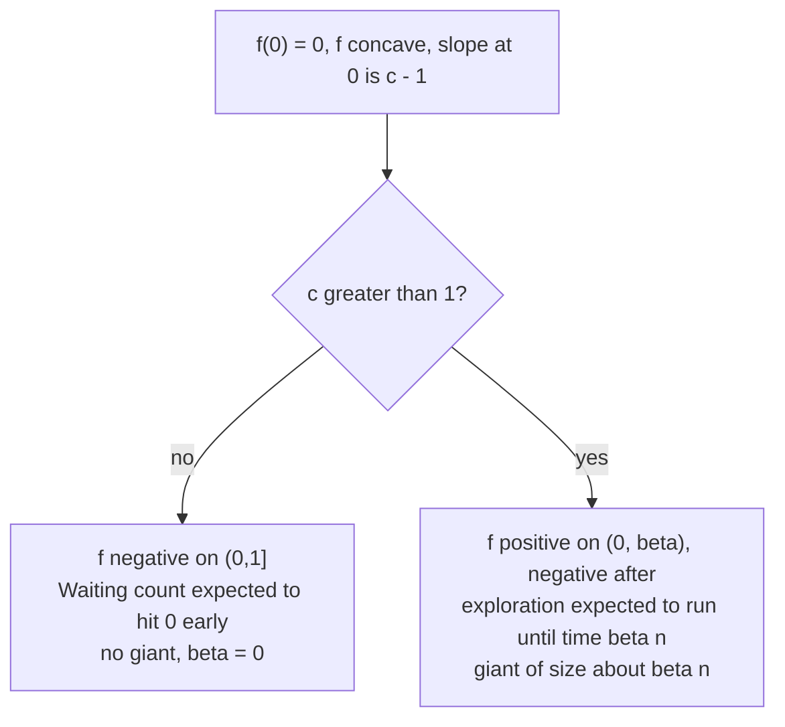
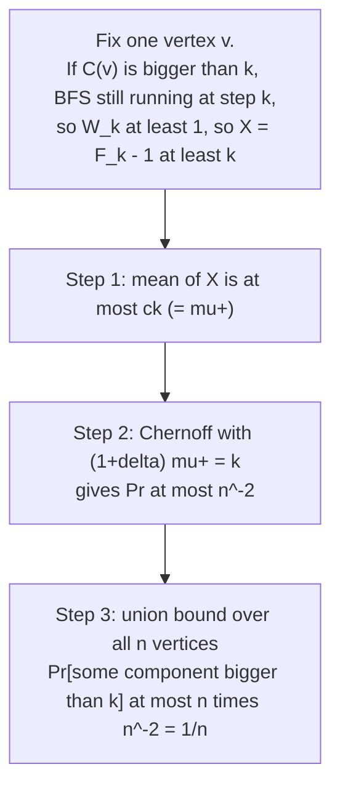
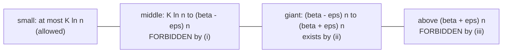
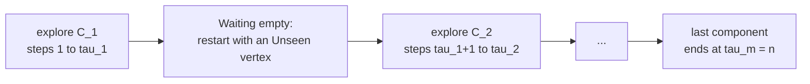
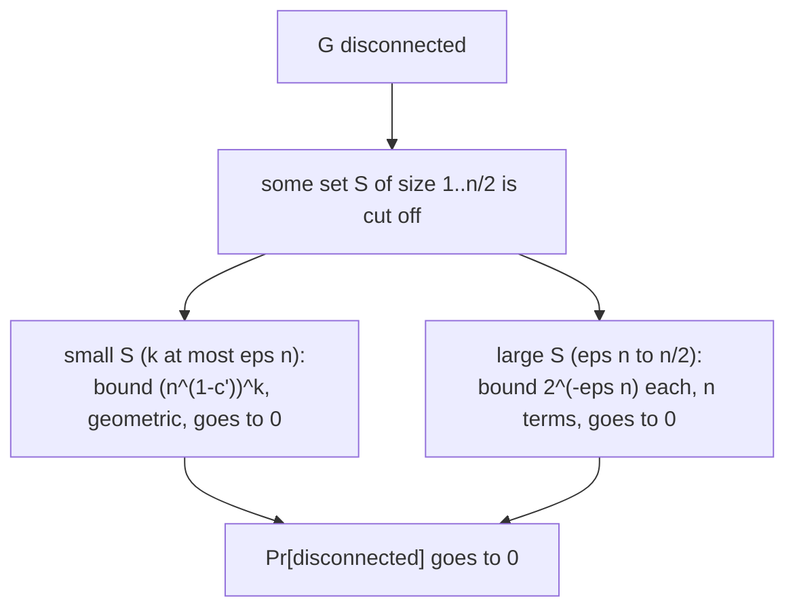

## 0. Notation cheat sheet (read once)

| Symbol              | Plain meaning                                                                          |
| ------------------- | -------------------------------------------------------------------------------------- |
| $G=(V,E)$           | graph: $V$ = vertices (dots), $E$ = edges (lines between pairs)                        |
| $n$                 | number of vertices                                                                     |
| $\binom{n}{2}$      | number of possible pairs = $n(n-1)/2$                                                  |
| $\deg(v)$           | number of edges touching $v$                                                           |
| component           | a group of vertices all reachable from each other, with no edge to the outside         |
| $C(v)$              | the component containing $v$; $\lvert C(v)\rvert$ = its size                           |
| $C_{\max}$          | the largest component                                                                  |
| $\mathrm{Bin}(m,p)$ | number of successes in $m$ independent coin flips, each heads with prob $p$; mean $mp$ |
| "w.h.p."            | "with high probability" = probability $\to 1$ as $n\to\infty$                          |

**Growth-rate notation** (all as $n \to \infty$):

| Notation | Meaning | Example |
|---|---|---|
| $a(n) = o(b(n))$ | $a$ is **much smaller** than $b$: $a/b \to 0$ | $\sqrt n = o(n)$ |
| $a(n) = \omega(b(n))$ | $a$ is **much bigger** than $b$: $a/b \to \infty$ | $n^2 = \omega(n)$ |
| $a(n) = \Theta(b(n))$ | **same order**: $a/b$ stays between two positive constants | $3n+5 = \Theta(n)$ |
| $a(n) = O(b(n))$ | **at most** order $b$ | $\log n = O(\log n)$ |
| $a \gg b$ | same as $a = \omega(b)$ | |

---

## 1. The $G(n,p)$ model

**Definition.** Take $n$ labelled vertices. For **each** of the $\binom n2$ pairs, flip an independent coin that lands heads with probability $p$. Heads = put the edge in.

$$\Pr[\{i,j\} \in E] = p, \quad \text{independently for every pair.}$$

- $p=0$: empty graph. $p=1$: complete graph (every pair connected).
- We study $n \to \infty$ and let $p = p(n)$ depend on $n$ (usually $p \to 0$).
- **Expected degree:** a vertex has $n-1$ possible partners, each present with prob $p$, so
$$\mathbb{E}[\deg(v)] = (n-1)p \approx np.$$
- Think of $np$ as "average number of friends". It is the most important number in this whole lecture.

> [!important] Key surprise
> Properties of $G(n,p)$ appear **suddenly** as $p$ crosses a certain value (a "threshold"). Below it, the property almost never holds; above it, it almost always holds. (Similar flavour to Week 2: volume of a high-dimensional ball concentrating in a thin shell.)

### Toy example: $G(4, \tfrac12)$ by hand

$n=4$, so $\binom42 = 6$ possible edges, each present with prob $\frac12$.

- **Any particular graph $H$:** 6 independent coin flips must all match $H$: $\Pr[G=H] = (\tfrac12)^6 = \tfrac1{64}$. So at $p=\frac12$ all 64 labelled graphs are equally likely.
- **Expected number of edges:** $6 \cdot \frac12 = 3$.
- **Vertex 1 has no edges:** its 3 possible edges must all be absent: $(\tfrac12)^3 = \tfrac18$.
- **Expected number of triangles:** there are $\binom43 = 4$ triples, each is a triangle if all 3 edges present ($(\frac12)^3$): $4 \cdot \frac18 = \frac12$.

This week: the **same kind of calculations**, but with $n \to \infty$ and $p \to 0$.

---

## 2. Thresholds and phase transitions

### 2.1 Definition of a threshold

Let $Q$ be a property (e.g. "contains a triangle", "is connected").

$p^*(n)$ is a **threshold** for $Q$ if, as $n \to \infty$:
$$p(n) = o(p^*(n)) \Rightarrow \Pr[Q] \to 0, \qquad p(n) = \omega(p^*(n)) \Rightarrow \Pr[Q] \to 1.$$

| $p(n)$ compared to $p^*(n)$ | $\Pr[Q]$ as $n\to\infty$ |
|---|---|
| much smaller ($o$) | $\to 0$ |
| same order ($\Theta$) - "the window" | **not specified** by the definition |
| much bigger ($\omega$) | $\to 1$ |

- $p^*$ is only defined **up to constants**: if $p^*$ is a threshold, so is $2p^*$ (because "much smaller than $p^*$" is the same as "much smaller than $2p^*$").
- The definition says nothing about what happens inside the window.


### 2.2 Sharp vs coarse thresholds

$p^*$ is **sharp** if for every small $\epsilon > 0$:
$$p \le (1-\epsilon)p^* \Rightarrow \Pr[Q] \to 0, \qquad p \ge (1+\epsilon)p^* \Rightarrow \Pr[Q]\to 1.$$

- Sharp = the switch from "never" to "always" happens inside a tiny window around $p^*$. Here the **constant in $p^*$ matters** (e.g. exactly $1/n$, not $2/n$).
- Otherwise $p^*$ is **coarse**: the probability changes gradually across the window.

| Property $Q$ | Threshold $p^*(n)$ |
|---|---|
| Contains a triangle | $1/n$ |
| Giant component (a component of size $\Theta(n)$) | $1/n$ (sharp) |
| Connected | $\ln n / n$ (sharp) |

> [!note] Which are sharp?
> The slides leave triangle sharpness to Problem Set D2/D3. Giant and connectivity are proved sharp below. (Hint for triangles: at $p=c/n$ the expected count tends to the constant $c^3/6$, so the probability of a triangle tends to something strictly between 0 and 1 for each fixed $c$ - this is what "coarse" looks like.)

### 2.3 Where thresholds come from: "expectation = 1"

> [!tip] Rule of thumb
> $p^*$ is the value of $p$ where a suitable **expected count equals 1**. Below $p^*$ the expected count $\to 0$ (or stays $<1$); above, it $\to \infty$ (or $>1$).

| Property | Expected quantity | It equals 1 when |
|---|---|---|
| Contains a triangle | $\mathbb{E}[\#\text{triangles}] \approx \frac16(np)^3$ | $p \approx 1/n$ |
| Giant component | $\mathbb{E}[\#\text{new neighbours per BFS step}] \approx np$ | $p = 1/n$ |
| Connected | $\mathbb{E}[\#\text{isolated vertices}] \approx n e^{-np}$ | $p = \ln n / n$ |

At $p = p^*$ the expected count is $\Theta(1)$ (a constant).

To prove "$\Pr[Q] \to 1$" you need more than the expectation: you also need to control the **variance** (Section 2.6).

### 2.4 The two standard tools (from Week 3)



- **Markov:** for a count $X \ge 0$, $\Pr[X \ge 1] \le \mathbb{E}[X]$.
- **Chebyshev:** $\Pr[|X - \mathbb{E}X| \ge a] \le \mathrm{Var}[X]/a^2$.

### 2.5 Triangles, first moment ($p^* = 1/n$)

Let $X$ = number of triangles. For each of the $\binom n3$ triples $r$, let $I_r = 1$ if all three of its edges are present (prob $p^3$), else 0.

$$X = \sum_{r=1}^{\binom n3} I_r, \qquad \mathbb{E}[I_r] = p^3,$$
$$\mathbb{E}[X] = \binom n3 p^3 \approx \frac{n^3}{6}p^3 = \frac16 (np)^3.$$

- **Linearity of expectation** works even though the $I_r$ are dependent (two triples sharing an edge are linked). Expectation of a sum = sum of expectations, always.
- By Markov: $\Pr[X \ge 1] \le \mathbb{E}[X] \to 0$ when $np \to 0$, i.e. $p = o(1/n)$.

> [!question] Does $\mathbb{E}[X] \to 0$ rule out a triangle in a given sample?
> **No.** Markov bounds a *probability*. In any single draw a triangle can still appear (each triple is a triangle with prob $p^3 > 0$). We only get: the chance of seeing one goes to 0.

### Triangle counts at $p = n^{-\alpha}$

$$\mathbb{E}[X] \approx \frac16 (np)^3 = \frac16 n^{3(1-\alpha)}.$$

- On a log-log plot of $\mathbb{E}[X]$ vs $n$, the slope is $3(1-\alpha)$:
  - $\alpha < 1$ ($p$ bigger than $1/n$): positive slope, count blows up.
  - $\alpha = 1$: slope 0, count stays constant.
  - $\alpha > 1$ ($p$ smaller than $1/n$): negative slope, count vanishes.
- Check: at $p = c/n$, $\mathbb{E}[X] \to c^3/6$, which equals 1 at $c \approx 1.8$.
- For finite $n$ the plotted lines sit a bit below the limit (by $\ln 6/\ln n$, because of the $\frac16$).

### 2.6 Triangles, second moment

> [!theorem] Second moment theorem
> If $\mathbb{E}[X] \to \infty$ **and** $\mathrm{Var}[X] = o(\mathbb{E}[X]^2)$, then $\Pr[X > 0] \to 1$.

**Proof.** If $X = 0$, then $X$ is at distance $\mathbb{E}X$ from its mean. So by Chebyshev:
$$\Pr[X=0] \le \Pr\big[|X - \mathbb{E}X| \ge \mathbb{E}X\big] \le \frac{\mathrm{Var}[X]}{\mathbb{E}[X]^2} \to 0. \qquad\blacksquare$$

- Both conditions are used: $\mathbb{E}X$ large makes "0" far from the mean; small variance means $X$ rarely strays that far.
- For triangles, $np \to \infty$ gives both conditions. (Only pairs of triangles **sharing an edge** create covariance - Problem Set D2.)
- **Conclusion:** $p \gg 1/n \Rightarrow$ triangles appear w.h.p. Together with 2.5, $1/n$ is the triangle threshold.

---

## 3. The giant component

### 3.1 The statement

Sparse regime: $p = c/n$ with $c$ a fixed constant (so average degree $\approx c$).

$$|C_{\max}| = \begin{cases} O(\log n), & c < 1 \quad \text{(subcritical)} \\ \Theta(n), & c > 1 \quad \text{(supercritical)} \end{cases}$$

- $p^* = 1/n$ is a **sharp** threshold.
- $c<1$: every component is tiny (at most order $\log n$).
- $c>1$: **one** component contains a constant fraction of all vertices (the "giant"). It is unique; all other components are $O(\log n)$.



Pictures from the slides ($n=60$): at $c=0.5$ only small components; at $c=1$ several similar-sized ones; at $c=2$ one component holds most vertices.

> [!tip] Intuition: a family tree
> Explore the component of $v$ outward. Each vertex you reach brings in about $c$ new neighbours on average.
> - If $c<1$, each "generation" is smaller than the last, so the exploration dies out fast.
> - If $c>1$, each generation is bigger, so the exploration can keep growing until it has eaten a constant fraction of the graph.

### 3.2 Exploring a component with BFS: notation

Run breadth-first search (BFS) from $v$. At every moment each vertex is in exactly one group:

| Group | Meaning | Size after $t$ steps |
|---|---|---|
| **Done** | all its Unseen neighbours have been found | $t$ |
| **Waiting** | found, but its edges not yet checked | $W_t$ |
| **Unseen** | not found yet | $U_t$ |
| **Found** | Done or Waiting | $F_t = t + W_t = n - U_t$ |


**One step $t \to t+1$:** take one Waiting vertex, check its edges to all Unseen vertices, move it to Done. It finds $X_{t+1}$ new vertices:
$$X_{t+1} \mid U_t \sim \mathrm{Bin}(U_t, p),$$
$$W_{t+1} = W_t - 1 + X_{t+1}, \qquad U_{t+1} = U_t - X_{t+1}, \qquad W_0 = 1 \ (\text{just } v).$$

- $-1$: the processed vertex leaves Waiting. $+X_{t+1}$: newly found vertices join Waiting.
- **The component is fully explored when Waiting is empty.** So
$$|C(v)| = \text{first } t \text{ with } W_t = 0 \quad (\text{equivalently } F_t = t).$$
(Problem Set C2 writes $z_t$ for $F_t$.)

### 3.3 Generating the edges while BFS runs

Trick: don't sample the whole graph first. Flip the coins **only when BFS needs them**.

| Symbol | Meaning |
|---|---|
| $\tau$ | last BFS step, $\tau = \lvert C(v)\rvert$ |
| $w_s$ | vertex moved Waiting $\to$ Done at step $s$ |
| $\mathcal U_s$ | set of Unseen vertices after step $s$; $U_s = \lvert\mathcal U_s\rvert$ |
| $\xi_{u,s}$ | an independent coin, 1 with prob $p$, one for each $u \ne v$ and each step $s \ge 1$ |

**Edge rule** at step $s \le \tau$: $\{w_s, u\} \in E \iff \xi_{u,s} = 1$, for $u \in \mathcal U_{s-1}$.
Every other pair (never checked by BFS) is an edge with prob $p$, independently.

- This produces exactly the same distribution as $G(n,p)$, because **every pair is decided exactly once**, by a fresh independent coin.
- Bonus: the coins $\xi_{u,s}$ exist for **all** $s$, even after BFS stops. This lets us define quantities for every $t$, which simplifies the maths.

### 3.4 The Unseen-count lemma

For every $t \ge 0$ define
$$U_t = \#\{u \ne v : \xi_{u,1} = \dots = \xi_{u,t} = 0\}, \qquad F_t = n - U_t.$$
(In words: $u$ is still Unseen after $t$ steps iff all of its first $t$ coins were tails.)

> [!theorem] Lemma (Unseen count)
> For $t \le \tau$, $U_t = |\mathcal U_t|$ (matches the real BFS). For **every** $t \ge 0$, with $q_t = 1 - (1-p)^t$:
> $$U_t \sim \mathrm{Bin}\big(n-1,\ (1-p)^t\big), \qquad F_t - 1 \sim \mathrm{Bin}(n-1,\ q_t).$$

**Plain meaning:** each of the $n-1$ other vertices independently "survives unseen" for $t$ steps with probability $(1-p)^t$ (it dodged $t$ independent chances of being found). $q_t$ = prob it **has** been found.

**Proof.**
- *Step 1 ($U_t = |\mathcal U_t|$), induction on $t$.* Start: $\mathcal U_0 = V\setminus\{v\}$. By the edge rule,
  $u \in \mathcal U_t \iff u \in \mathcal U_{t-1}$ and $\{w_t,u\} \notin E \iff \xi_{u,1}=\dots=\xi_{u,t-1}=0$ and $\xi_{u,t}=0$.
- *Step 2 (distribution).* Let $I_u = 1[\xi_{u,1}=\dots=\xi_{u,t}=0]$. Then $U_t = \sum_{u\ne v} I_u$, $\Pr[I_u=1] = (1-p)^t$ (independent coins), and different $I_u$ use **disjoint** sets of coins, so they are independent. Sum of $n-1$ independent 0/1 variables with the same prob = Binomial.
- Finally $F_t - 1 = (n-1) - U_t \sim \mathrm{Bin}(n-1, q_t)$. $\blacksquare$

### 3.5 Where is $\mathbb{E}[W_t]$ positive? The function $f(\theta)$

If $|C(v)| > t$, the exploration is still running at step $t$, so $W_t \ge 1$. So: for which $t$ can $W_t$ stay positive?

From the counts: $W_t = F_t - t = 1 + (n-1-U_t) - t$. Take expectations:
$$\mathbb{E}[W_t] = 1 + (n-1)q_t - t.$$

Put $p = c/n$ and measure time as a fraction of $n$: $t = \theta n$, $0 \le \theta \le 1$. Using $(1-\frac cn)^{\theta n} \to e^{-c\theta}$:
$$\frac{\mathbb{E}[W_{\theta n}]}{n} \to 1 - e^{-c\theta} - \theta =: f(\theta).$$

- $1 - e^{-c\theta}$ = fraction of vertices found by time $\theta n$.
- $\theta$ = fraction of vertices already Done.
- $f(\theta)$ = fraction still Waiting. If $f > 0$ for some $\theta > 0$, the exploration is expected to survive to time $\Theta(n)$: a giant component.

### 3.6 The sign of $f(\theta) = 1 - e^{-c\theta} - \theta$

Facts: $f(0) = 0$; $f$ is **concave** (curves downward); $f(1) = -e^{-c} < 0$; slope at 0 is $f'(0) = c - 1$.

- **$c \le 1$:** $f'(0) \le 0$, and a concave function starting at 0 with non-positive slope stays below 0. So $f < 0$ on $(0,1]$: no giant.
- **$c > 1$:** $f'(0) > 0$, so $f$ first goes up, then must come back down to $f(1) < 0$. It crosses zero at exactly one point $\beta \in (0,1)$: $f>0$ on $(0,\beta)$ and $f<0$ on $(\beta,1]$.

$$\beta \text{ solves } 1 - \beta = e^{-c\beta}, \quad (\beta = 0 \text{ for } c \le 1).$$



**Simulation check (slides):** one BFS run with $n=4000$, $c=2$ stopped at $0.804n$; the limit predicts $\beta n = 0.797n$. Differences come from (1) $f$ being the $n\to\infty$ limit, (2) one random sample. (Problem Set C3.)

---

## 4. Subcritical proof ($c<1$): every component is $O(\log n)$

> [!theorem] Theorem
> Let $c<1$, $\alpha = c - 1 - \ln c$, $k = \frac{2}{\alpha}\ln n$. Then for $G(n, c/n)$:
> $$\Pr\big[|C_{\max}| > k\big] \le \frac1n.$$

- $\alpha > 0$ for $c<1$ (because $\ln c < c - 1$ for every $c \ne 1$). So $k$ is a constant times $\ln n$.

**Tool: Chernoff upper tail with an upper bound on the mean.** If $X$ is a sum of independent 0/1 variables with $\mathbb{E}[X] \le \mu^+$ and $\delta > 0$:
$$\Pr\big[X \ge (1+\delta)\mu^+\big] \le \exp\big(\mu^+[\delta - (1+\delta)\ln(1+\delta)]\big).$$
(Same proof as Week 3, just using an upper bound $\mu^+$ instead of the exact mean: a smaller true mean only makes the tail smaller.)



**Step 1 (mean).** $X = F_k - 1 \sim \mathrm{Bin}(n-1, q_k)$. If $|C(v)| > k$ then $W_k = X + 1 - k \ge 1$, i.e. $X \ge k$.
$$\mathbb{E}[X] = (n-1)q_k \le (n-1)kp \le ck =: \mu^+.$$
Here $q_k = 1-(1-p)^k \le kp$ (union bound: the chance of being found in at least one of $k$ steps is at most $k$ times the chance per step).

**Step 2 (plug into Chernoff).** We want $(1+\delta)\mu^+ = k$, so $1 + \delta = 1/c$ (which is $>1$ since $c<1$). Then
$$\Pr[|C(v)|>k] \le \Pr[X \ge (1+\delta)\mu^+] \le \exp\Big(ck\Big[\tfrac1c - 1 - \tfrac1c \ln\tfrac1c\Big]\Big) = \exp\big(-k[c - 1 - \ln c]\big) = e^{-\alpha k} = n^{-2}.$$
(Last step uses $k = \frac2\alpha \ln n$.)

**Step 3 (all vertices).** Union bound: $\Pr[|C_{\max}| > k] \le n \cdot n^{-2} = \frac1n$. $\blacksquare$

> [!note] Union bound
> $\Pr[A_1 \text{ or } A_2 \text{ or } \dots] \le \Pr[A_1] + \Pr[A_2] + \dots$ Used constantly in this lecture: bound one case, multiply by the number of cases.

---

## 5. Supercritical proof ($c>1$): one component of size $\Theta(n)$

> [!theorem] Theorem
> Let $G = G(n, c/n)$ with $c>1$, $\beta \in (0,1)$ the root of $1-\beta = e^{-c\beta}$, and $0 < \epsilon < \min(\beta, 1-\beta)$. There is a constant $K$ such that, with probability $\to 1$:
> 1. **(i)** no component has size in $[K\ln n,\ (\beta-\epsilon)n]$ - a "forbidden middle range";
> 2. **(ii)** some component has size $> (\beta-\epsilon)n$;
> 3. **(iii)** every component has size $\le (\beta+\epsilon)n$.

So: one component of size $(\beta\pm\epsilon)n$, every other of size $O(\log n)$. (Uniqueness of the giant: Alon-Spencer, *The Probabilistic Method*, Ch. 11.)



### 5.1 Tools: Chernoff with bounds on the mean

$X$ a sum of independent 0/1 variables.
- **Lower tail** (needs a *lower* bound $\mathbb{E}[X] \ge \mu^-$), $0<\delta<1$:
$$\Pr[X \le (1-\delta)\mu^-] \le e^{-\mu^-\delta^2/2}.$$
- **Upper tail** (needs an *upper* bound $\mathbb{E}[X] \le \mu^+$), $\delta>0$:
$$\Pr[X \ge (1+\delta)\mu^+] \le \exp\big(\mu^+[\delta-(1+\delta)\ln(1+\delta)]\big).$$

Rule: to show $X$ is rarely **small**, you need to know its mean is **big** (and vice versa).

### 5.2 Component size and $X_t$

Let $X_t$ = number of Found vertices other than $v$ after step $t$:
$$X_t = F_t - 1 \sim \mathrm{Bin}(n-1, q_t), \qquad q_t = 1 - (1-\tfrac cn)^t.$$
For $t \le \tau$: $W_t = X_t + 1 - t$, so $W_t \ge 1 \iff X_t \ge t$.

**So $|C(v)| > t$ implies $X_t \ge t$.** "The component is still growing at time $t$" = "BFS has found at least $t$ other vertices by time $t$".

> [!theorem] Lemma (Mean vs step)
> For $n \ge 2c$, $t = \theta n \le n$, $f(\theta) = 1 - e^{-c\theta}-\theta$:
> $$n f(\theta) - 1 \ \le\ \mathbb{E}[X_t] - t\ \le\ n f(\theta) + c^2.$$

Meaning: $\mathbb{E}[X_t] - t = nf(\theta) + O(1)$, which has the **same sign as $f(\theta)$** (for large $n$). So the earlier limit calculation is accurate up to a constant.

**Proof.**
- *Lower bound:* $\mathbb{E}[X_t] = (n-1)q_t \ge (n-1)(1-e^{-c\theta})$ (using $1-x \le e^{-x}$) $\ge n(1-e^{-c\theta}) - 1$ (since $1 - e^{-c\theta} \le 1$). Subtract $t = \theta n$.
- *Upper bound:* with $x = c/n \le \frac12$, use $\ln(1-x) \ge -x - x^2$ to get $(1-\frac cn)^t \ge e^{-c\theta}e^{-c^2\theta/n}$. Then $q_t \le 1 - e^{-c\theta} + \frac{c^2\theta}{n}$ (using $1 - e^{-y} \le y$). So $\mathbb{E}[X_t] \le nq_t \le n(1-e^{-c\theta}) + c^2$ (as $\theta\le 1$). Subtract $t$. $\blacksquare$

### 5.3 Turning the lemma into bounds Chernoff can use

**Lower bound (before $\beta$).** For $1/\gamma \le t \le (\beta-\epsilon)n$, where
$$\gamma = \frac{f(\beta-\epsilon)}{2(\beta-\epsilon)} > 0.$$
- Because $f$ is concave with $f(0)=0$, the curve lies above the straight line from $(0,0)$ to $(\beta-\epsilon, f(\beta-\epsilon))$, so $nf(\theta) \ge 2\gamma t$.
- Then $\mathbb{E}[X_t] - t \ge 2\gamma t - 1 \ge \gamma t$ (using $t \ge 1/\gamma$).
- So $\mathbb{E}[X_t] \ge (1+\gamma)t =: \mu_t^-$.

**Upper bound (after $\beta$).** For $t = (\beta+\epsilon)n \ge c^2/\gamma'$, where
$$\gamma' = \frac{-f(\beta+\epsilon)}{2(\beta+\epsilon)} > 0.$$
- $\mathbb{E}[X_t] - t \le nf(\beta+\epsilon) + c^2 = -2\gamma' t + c^2 \le -\gamma' t$.
- So $\mathbb{E}[X_t] \le (1-\gamma')t =: \mu_t^+$.

Proofs (i) and (ii) use $\mu^-$ (lower tail); (iii) uses $\mu^+$ (upper tail).

### 5.4 Proof of (i): no component in the forbidden middle

**Step 1 (one vertex, one time).** Fix $t$ with $K\ln n \le t \le (\beta-\epsilon)n$. Let $Z \sim \mathrm{Bin}(n-1, q_t)$. Choose $\delta$ with $1 - \delta = \frac{1}{1+\gamma}$, so $(1-\delta)\mu_t^- = t$.
$$\Pr[Z \le t-1] \le \Pr[Z \le (1-\delta)\mu_t^-] \le e^{-\mu_t^-\delta^2/2} \le e^{-t\delta^2/2} \le n^{-3},$$
using $\mu_t^- \ge t$ and $t \ge K\ln n$ with $K = 6/\delta^2$.
Since $W_t = X_t + 1 - t$: $\Pr[W_t = 0] \le \Pr[X_t \le t-1] \le n^{-3}$.
(For large $n$, $K\ln n \ge 1/\gamma$, so the lower bound on the mean applies.)

**Step 2 (all vertices, all times).** Let $I = \{t : K\ln n \le t \le (\beta-\epsilon)n\}$, so $|I| \le n$. The bad event is
$$B = \bigcup_{v}\bigcup_{t\in I}\{|C(v)| = t\}.$$
BFS from $v$ stops at $\tau = |C(v)|$ with $W_\tau = 0$, so $\{|C(v)|=t\} \subseteq \{W_t^{(v)} = 0\}$. Union bound over at most $n \cdot n$ pairs $(v,t)$:
$$\Pr[B] \le n \cdot n \cdot n^{-3} = \frac1n. \qquad\blacksquare$$

### 5.5 Proof of (ii): a giant exists

Idea: explore the **whole graph** one component after another. The exploration can't end in the forbidden range, so some component must stretch across it.

**Step 1 (BFS with restarts).** Run BFS from $v$. Whenever Waiting becomes empty, move one Unseen vertex into Waiting and continue. Let $W_t$ = Waiting after step $t$ (before any restart).
- $W_t = F_t - t$. The times when $W_t = 0$ are $\tau_1 < \dots < \tau_m$ (with $\tau_0 = 0$); these are the moments a component finishes.
- Component $C_j$ = vertices processed at steps $\tau_{j-1}+1, \dots, \tau_j$, so $|C_j| = \tau_j - \tau_{j-1}$.
- Each step moves one vertex to Done, so $\tau_m = n$. Every pair is still decided once.



**Step 2 (Found count).** Let $Y_t = \#\{u \ne v : \xi_{u,s} = 1 \text{ for some } s \le t\} \sim \mathrm{Bin}(n-1, q_t)$. Each such $u$ is Found by step $t$ (restarts only add more Found vertices), so $F_t - 1 \ge Y_t$. Hence
$$Y_t > t-1 \Rightarrow F_t > t \Rightarrow W_t \ne 0, \qquad \text{i.e. } \{W_t = 0\} \subseteq \{Y_t \le t-1\}.$$

**Step 3 (no component finishes inside $I$).** Let $A = \bigcap_{t\in I}\{W_t \ge 1\}$. Union bound + Step 1 of (i) (with $Z = Y_t$):
$$\Pr[A^c] \le \sum_{t \in I}\Pr[Y_t \le t-1] \le n \cdot n^{-3} = n^{-2}.$$

**Step 4 (one big component).** Suppose $A$ holds. Let $j$ be the first index with $\tau_j \ge \min I$. Since no $\tau$ lies in $I$: $\tau_{j-1} < \min I$ and $\tau_j > \max I$. So $C_j$ covers all of $I$:
$$|C_j| \ge |I| + 1 \ge (\beta-\epsilon)n - K\ln n \ge \tfrac12(\beta-\epsilon)n \quad (n \text{ large}).$$

**Step 5 (combine with (i)).** On $A \cap B^c$: $|C_j| \ge \frac12(\beta-\epsilon)n > K\ln n$, and by (i) $|C_j| \notin I$, so $|C_j| > (\beta-\epsilon)n$.
$$\Pr[(A\cap B^c)^c] \le \Pr[A^c] + \Pr[B] \le n^{-2} + \frac1n \to 0. \qquad\blacksquare$$

### 5.6 Proof of (iii): nothing bigger than $(\beta+\epsilon)n$

**Step 1 (one vertex).** Let $t = (\beta+\epsilon)n$ and $\mu_t^+ = (1-\gamma')t \ge \mathbb{E}[X_t]$. Choose $1 + \delta = \frac{1}{1-\gamma'}$ so $(1+\delta)\mu_t^+ = t$.
$$\Pr[|C(v)| > t] \le \Pr[X_t \ge t] = \Pr[X_t \ge (1+\delta)\mu_t^+] \le \exp\big(\mu_t^+[\delta - (1+\delta)\ln(1+\delta)]\big) = e^{-\kappa n},$$
with $\kappa = (1-\gamma')(\beta+\epsilon)\big[(1+\delta)\ln(1+\delta) - \delta\big] > 0$.

**Step 2 (all vertices).** $\Pr[|C_{\max}| > t] \le n e^{-\kappa n} \to 0$. $\blacksquare$

### 5.7 Size of the giant in numbers

Giant fraction $\beta(c)$ = largest root in $[0,1)$ of $1 - \beta = e^{-c\beta}$.

| $c = np$ | $\le 1$ | 1.5 | 2 | 3 | $\to\infty$ |
|---|---|---|---|---|---|
| $\beta$ | 0 | 0.583 | 0.797 | 0.940 | $\to 1$ |

At $p = 2/n$ (average 2 friends), about **80%** of vertices are in the giant. (Problem Set C4.)

> [!tip] Where the equation $1-\beta = e^{-c\beta}$ comes from (intuition)
> A vertex is *outside* the giant iff none of its ~$c$ neighbours lead into the giant. If a fraction $\beta$ is in the giant, the chance a given vertex has no edge to it is about $(1-p)^{\beta n} \approx e^{-c\beta}$. So "fraction outside" $1-\beta$ = $e^{-c\beta}$.

### 5.8 Simulating the phase transition

```
Input: n, constant c; set p = c/n
E = empty
for each pair {i, j}, i < j:
    with probability p, add {i, j} to E
find connected components of ([n], E)     # BFS or union-find
C_max = largest component
return s = |C_max| / n                    # giant fraction
```
- Sweep $c$ and plot $s$ against $c$.
- The pair loop is $O(n^2)$. A smarter "edge-skipping" sampler is $O(n + |E|)$.
- Result ($n=2000$, 5 trials per point): for $c<1$, $s \approx 0$; for $c>1$, $s \approx \beta$ ($\approx 0.8$ at $c=2$).

---

## 6. Connectivity: threshold $p^* = \ln n / n$

### 6.1 Isolated vertices

$v$ is isolated iff all its $n-1$ possible edges are absent:
$$\Pr[v \text{ isolated}] = (1-p)^{n-1} \approx e^{-np}, \qquad \mathbb{E}[\#\text{isolated}] \approx ne^{-np}.$$
At $p = c\ln n/n$: $ne^{-c\ln n} = n^{1-c}$.

| $c$ | $n^{1-c}$ at $n = 10^6$ |
|---|---|
| 1/2 | 1000 |
| 1 | 1 |
| 2 | $10^{-6}$ |

- $c<1$: many isolated vertices $\Rightarrow$ disconnected.
- $c>1$: expected number $\to 0$, so by Markov no isolated vertex w.h.p.

**Why $\ln n/n$ and not $1/n$?** At $p = c/n$ the expected number of isolated vertices is $ne^{-c}$, still a constant fraction of all vertices. You need average degree around $\ln n$ to make even the *loneliest* vertex get an edge. So the giant appears at average degree 1, but full connectivity needs average degree $\ln n$.

### 6.2 Isolated vertices are the bottleneck

> [!question] For $c>1$ no single vertex is cut off. Could a larger group be cut off?

A set $S$ with $|S| = k \le n/2$ is **cut off** iff all $k(n-k)$ edges leaving it are absent.
$$\mathbb{E}[\#\text{cut-off } k\text{-sets}] = \binom nk (1-p)^{k(n-k)} \le \big(ne^{-p(n-k)}\big)^k \approx (n^{1-c})^k \quad (k \ll n).$$
(Uses $\binom nk \le n^k$ and $1-p \le e^{-p}$.)

- Each extra vertex in $S$ multiplies the bound by $n^{1-c} \to 0$. Bigger cut-off sets are **much** rarer than single isolated vertices.
- The sum over $k$ is a geometric series dominated by $k=1$.
- When $k$ is comparable to $n$, use the sharper $\binom nk \le (en/k)^k$.

> [!important] W.h.p.: $G$ connected $\iff$ no isolated vertex.

### 6.3 The theorem

> [!theorem] Connectivity theorem
> Let $c>0$ constant, $p = c\ln n/n$, $G = G(n,p)$.
> - **(i)** If $c>1$: $\Pr[G \text{ connected}] \to 1$.
> - **(ii)** If $c<1$: $\Pr[G \text{ has an isolated vertex}] \to 1$, hence $\Pr[G \text{ connected}] \to 0$.
>
> So $p^* = \ln n/n$ is a **sharp** threshold for connectivity.

| Part | Event bounded | Tool |
|---|---|---|
| (ii), $c<1$ | no isolated vertex | second moment, Chebyshev |
| (i), $c>1$ | some cut-off set | union bound over all sets |

### 6.4 Proof of (ii), $c<1$: an isolated vertex exists

Let $I_v = 1[v \text{ isolated}]$, $X = \sum_v I_v$ = number of isolated vertices.

**Step 1 (mean is large).** For large $n$ ($p \le \frac12$, $c^2\ln^2 n \le n$):
$$\mathbb{E}[X] = n(1-p)^{n-1} \ge ne^{-(n-1)(p+p^2)} \ge ne^{-np}e^{-np^2} = n^{1-c}e^{-c^2\ln^2 n/n} \ge n^{1-c}/e \to \infty.$$
(Uses $\ln(1-x) \ge -x - x^2$ on $[0,\frac12]$, and $np = c\ln n$.)

**Step 2 (variance).** For $u \ne v$: both isolated means $2n-3$ distinct edges are absent (the edge $uv$ is shared):
$$\mathbb{E}[I_uI_v] = (1-p)^{2n-3}, \quad \mathrm{Cov}(I_u,I_v) = (1-p)^{2n-3} - (1-p)^{2n-2} = p(1-p)^{2n-3}.$$
$$\mathrm{Var}[X] \le \mathbb{E}[X] + n^2 p (1-p)^{2n-3} \quad (\text{using } \mathrm{Var}[I_v] \le \mathbb{E}[I_v]).$$

**Step 3 (Chebyshev).** With $\mathbb{E}[X]^2 = n^2(1-p)^{2n-2}$:
$$\Pr[X=0] \le \frac{\mathrm{Var}[X]}{\mathbb{E}[X]^2} \le \frac{1}{\mathbb{E}[X]} + \frac{p}{1-p} \to 0.$$
So w.h.p. some vertex is isolated, and $G$ is disconnected. $\blacksquare$

### 6.5 Proof of (i), $c>1$: no cut-off set

$S \subseteq V$ is **cut off** if no edge joins $S$ to $V\setminus S$. Put
$$a_k = \binom nk (1-p)^{k(n-k)}, \qquad 1 \le k \le \lfloor n/2\rfloor.$$
(Note $a_1 = n(1-p)^{n-1}$ = expected number of isolated vertices.)

> [!theorem] Lemma (cut-off sets)
> (a) $G$ is disconnected $\iff$ some $S$ with $1 \le |S| \le n/2$ is cut off.
> (b) $\Pr[G \text{ disconnected}] \le \sum_{k=1}^{\lfloor n/2\rfloor} a_k$.

**Proof of lemma.**
- (a, $\Rightarrow$): If $G$ is disconnected, take a component $C \ne V$. The smaller of $C$ and $V\setminus C$ is cut off and has size between 1 and $n/2$.
- (a, $\Leftarrow$): If $S$ is cut off, no path joins $S$ to the rest, so $G$ is disconnected.
- (b): A fixed $S$ of size $k$ has $k(n-k)$ possible outgoing edges, so $\Pr[S\text{ cut off}] = (1-p)^{k(n-k)}$. Union bound over all $\binom nk$ sets of each size $k$ gives $\sum_k a_k$. $\blacksquare$

Now show $\sum_k a_k \to 0$. Split into small and large sets. Set
$$\epsilon = \frac{c-1}{2c} \in (0, \tfrac12), \qquad c' = c(1-\epsilon) = \frac{c+1}{2} > 1.$$

**Step 1 (small sets, $1 \le k \le \epsilon n$).** Here $n - k \ge (1-\epsilon)n$:
$$a_k \le n^k e^{-pk(n-k)} \le n^k e^{-pkn(1-\epsilon)} = (n^{1-c'})^k.$$
$$\sum_{1\le k\le\epsilon n} a_k \le \frac{n^{1-c'}}{1 - n^{1-c'}} \to 0 \quad (\text{geometric series}).$$
Small sets: dominated by $k=1$, the isolated vertices.

**Step 2 (large sets, $\epsilon n < k \le n/2$).** Here $n-k \ge n/2$. Use $\binom nk \le (en/k)^k$ (from $k! \ge (k/e)^k$) and $n/k < 1/\epsilon$:
$$a_k \le \Big(\frac{en}{k}\Big)^k e^{-pkn/2} \le b^k, \qquad b = \frac{e}{\epsilon}n^{-c/2}.$$
For large $n$, $b \le \frac12$, so $a_k \le 2^{-\epsilon n}$ (as $k > \epsilon n$). At most $n$ terms: $\sum a_k \le n2^{-\epsilon n} \to 0$.

**Step 3 (combine).** $\Pr[G\text{ disconnected}] \le \sum_k a_k \to 0$. $\blacksquare$



---

## 7. Summary

1. **Erdos-Renyi model** $G(n,p)$: every edge independently with prob $p = p(n)$; expected degree $\approx np$.
2. **Threshold** $p^*$: defined up to constants; **sharp** (tiny window, constant matters) vs **coarse**.
3. **Phase transitions via moments:**
   - first moment + Markov $\Rightarrow$ structure **absent** below threshold;
   - second moment + Chebyshev $\Rightarrow$ structure **present** above threshold.
4. **Giant component:** appears sharply at $p = 1/n$. At $p = c/n$ the giant fraction $\beta$ solves $1-\beta = e^{-c\beta}$. Proof: Chernoff bounds on the Found count $X_t = F_t - 1$ during BFS.
5. **Connectivity:** $p^* = \ln n/n$. Isolated vertices vanish exactly there; bigger cut-off sets are even rarer. Proof: Chebyshev on isolated vertices ($c<1$); union bound over cut-off sets ($c>1$).

| Average degree $np$ | What the graph looks like |
|---|---|
| $\to 0$ | almost no edges, no triangles |
| $c<1$ | small tree-like pieces, largest $O(\log n)$ |
| $c>1$ | one giant ($\beta n$ vertices) + small pieces + isolated vertices |
| $c\ln n$, $c<1$ | giant almost everything, but still some isolated vertices |
| $c\ln n$, $c>1$ | connected |

## 8. What next

- In $G(n,p)$, $\deg(v) \sim \mathrm{Bin}(n-1,p) \approx \mathrm{Poisson}(np)$. The Poisson tail is **very light**: almost nobody has a huge degree.
- Real networks have **heavy-tailed** degrees (some vertices have enormous degree).
- Next: models with the mechanisms $G(n,p)$ is missing -> [[FDS Week 7 - Real Networks - Hubs, Triangles, Communities]].

---

## Quick self-check

- [ ] Why is $p^*$ only defined up to a constant, yet for a sharp threshold the constant matters?
- [ ] Why does $\mathbb{E}[\#\text{triangles}] \to 0$ not mean "no triangle in this sample"?
- [ ] In BFS, why is $|C(v)|$ the first $t$ with $W_t = 0$?
- [ ] Why is $U_t \sim \mathrm{Bin}(n-1,(1-p)^t)$ (what independence is used)?
- [ ] Derive $f(\theta) = 1-e^{-c\theta}-\theta$ and explain why $f'(0) = c-1$ decides everything.
- [ ] In the subcritical proof, why is $1+\delta = 1/c$ chosen?
- [ ] In (ii), why must some component "straddle" the forbidden range?
- [ ] Why is the connectivity threshold $\ln n/n$ and not $1/n$?
