# Week 7 - Real Networks: Hubs, Triangles, Communities

> [!abstract] Big picture
> Last week: $G(n,p)$, where every edge appears independently with prob $p$ ([[FDS Week 6 - Erdos-Renyi Random Graphs and the Giant Component]]).
> This week: two popular algorithms that run **random walks** on a graph - **PageRank** and **node2vec**.
> **Question:** which properties of a real graph do these walks rely on? Does $G(n,p)$ have them?
> **Answer:** real graphs (e.g. Facebook) have **hubs, triangles and communities**. Lemmas 1-3 prove $G(n,p)$ has essentially **none** of them. So $G(n,p)$ is a bad model for real networks, and we look at three better models.

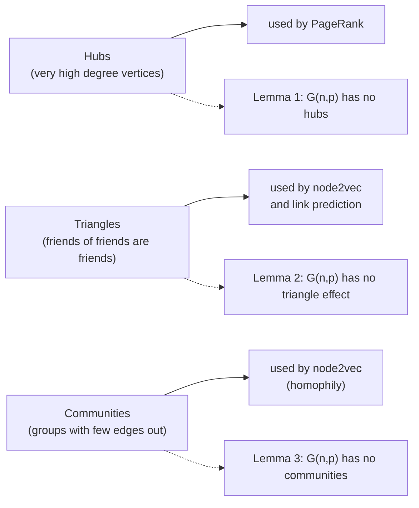

---

## 1. Notation and the running example

### 1.1 Basic notation

$G=(V,E)$ undirected, $n = |V|$. For $v \in V$:
$$N(v) = \{u : uv \in E\} \ (\text{neighbours}), \qquad \deg(v) = |N(v)|, \qquad \bar d = \frac{2|E|}{n} \ (\text{mean degree}).$$
Why $\bar d$ is the mean degree: each edge has two ends, so $\sum_v \deg(v) = 2|E|$.

**Toy graph** ($n=4$, $|E|=4$): triangle A-B-C plus D hanging off A.

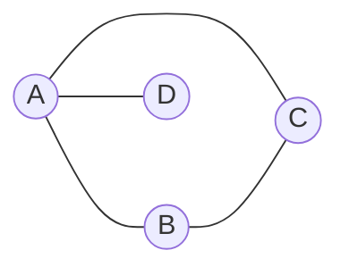
$N(A) = \{B,C,D\}$, $\deg(A)=3$, $\deg(B)=\deg(C)=2$, $\deg(D)=1$, $\bar d = 8/4 = 2$.

### 1.2 The simple random walk and its visit rates

**Random walk:** standing at $v$, step to a neighbour chosen uniformly at random. Step probabilities:
$$P_{vu} = \frac{1\{u \in N(v)\}}{\deg(v)}.$$

For a connected $G$, the **stationary distribution** (the long-run fraction of time the walk spends at each vertex) is unique and equals
$$\pi_v = \frac{\deg(v)}{2|E|}.$$
- Plain meaning: **the walk visits a vertex in proportion to its degree.** More edges = more ways to arrive.
- Check: $\pi P = \pi$. (Uniqueness and the "long-run fraction" theorem come in Week 8.)

Toy: $\pi_A = \frac38$, $\pi_B = \pi_C = \frac28$, $\pi_D = \frac18$.

### 1.3 The three properties (formal versions)

1. **Hubs:** vertices with $\deg(v) \ge K\bar d$, for some $K>1$. (PageRank)
2. **Triangles:** a fraction $\ge \gamma$ of paths $u - w - v$ have $uv \in E$. (node2vec, link prediction)
3. **Communities:** sets $S$ where a fraction $\le \phi$ of the edge-ends in $S$ belong to edges leaving $S$. (node2vec)

### 1.4 Running example: ego-Facebook

Friendships among Facebook survey users (McAuley & Leskovec, 2012; SNAP "facebook combined"):
$$n = 4{,}039, \quad |E| = 88{,}234, \quad \bar d = 43.69.$$
The **fitted** $G(n,p)$ uses the same $n$ and the same mean degree:
$$p = \frac{\bar d}{n-1} = 0.0108.$$
(This $p$ makes $\mathbb{E}[\bar d] = (n-1)p$ match the real $\bar d$; it is also the maximum-likelihood $p$.) The node2vec paper uses this graph for link prediction.

So any difference between Facebook and fitted $G(n,p)$ is **not** due to size or average degree - it's due to structure.

---

## 2. Hubs and PageRank

### 2.1 Definition: $K$-hub

Let $K>1$. $v$ is a **$K$-hub** if $\deg(v) \ge K\bar d$ (its degree is at least $K$ times the average).

**Toy** ($n=7$, $|E|=9$): centre $h$ joined to six vertices, which are paired up by 3 extra edges.
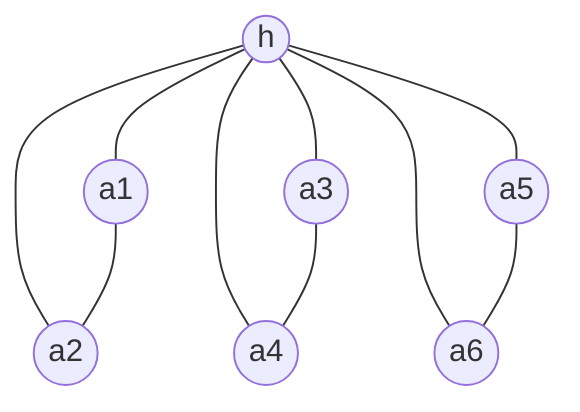
$\bar d = 18/7$, $\deg(h) = 6 = \frac73\bar d$, $\deg(a_k) = 2 = \frac79\bar d$. So $h$ is a 2-hub ($\frac73 \ge 2$).

### 2.2 Hubs and the random walk

Compare the visit rate $\pi_v$ to the "fair share" $1/n$:
$$n\pi_v = \frac{n\deg(v)}{2|E|} = \frac{\deg(v)}{\bar d}.$$

> [!important] $v$ is a $K$-hub $\iff$ the random walk visits $v$ at least $K$ times as often as a uniform visit rate.

Toy: $\pi_h = 6/18 = \frac13$; uniform rate $\frac17$; $n\pi_h = \frac73$.

### 2.3 Definition: PageRank

Let $0<\alpha<1$. Modified walk: from $v$,
- with prob $\alpha$: step to a uniform neighbour (normal walk);
- with prob $1-\alpha$: **teleport** to a uniformly random vertex.

**PageRank** $\mathrm{PR}$ = stationary distribution of this walk:
$$\mathrm{PR} = \frac{1-\alpha}{n}\mathbf 1 + \alpha\,\mathrm{PR}\,P.$$
- Read it as: "your PageRank = your share of the teleports + what flows in from neighbours".
- PageRank ranks vertices by $\mathrm{PR}_v$. Figures use $\alpha = 0.85$.

**Toy: star with $n=4$, $\alpha=\frac12$** (hub $h$, three leaves $\ell$, each leaf has degree 1).
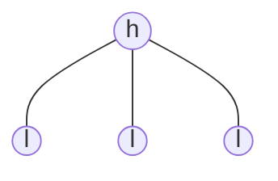
- Hub: receives teleports $\frac{1-\alpha}{n} = \frac18$, plus each of 3 leaves sends all of its walk-mass to $h$: $\mathrm{PR}_h = \frac18 + \frac12\cdot 3\,\mathrm{PR}_\ell$.
- Leaf: $\frac18$ plus $\frac13$ of the hub's walk-mass: $\mathrm{PR}_\ell = \frac18 + \frac12\cdot\frac13\mathrm{PR}_h$.
- Solve: $\mathrm{PR}_h = \frac5{12}$, $\mathrm{PR}_\ell = \frac7{36}$. (Check: $\frac5{12} + 3\cdot\frac7{36} = 1$.)

Without teleport, $\pi_h = 3/6 = \frac12$. Teleporting pulls the hub down to $\frac5{12}$, **toward the uniform** $\frac14$.

### 2.4 PageRank tracks the visit rate

> [!theorem] Claim
> If $a \le n\pi_v \le b$ for all $v$ (with $0<a\le b$), then for every $\alpha$ and every $v$:
> $$\frac ab \le n\,\mathrm{PR}_v \le \frac ba.$$

- **Meaning:** if all simple-walk visit rates are close to $1/n$ (no hubs), then all PageRanks are close to $1/n$ too. PageRank can only highlight vertices that the degree structure already highlights.
- Proof idea: expand $\mathrm{PR} = \frac{1-\alpha}{n}\mathbf 1\sum_{t\ge0}\alpha^tP^t$ and use the symmetry $\pi_uP_{uv} = \pi_vP_{vu}$.
- Toy star: $n\pi_h = 2$, $n\pi_\ell = \frac23$, so $a = \frac23$, $b=2$, bounds $[\frac13, 3]$. Indeed $n\mathrm{PR}_h = \frac53$ and $n\mathrm{PR}_\ell = \frac79$ lie inside.

### 2.5 Lemma 1: degrees concentrate in $G(n,p)$

> [!question] For which $K$ does $G(n,p)$ have a $K$-hub?

> [!theorem] Lemma 1
> Let $G \sim G(n,p)$, $0<\delta<1$, $\mu = (n-1)p \ge 9\ln n/\delta^2$. Then with prob $\ge 1 - 2/n^2$, every $v$ satisfies
> $$(1-\delta)\mu < \deg(v) < (1+\delta)\mu, \qquad \frac{1-\delta}{1+\delta} < n\pi_v < \frac{1+\delta}{1-\delta}.$$
> Hence $G$ has **no $K$-hub** for any $K \ge \frac{1+\delta}{1-\delta}$.

Meaning: when the average degree is at least order $\ln n$, **every** vertex has nearly the average degree. All visit rates agree up to the factor $\frac{1+\delta}{1-\delta}$.

**Proof.** Two-sided Chernoff (Week 3): for $X$ a sum of independent 0/1 variables, mean $\mu$, $0<\delta\le1$: $\Pr[|X-\mu| \ge \delta\mu] \le 2e^{-\mu\delta^2/3}$.
- *Step 1 (one vertex):* $\deg(v) \sim \mathrm{Bin}(n-1,p)$ has mean $\mu$, so
$\Pr[|\deg(v)-\mu| \ge \delta\mu] \le 2e^{-\mu\delta^2/3} \le 2e^{-3\ln n} = 2n^{-3}$.
- *Step 2 (all vertices):* union bound over $n$ vertices: failure prob $\le 2n^{-2}$.
- *Step 3 (rates):* $\bar d$ is the average of the degrees, so it is also in $((1-\delta)\mu, (1+\delta)\mu)$. Divide: $n\pi_v = \deg(v)/\bar d$ lies between the ratios. $\blacksquare$

### 2.6 Sparse case: degree tail of $G(n,c/n)$

Lemma 1 needs $\mu \ge 9\ln n/\delta^2$. In the sparse case $\mu = (n-1)c/n < c$ (a constant), so use the Chernoff upper tail with $(1+\delta)\mu = k > c$:
$$\Pr[\deg(v) \ge k] \le e^{-\mu}\Big(\frac{e\mu}{k}\Big)^k \le e^{-c}\Big(\frac{ec}{k}\Big)^k.$$
(Second step: the expression grows with $\mu$ on $(0,k)$, and $\mu < c$.)

**Example:** $c=10$, $n = 10^5$, $k=100$:
$$\mathbb{E}\big[\#\{v : \deg(v) \ge 100\}\big] \le n e^{-10}\Big(\frac{10e}{100}\Big)^{100} \approx 1.2\times10^{-56}.$$
A vertex with 10x the mean degree essentially **never** happens.

### 2.7 Data: PageRank on Facebook vs fitted $G(n,p)$ ($\alpha = 0.85$)

| | Facebook | Fitted $G(n,p)$ |
|---|---|---|
| 2-hubs | 597 | 0 |
| 5-hubs | 20 | 0 |
| 10-hubs | 4 | 0 |
| range of $n\cdot\mathrm{PR}_v$ | $[0.17, 30.8]$ | $[0.61, 1.47]$ |

Largest $n\cdot\mathrm{PR}_v$: **30.8** on Facebook, **1.47** on $G(n,p)$. PageRank is only interesting on graphs with hubs.

---

## 3. Triangles, node2vec and link prediction

### 3.1 Wedges and triangles

A **wedge** is a path $u - w - v$ with $u \ne v$ ($w$ is the centre). The wedge is **closed** if $uv \in E$; then $\{u,v,w\}$ is a triangle.

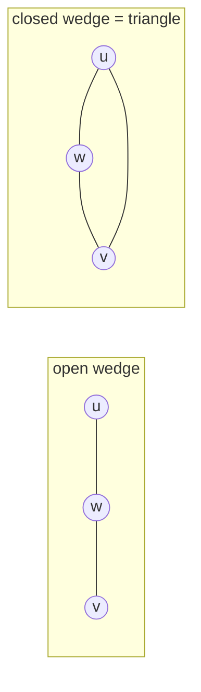

$c_{uv}$ = number of wedges with ends $u,v$ = number of **common neighbours**:
$$c_{uv} = |N(u)\cap N(v)|.$$
Each triangle closes **three** wedges (one with each corner as centre).

### 3.2 $\gamma$-closure

$$\tau(G) = \frac{\#\text{closed wedges}}{\#\text{wedges}}$$
= probability that a uniformly random wedge is closed ("if two of my friends are picked, how likely are they friends with each other?"). $G$ has **$\gamma$-closure** if $\tau(G) \ge \gamma$.

**Toy** (same A-B-C triangle + D graph):
- centre A: $B-A-C$, $B-A-D$, $C-A-D$ (3 wedges)
- centre B: $A-B-C$; centre C: $A-C-B$; centre D: none (only one neighbour)
- Closed: $B-A-C$, $A-B-C$, $A-C-B$. So $\tau = \frac35$.

### 3.3 node2vec's second-order walk

A walk that **remembers where it came from**. Parameters $\rho, \eta > 0$ (the node2vec paper calls them $p, q$).

$X_1$ is a uniform neighbour of $X_0$. After stepping $t \to v$, the walk picks the next vertex $x \in N(v)$ with prob $\omega(t,x)/Z_{tv}$, where
$$\omega(t,x) = \begin{cases} 1/\rho, & x = t \quad (\text{go back}) \\ 1, & x \in N(t) \quad (\text{stay close: neighbour of where I came from}) \\ 1/\eta, & \text{otherwise} \quad (\text{move away}) \end{cases}, \qquad Z_{tv} = \sum_{y\in N(v)}\omega(t,y).$$

- $\rho$ = **return** parameter. Small $\rho$ $\Rightarrow$ big weight on going back.
- $\eta$ = **in-out** parameter. Small $\eta$ $\Rightarrow$ big weight on moving outward (explores, DFS-like). Large $\eta$ $\Rightarrow$ stays local (BFS-like).
- $\rho = \eta = 1$: all weights 1 = the simple random walk.

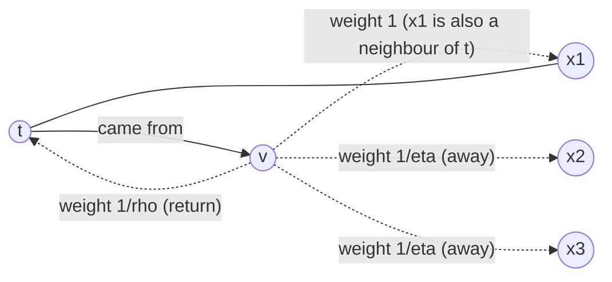

### 3.4 Toy: one step of the walk

Weights listed for $t, x_1, x_2, x_3$ (only $x_1$ is a neighbour of $t$):

| $\rho, \eta$ | weights | $Z_{tv}$ | result |
|---|---|---|---|
| $1, 1$ | 1, 1, 1, 1 | 4 | $\Pr[x_2] = \frac14$, $\Pr[t] = \frac14$ |
| $1, \frac12$ | 1, 1, 2, 2 | 6 | $\Pr[x_2] = \frac13$ (pushed away) |
| $\frac12, 1$ | 2, 1, 1, 1 | 5 | $\Pr[t] = \frac25$ (pulled back) |

Small $\eta$ pushes the walk away from $t$; small $\rho$ pulls it back.

### 3.5 node2vec's walk closes wedges

With $c_{tv} = |N(t)\cap N(v)|$, the total weight is
$$Z_{tv} = \rho^{-1} + c_{tv} + (\deg(v) - 1 - c_{tv})\eta^{-1}.$$

> [!theorem] Claim
> Given $X_{k-1} = t$, $X_k = v$, the wedge $t - v - X_{k+1}$ is closed with probability
> $$\Pr[X_{k+1} \in N(t) \mid X_{k-1}=t, X_k=v] = \frac{c_{tv}}{Z_{tv}}.$$

- If $c_{tv} = 0$ (no triangles through edge $tv$), **no** choice of $\rho,\eta$ closes the wedge. The "middle case" weight is useless without triangles.
- Toy, $\rho=\eta=1$: $c_{tv}=1$, $Z_{tv}=4$, so prob $\frac14$.
- Average of $c_{tv}/(\deg(v)-1)$: **Facebook 0.57**, fitted $G(n,p)$ **0.011**.

### 3.6 node2vec: the full method

Goal: an **embedding** $f: V \to \mathbb{R}^d$ (a vector for each vertex) so that vertices "near" each other in the graph get similar vectors. Parameters $d, r, \ell \ge 1$ (defaults $d=128$, $r=10$, $\ell=80$).

**Step 1 (walks).** From each $u$, run $r$ second-order walks $u = X_0, X_1, \dots, X_\ell$. $NS(u)$ = multiset (list with repeats) of all $X_1,\dots,X_\ell$ from those walks = "the neighbourhood of $u$ as seen by walks".

Toy: $r=2$, $\ell=2$, walks $u\to a\to b$ and $u\to a\to c$: $NS(u) = \{a,a,b,c\}$.

**Step 2 (embedding).** Choose $f$ to maximise
$$\sum_{u\in V}\sum_{x\in NS(u)}\log\Pr[x\mid u], \qquad \Pr[x\mid u] = \frac{e^{f(x)\cdot f(u)}}{\sum_{y\in V}e^{f(y)\cdot f(u)}}.$$
- $\Pr[x \mid u]$ is a **softmax**: vertices whose vector points in the same direction as $f(u)$ get high probability.
- Toy term for $u$: $2\log\Pr[a\mid u] + \log\Pr[b\mid u] + \log\Pr[c\mid u]$.
- Effect: vertices that walks from $u$ visit **often** get a large dot product $f(x)\cdot f(u)$.
- Trained by stochastic gradient descent with negative sampling (avoids computing the full sum over $V$).

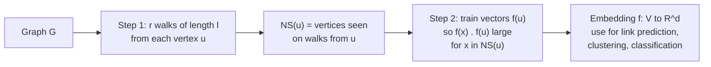

### 3.7 Link prediction by common neighbours

**Link prediction:** some edges are hidden; score each non-adjacent pair $u,v$; a high score predicts a hidden edge. Simplest score:
$$s(u,v) = c_{uv} = |N(u)\cap N(v)|.$$

**Toy:** $u$ and $v$ share neighbours $w_1, w_2$; $u$ and $z$ share only $w_1$.
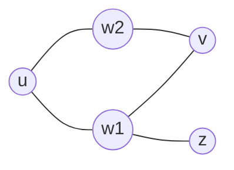
$s(u,v) = 2$, $s(u,z) = 1$, so $uv$ is ranked above $uz$.

Why it works on real graphs: **closure** - each open wedge $u-w-v$ makes the edge $uv$ more likely.

### 3.8 Lemma 2: edge independence in $G(n,p)$

> [!theorem] Lemma 2
> Let $G\sim G(n,p)$, $u\ne v$, and $A$ any event with $\Pr[A]>0$ that depends only on edges **other than** $uv$. Then
> $$\Pr[uv\in E \mid A] = p.$$
> In particular:
> - **(a)** $\Pr[uv\in E \mid uw\in E, vw\in E] = p$ for $w\notin\{u,v\}$: a wedge is closed with prob just $p$;
> - **(b)** $\Pr[uv\in E\mid c_{uv} = c] = p$ for every $c$: common neighbours tell you **nothing**;
> - **(c)** $\mathbb{E}[\#\text{closed wedges}] = p\,\mathbb{E}[\#\text{wedges}]$, so $\tau \approx p$.

**Proof.**
- *Step 1:* the coin for $uv$ is independent of all other coins, so $\Pr[\{uv\in E\}\cap A] = p\Pr[A]$. Divide by $\Pr[A]$.
- *Step 2 (a):* $\{uw\in E, vw\in E\}$ uses only edges $uw, vw$. Apply Step 1.
- *Step 3 (b):* $c_{uv} = \sum_{w\ne u,v}1\{uw\in E\}1\{vw\in E\}$ never looks at $uv$. Apply Step 1 with $A = \{c_{uv}=c\}$.
- *Step 4 (c):* sum (a) over all wedges, linearity of expectation. $\blacksquare$

Since $p \to 0$ for sparse graphs, $\tau \approx p \to 0$: **no triangle effect at all.**

### 3.9 Corollary: every link predictor is useless on $G(n,p)$

**AUC** (area under the ROC curve) = probability a hidden true edge scores higher than a random non-edge (ties count half). AUC $=\frac12$ means "no better than a coin flip"; 1 is perfect.

> [!theorem] Corollary
> Let $G\sim G(n,p)$. Delete each edge independently with prob $\frac12$; $G'$ = what remains; $U$ = pairs not in $G'$. Let $s$ be **any** score computed from $G'$. Draw $e^+$ uniformly from deleted edges and $e^-$ uniformly from non-edges of $G$. Then
> $$\mathrm{AUC} := \Pr[s(e^+) > s(e^-)] + \tfrac12\Pr[s(e^+) = s(e^-)] = \tfrac12.$$

**Proof.**
- *Step 1 (labels):* each pair independently is: in $G'$ w.p. $\frac p2$; deleted w.p. $\frac p2$; non-edge w.p. $1-p$. Given $G'$, each pair in $U$ is "deleted" w.p. $\frac{p/2}{1-p/2}$, independently of everything else.
- *Step 2 (exchangeability):* so given $G'$ and the number of deleted pairs, the deleted set is a **uniformly random subset** of $U$. Hence $(e^+, e^-)$ and $(e^-, e^+)$ have the same distribution - you can't tell them apart.
- *Step 3 (symmetry):* $s$ is fixed by $G'$, so $\Pr[s(e^+)>s(e^-)] = \Pr[s(e^-)>s(e^+)]$. The three outcomes $>,<,=$ sum to 1, so AUC $=\frac12$. $\blacksquare$

On Facebook, $\Pr[uv\in E\mid c_{uv}=c]$ **grows** with $c$, so AUC $>\frac12$.

### 3.10 Data: triangles on Facebook vs fitted $G(n,p)$

| | Facebook | Fitted $G(n,p)$ |
|---|---|---|
| closure $\tau$ | 0.519 | 0.0109 ($\approx p$) |
| $\Pr[uv\in E\mid c_{uv}=c]$ | rises with $c$ | flat at $p$ |
| common-neighbours AUC | 0.973 | 0.502 |

---

## 4. Communities and node2vec

### 4.1 Conductance

For $S\subseteq V$ with $1\le|S|\le n/2$:
$$\Phi(S) = \frac{e(S, V\setminus S)}{\mathrm{vol}(S)}, \qquad \mathrm{vol}(S) = \sum_{v\in S}\deg(v).$$
- $e(S, V\setminus S)$ = number of edges with one end in $S$ and one outside (the "cut").
- $\mathrm{vol}(S)$ = total number of edge-ends sitting in $S$.
- $\Phi(S)$ = **fraction of edge-ends in $S$ whose edge leaves $S$**. Small = $S$ is inward-looking.

**Toy:** two triangles joined by one edge $C-D$.
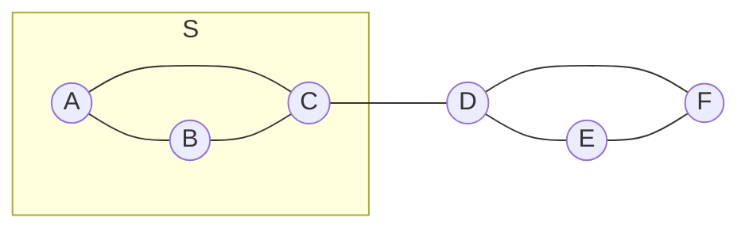
$S = \{A,B,C\}$: $\mathrm{vol}(S) = 2+2+3 = 7$, $e(S,V\setminus S) = 1$ (edge $CD$), $\Phi(S) = \frac17$.

### 4.2 $\phi$-community

Let $0<\phi<\frac12$. $S$ is a **$\phi$-community** if $\Phi(S)\le\phi$. Equivalently, at least a fraction $1-\phi$ of edge-ends in $S$ lie on edges **inside** $S$.

Toy: $\{A,B,C\}$ has $\Phi=\frac17$, so it is a $\frac17$-community. $\{A,B\}$ has $\mathrm{vol}=4$, cut edges $AC, BC$, so $\Phi = \frac24 = \frac12$: a $\phi$-community for **no** $\phi<\frac12$.

### 4.3 Where node2vec uses communities: homophily

node2vec trains $f(u)$ so that $f(x)\cdot f(u)$ is large for $x\in NS(u)$. **Homophily** = vertices in the same community get nearby vectors. This only works if walks from $u$ **stay inside** $u$'s community, so that $NS(u)$ is mostly in the community. (Toy: walk $A\to B\to C$ stays in $S$, so $NS(A)\subseteq S$.)

### 4.4 One step out of a community

> [!theorem] Claim
> Start the walk at $v\in S$ with prob $\Pr[X_0 = v] = \deg(v)/\mathrm{vol}(S)$ (that is, the stationary $\pi$ restricted to $S$). Then
> $$\Pr[X_1\notin S] = \Phi(S).$$

So conductance has a direct meaning: **the chance a walk inside $S$ leaves in one step.**

Toy, $S=\{A,B,C\}$: only $C$ has an edge out (1 of its 3):
$$\Pr[X_1\notin S] = \tfrac27\cdot0 + \tfrac27\cdot0 + \tfrac37\cdot\tfrac13 = \tfrac17.$$

**Proof.**
- *Step 1:* from $v$, $\Pr[X_1\notin S\mid X_0=v] = \frac{|N(v)\setminus S|}{\deg(v)}$.
- *Step 2 (average over the start):*
$$\Pr[X_1\notin S] = \sum_{v\in S}\frac{\deg(v)}{\mathrm{vol}(S)}\cdot\frac{|N(v)\setminus S|}{\deg(v)} = \frac{1}{\mathrm{vol}(S)}\sum_{v\in S}|N(v)\setminus S| = \frac{e(S,V\setminus S)}{\mathrm{vol}(S)}.$$
The last step: each edge leaving $S$ has exactly one end in $S$, so it is counted exactly once. $\blacksquare$

### 4.5 $t$ steps inside a community

Union bound over the $t$ steps (each step leaves w.p. at most $\Phi(S)$):
$$\Pr[X_1,\dots,X_t\in S] \ge 1 - \sum_{j=1}^t\Pr[X_{j-1}\in S, X_j\notin S] \ge 1 - t\,\Phi(S).$$
Why each term is $\le\Phi(S)$: the walk started from $\pi$ restricted to $S$ never puts more weight on a vertex than that start did, i.e. $\Pr[X_{j-1}=v]\le\pi_v/\pi(S)$ (because $\pi$ is stationary). So leaving at step $j$ is no likelier than leaving at step 1, which is $\Phi(S)$.

Example: median Facebook community has $\Phi = 0.036$; a 10-step walk stays inside with prob $\ge 1 - 0.36 = 0.64$.

**$\phi$-community $\Rightarrow$ a walk stays inside for $t$ steps w.p. $\ge 1 - t\phi$.**

### 4.6 Lemma 3: no communities in $G(n,p)$

> [!theorem] Lemma 3
> Let $G\sim G(n,p)$, $n\ge2$, $0<\delta<1$, $(n-1)p\ge 9\ln n/\delta^2$. With prob $\ge 1-3/n$, **every** $S$ with $1\le|S|\le n/2$ has
> $$\Phi(S)\ge\frac{1-\delta}{2(1+\delta)}.$$
> So $G$ has no $\phi$-community for any $\phi < \frac{1-\delta}{2(1+\delta)}$.

- As $\delta\to0$ the bound tends to $\frac12$. Meaning: in $G(n,p)$, any set of at most half the vertices loses about **half** its edges to the outside. (Makes sense: a vertex's neighbours are random, and at least half the vertices are outside $S$.)
- Walk version: from $\pi$ on $S$, $\Pr[X_1\notin S] \ge \frac{1-\delta}{2(1+\delta)}$.

**Proof.** Fix $S$ with $s = |S|\le n/2$.

- *Step 1 (cut of one set is not too small).* $e(S,V\setminus S)\sim\mathrm{Bin}(s(n-s),p)$, with mean
$\mu_S = s(n-s)p \ge s(n-1)p/2$ (since $n-s \ge (n-1)/2$). Chernoff lower tail:
$$\Pr[e(S,V\setminus S)\le(1-\delta)\mu_S] \le e^{-\delta^2\mu_S/2} \le e^{-\delta^2 s(n-1)p/4} \le n^{-9s/4}.$$
- *Step 2 (all sets).* Union bound; there are $\binom ns\le n^s$ sets of size $s$, and $n^{-5/4}\le\frac12$:
$$\sum_{s\ge1}\binom ns n^{-9s/4} \le \sum_{s\ge1}n^{-5s/4} \le 2n^{-5/4} \le \frac2n.$$
So w.p. $\ge 1 - \frac2n$, every $S$ has $e(S,V\setminus S) > (1-\delta)s(n-s)p$.
- *Step 3 (volume is not too big).* By Lemma 1 (failure $\le\frac1n$), every $\deg(v) < (1+\delta)(n-1)p$, so $\mathrm{vol}(S) < (1+\delta)s(n-1)p$.
- *Step 4 (ratio).* Divide, using $n-s\ge(n-1)/2$:
$$\Phi(S) \ge \frac{(1-\delta)s(n-s)p}{(1+\delta)s(n-1)p} \ge \frac{1-\delta}{2(1+\delta)}.$$
Both events hold w.p. $\ge 1-\frac3n$. $\blacksquare$

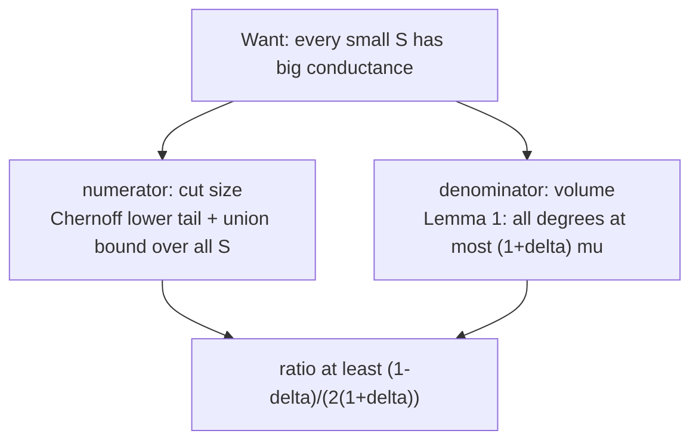

### 4.7 Data: communities on Facebook vs fitted $G(n,p)$

Sets found by **Louvain** (a standard algorithm that greedily groups vertices to maximise "modularity", i.e. edges inside groups beyond what chance predicts).

| | Facebook | Fitted $G(n,p)$ |
|---|---|---|
| number of sets found | 15 | 10 |
| $\Phi$ range | 0.0018 to 0.17 | 0.67 to 0.89 |
| median $\Phi$ | 0.036 | 0.78 |

Every Facebook set is a 0.18-community. Median Facebook community: $1-\Phi = 0.96$ of its edge-ends stay inside. In $G(n,p)$, Louvain still outputs groups, but they are fake: most edges leave them.

---

## 5. Random graph models with each property

$G(n,p)$ lacks all three properties. Each model below adds **one mechanism** that creates one property.

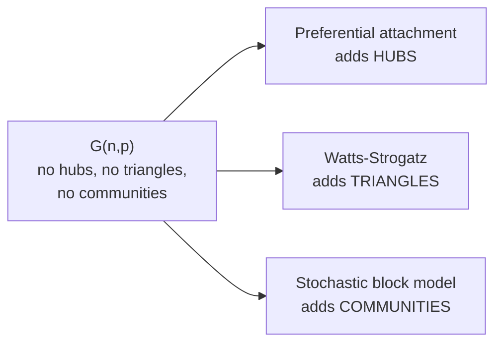

### 5.1 Hubs: preferential attachment (Barabasi-Albert, 1999)

Start from a small graph $G_0$. Fix $m\ge1$. At each step $t$, add one new vertex with $m$ edges. Each edge attaches to an old vertex $v$ with probability proportional to its current degree:
$$\Pr[\text{new vertex}\to v] = \frac{\deg_{t-1}(v)}{\sum_w\deg_{t-1}(w)}.$$

"**Rich get richer**": popular vertices attract more new edges, so they become even more popular. This produces hubs; the degree tail behaves like $k^{-3}$ (a heavy tail; Bollobas-Riordan-Spencer-Tusnady 2001).

**Toy:** $m=1$, $G_{t-1}$ is a star with centre $h$ and leaves $a,b,c$; new vertex $x$.
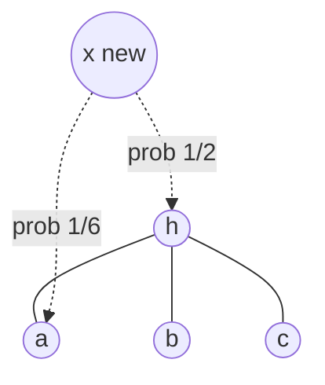
$\sum_w\deg(w) = 6$, so $\Pr[x\to h] = \frac36 = \frac12$ and $\Pr[x\to a] = \frac16$. A uniform choice would give $h$ only $\frac14$.

### 5.2 Triangles: Watts-Strogatz (1998)

Let $k\ge1$, $n>2k$, $0\le\beta\le1$. Place $v_0,\dots,v_{n-1}$ on a ring (indices mod $n$). Connect each vertex to its $k$ nearest neighbours on each side:
$$E_0 = \{v_iv_{i+j} : 0\le i<n,\ 1\le j\le k\}.$$
Then **rewire** each edge $v_iv_{i+j}$ with prob $\beta$: replace $v_{i+j}$ by a uniform vertex not already $v_i$ or a neighbour of $v_i$.

- Rewiring moves edges but keeps $|E| = nk$.
- $\beta=0$: pure ring, lots of triangles (neighbours on the ring are neighbours of each other) but long distances.
- Small $\beta$: still lots of triangles, but a few random "shortcuts" make distances short ("small world").
- $\beta=1$: close to random.

**Toy:** $n=8$, $k=2$, $\beta=0$: $|E_0| = nk = 16$, every vertex has degree $2k=4$.
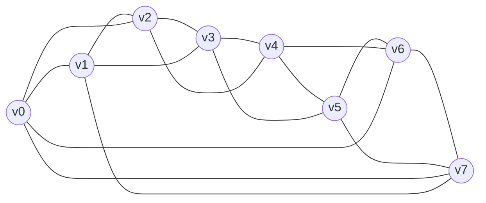

**Closure of the ring.** Centre $v_0$ has neighbours $v_{-2},v_{-1},v_1,v_2$, so $\binom42 = 6$ wedges. Closed ones (ends at ring-distance $\le2$): $v_{-2}v_{-1}$, $v_{-1}v_1$, $v_1v_2$. Open: $v_{-2}v_1$, $v_{-1}v_2$ (distance 3), $v_{-2}v_2$ (distance 4). By rotation every vertex looks the same, so $\tau = \frac36 = \frac12$.

Compare: mean degree 4 and $n\to\infty$: ring $\tau = \frac12$; $G(n,p)$ has $\tau\approx p = \frac4{n-1}\to0$.

### 5.3 Communities: stochastic block model (Holland-Laskey-Leinhardt, 1983)

Split $V$ into blocks $B_1,\dots,B_r$. Let $0<p_{\text{out}}<p_{\text{in}}<1$. Edges independent with
$$\Pr[uv\in E] = \begin{cases}p_{\text{in}}, & u,v \text{ in the same block}\\ p_{\text{out}}, & \text{otherwise.}\end{cases}$$
It is "$G(n,p)$ inside each block, plus a sparser $G(n,p)$ between blocks".

**Toy:** $r=2$, blocks of size 3, $p_{\text{in}}=\frac23$, $p_{\text{out}}=\frac19$.
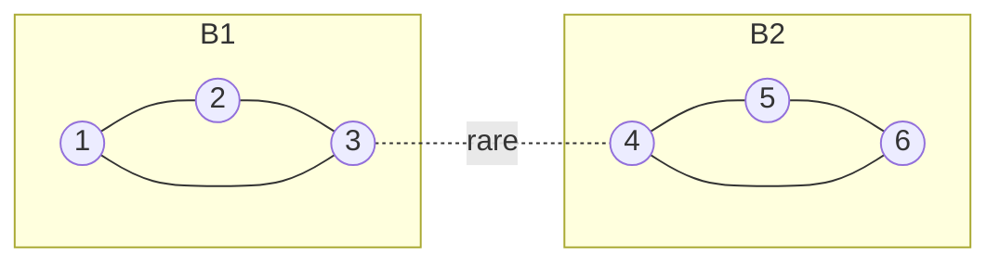
- $\mathbb{E}[\#\text{inside}] = 2\text{ blocks}\cdot3\text{ pairs}\cdot\frac23 = 4$.
- $\mathbb{E}[\#\text{across}] = 9\text{ pairs}\cdot\frac19 = 1$.
- Expected degree: $2\cdot\frac23 = \frac43$ inside its block, $3\cdot\frac19 = \frac13$ across.

(Week 10 problem set B3 samples a block model.)

### 5.4 Embedding edge score

Given an embedding $f:V\to\mathbb{R}^r$, a bias $b\in\mathbb{R}$, weights $w\in\mathbb{R}^r$, and the sigmoid $\sigma(z) = \frac{1}{1+e^{-z}}$ (squashes any number into $(0,1)$):
$$s(u,v) = \sigma\Big(b + \sum_{i=1}^r w_if_i(u)f_i(v)\Big).$$
- $s(u,v)\in(0,1)$, read as "estimated probability of edge $uv$".
- It rises with the weighted similarity $\sum_iw_if_i(u)f_i(v)$.

**Toy:** $r=2$, $b=-1$, $w=(2,2)$, $f(u)=f(v)=(1,0)$, $f(x)=(0,1)$.
- $s(u,v) = \sigma(-1+2) = \sigma(1) = 0.73$ (same direction).
- $s(u,x) = \sigma(-1) = 0.27$ (perpendicular).

### 5.5 The block model is exactly an embedding model

Put $f(u) = e_k$ (the $k$-th standard basis vector: 1 in position $k$, 0 elsewhere) for $u\in B_k$. Set
$$b = \sigma^{-1}(p_{\text{out}}), \qquad w_k = \sigma^{-1}(p_{\text{in}}) - \sigma^{-1}(p_{\text{out}}) \text{ for all } k.$$
Then
- same block $k$: only coordinate $k$ is 1 in both vectors, so $\sum_iw_if_i(u)f_i(v) = w_k$ and $s = \sigma(b+w_k) = \sigma(\sigma^{-1}(p_{\text{in}})) = p_{\text{in}}$;
- different blocks: the term is 0, so $s = \sigma(b) = p_{\text{out}}$.

So $s(u,v) = \Pr[uv\in E]$ **exactly**, for every pair. A one-hot "which block am I in" embedding perfectly describes a block model.

Check with $p_{\text{in}}=\frac23$, $p_{\text{out}}=\frac19$: $\sigma^{-1}(y) = \ln\frac{y}{1-y}$, so $b = \ln\frac18 = -3\ln2$ and $w_k = \ln2 - (-3\ln2) = 4\ln2$.

---

## 6. Summary

Facebook and fitted $G(n,p)$ share $n = 4{,}039$ and $\bar d = 43.69$, yet:

| Property | Used by | $G(n,p)$ (lemma) | Facebook | Fitted $G(n,p)$ |
|---|---|---|---|---|
| **Hubs** $\deg(v)\ge K\bar d$ | PageRank | Lemma 1: $\frac{1-\delta}{1+\delta}<n\pi_v<\frac{1+\delta}{1-\delta}$ for all $v$ | max $n\cdot\mathrm{PR}$ = 30.8 | max $n\cdot\mathrm{PR}$ = 1.47 |
| **Triangles** (closure $\tau$) | node2vec middle case, link prediction | Lemma 2: $\tau\approx p$; any predictor has AUC $\frac12$ | $\tau = 0.519$, AUC 0.973 | $\tau = 0.0109$, AUC 0.502 |
| **Communities** $\Phi(S)\le\phi$ | node2vec homophily | Lemma 3: $\Phi(S)\ge\frac{1-\delta}{2(1+\delta)}$ | median $\Phi$ 0.036 | median $\Phi$ 0.78 |

- When $\tau\gg p$: $\Pr[uv\in E\mid c_{uv}]$ rises with $c_{uv}$. Common neighbours and node2vec's middle case ($\rho,\eta$ tune it) exploit this.
- **Models:** preferential attachment (hubs), Watts-Strogatz (triangles), stochastic block model (communities).

## 7. What next

- Week 8, random walks: stationary $\pi$, **mixing time** $t_{\text{mix}}$ (how long until the walk "forgets" where it started), PageRank; then node2vec.
- **Bottleneck bound:** $t_{\text{mix}}\ge\frac{1}{4\Phi(S)}$ for every $S$ with $\mathrm{vol}(S)\le|E|$. Low-conductance communities trap the walk, so it mixes slowly. (Levin & Peres, *Markov Chains and Mixing Times*, Ch. 7.)

---

## Quick self-check

- [ ] Why is $\pi_v = \deg(v)/2|E|$, and why does $n\pi_v = \deg(v)/\bar d$ make "hub" a statement about the walk?
- [ ] Solve the PageRank star toy yourself. Why does teleporting push PageRank toward uniform?
- [ ] Why does Lemma 1 need $\mu\ge 9\ln n/\delta^2$? What happens in the sparse case instead?
- [ ] Compute $\tau$ for the A-B-C-D toy and for the $k=2$ ring.
- [ ] In node2vec, what do small $\rho$ and small $\eta$ do? Why can't any $\rho,\eta$ close a wedge when $c_{tv}=0$?
- [ ] Why is the AUC exactly $\frac12$ for **any** score on $G(n,p)$?
- [ ] Show $\Pr[X_1\notin S] = \Phi(S)$ from the stationary start on $S$.
- [ ] Why does Lemma 3's bound approach $\frac12$?
- [ ] Find $b$ and $w_k$ that make the embedding score reproduce a block model.
