# PART 1: CNN basics [Slides]

## 1.1 Why do we need CNNs?

A fully connected (FC) layer flattens the image into one long vector.

- It does **not** know which pixels are neighbours.
- Pixels close together and pixels far apart are treated the same way.
- Images have **spatial structure** (nearby pixels form edges, corners, shapes). FC layers throw this away.

A **convolutional neural network (CNN)** is built to use that structure.

CNNs are good for deep image networks because **weight sharing** keeps the number of trainable parameters small.

## 1.2 The three basic ideas

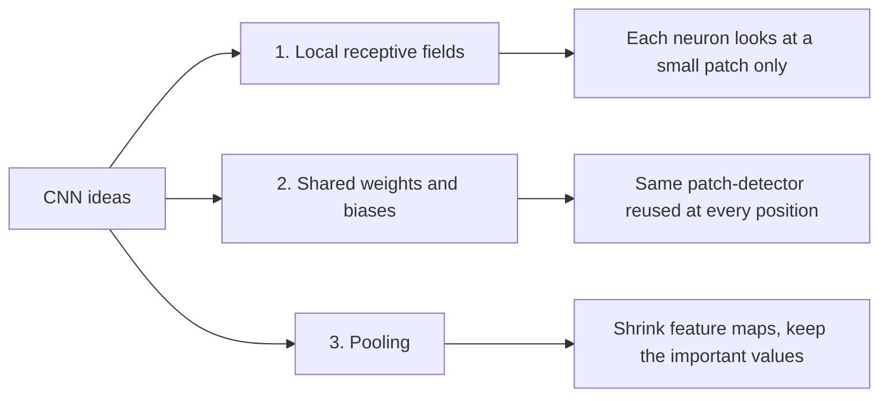

---

## 1.3 Local receptive fields

Instead of flattening, keep the input as a grid, e.g. a $28 \times 28$ grid of pixel values (MNIST).

- Each hidden neuron connects to only a **small region** of the input, e.g. $5 \times 5$ pixels.
- That region is the neuron's **local receptive field**.
- The neuron has one weight per connection (25 weights) and one bias.

### Sliding the window

Slide the $5 \times 5$ window across the whole image. Each position gets its **own** hidden neuron.

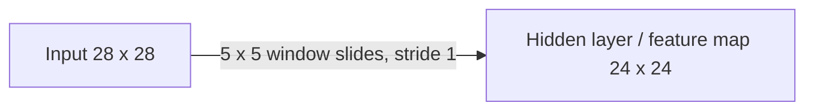

**Why 24 x 24?** The window cannot hang off the edge. In one row of 28 pixels, a 5-wide window can start at positions 1 to 24, so there are 24 positions.

### Output size formula

For input size $N$, window size $F$, stride $S$ (no padding):

$$\text{output size} = \left\lfloor \frac{N - F}{S} \right\rfloor + 1$$

(The floor means: round down if the window does not fit evenly.)

### Stride

**Stride** $s$ = how many pixels the window jumps each step.

| Input | Window | Stride | Calculation | Output |
|---|---|---|---|---|
| 28 x 28 | 5 x 5 | 1 | $(28-5)/1 + 1$ | 24 x 24 |
| 28 x 28 | 5 x 5 | 2 | $\lfloor (28-5)/2 \rfloor + 1 = 12 + 1$ | 12 x 12 |

Bigger stride -> smaller output, less computation.

---

## 1.4 Shared weights and biases

With stride 1, one feature map has $24 \times 24$ neurons. **All of them use the same $5 \times 5$ weights and the same bias.**

For the neuron at position $(j, k)$:

$$a_{j,k} = \sigma\!\left( b + \sum_{l=0}^{4} \sum_{m=0}^{4} w_{l,m}\, a^{0}_{j+l,\,k+m} \right)$$

Meaning of each symbol:

- $a^0$ = input pixel values (layer 0).
- $w_{l,m}$ = the shared $5 \times 5$ weights, $b$ = the shared bias.
- $(j,k)$ = where the window is placed. $(l,m)$ = position inside the window.
- $\sigma$ = activation function (sigmoid, ReLU, ...).

**Intuition:** if these weights detect, say, a vertical edge, then every neuron in the feature map checks "is there a vertical edge here?" at its own location.

> **Key idea:** one set of shared weights = one **feature detector**. Applying it across the image tells you **where** that feature occurs.

### Terminology

| Term | Meaning |
|---|---|
| Shared weights / shared bias | The weights and bias reused at every position |
| Filter (or kernel) | The $5 \times 5$ shared weights (plus its one shared bias) |
| Feature map | The grid of outputs from applying one filter across the input |

**One filter -> one feature map.** So number of filters = number of feature maps.

---

## 1.5 Multiple feature maps

One filter finds only one kind of feature. A conv layer uses **many filters**, each detecting a different local feature.

- Slide example: 3 feature maps. Each has its own $5 \times 5$ weights and its own bias.
- LeNet-5 used 6 feature maps with $5 \times 5$ receptive fields for MNIST.
- In practice layers use many more (Nielsen's network: 20, then 40).

### Visualizing learned filters

The slides show 20 learned $5 \times 5$ filters as small grayscale blocks. Lighter = smaller weight, darker = larger weight. The pattern of light/dark gives a rough idea of what each filter looks for (edges, strokes, blobs).

---

## 1.6 Parameter counting (very exam-friendly)

Parameters per filter (single input channel) $= 5 \times 5 + 1 = 26$ (25 weights + 1 bias).

| Question | Answer |
|---|---|
| 3 feature maps, $5 \times 5$ | $3(25+1) = 78$ |
| 20 feature maps, $5 \times 5$ | $20 \times 26 = 520$ |
| 20 x 24 x 24 units, **no sharing** (each unit has its own 25 weights + bias) | $20 \times 24 \times 24 \times 26 = 299{,}520$ |
| Same layer **with sharing** | $520$ |
| Reduction factor | $299{,}520 / 520 = 576$ |

The factor 576 is just $24 \times 24$: each filter is reused at 576 positions.

> **Why weight sharing matters:** far fewer parameters, so the network trains faster and overfits less.

---

## 1.7 Pooling layers

Placed right after conv layers.

- Condenses each feature map.
- Reduces spatial size, so later layers deal with a more compact summary of detected features.
- Works on each feature map separately.

### Max pooling

Each pooling unit outputs the **maximum** activation in a $2 \times 2$ region.

- $2 \times 2$ max-pooling with stride 2 turns $24 \times 24$ into $12 \times 12$.
- **No trainable weights or biases** in pooling.

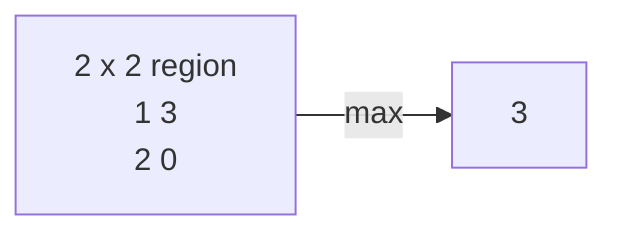

### L2 pooling

Take the square root of the sum of squares in the region:

$$p = \sqrt{a_1^2 + a_2^2 + a_3^2 + a_4^2}$$

Worked example, region $\begin{pmatrix} 1 & 2 \\ 2 & 4 \end{pmatrix}$:

- Max pooling: $p = 4$
- L2 pooling: $p = \sqrt{1 + 4 + 4 + 16} = \sqrt{25} = 5$

Both compress a local region to one number.

---

## 1.8 A simple full CNN (MNIST) [Slides]

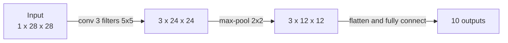

Parameter count:

| Layer | Calculation | Params |
|---|---|---|
| Conv | $3(5 \times 5 + 1)$ | 78 |
| Max-pool | no weights | 0 |
| FC output | $(3 \times 12 \times 12)(10) + 10 = 432 \times 10 + 10$ | 4330 |
| **Total** | | **4408** |

FC parameter formula: (inputs x outputs) + outputs (one bias per output).

---

## 1.9 Backpropagation in a CNN [Slides]

Good news: only a few things change versus a plain network.


### Recap of BP1 to BP4 (from the earlier backprop chapter)

- BP1: $\delta^L = \nabla_a C \odot \sigma'(z^L)$ (error at output layer)
- BP2: $\delta^l = \left((w^{l+1})^T \delta^{l+1}\right) \odot \sigma'(z^l)$ (push error backward)
- BP3: $\dfrac{\partial C}{\partial b^l_j} = \delta^l_j$
- BP4: $\dfrac{\partial C}{\partial w^l_{jk}} = a^{l-1}_k\, \delta^l_j$

### 1) Through max-pooling

During the forward pass, only the max value was passed on. So in the backward pass, **the gradient goes only to the position that was the max; the others get 0.**

Example: region $\begin{pmatrix} 1 & 3 \\ 2 & 0 \end{pmatrix} \to 3$. If the incoming gradient is $\dfrac{\partial C}{\partial a_{j,k}}$, then the gradients passed back are

$$\begin{pmatrix} 0 & \dfrac{\partial C}{\partial a_{j,k}} \\ 0 & 0 \end{pmatrix}$$

### 2) Through a conv layer (one feature map)

Pre-activation at position $(j,k)$:

$$z_{j,k} = b + \sum_{l,m} w_{l,m}\, a^{0}_{j+l,\,k+m}$$

Error at that position:

$$\delta_{j,k} = \frac{\partial C}{\partial z_{j,k}} = \frac{\partial C}{\partial a_{j,k}} \odot \sigma'(z_{j,k})$$

### 3) Gradient of a shared weight

The same $w_{l,m}$ is used at every position $(j,k)$, so its gradient is the **sum** of contributions from all positions:

$$\frac{\partial C}{\partial w_{l,m}} = \sum_{j,k} a^{0}_{j+l,\,k+m}\, \delta_{j,k}$$

$$\frac{\partial C}{\partial b} = \sum_{j,k} \delta_{j,k}$$

> **Takeaway:** FC layer -> BP1 to BP4. Max-pool -> route gradient to the winner. Conv -> compute $\delta_{j,k}$, then **sum over every position** where the shared parameter was used.

---

# PART 2: The MNIST experiment ladder (Nielsen) [Slides]

## 2.1 Network 1: one conv-pool layer

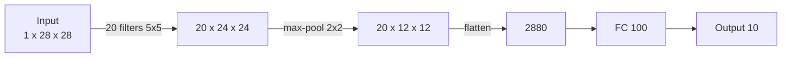

Shape tracing: $1 \times 28 \times 28 \to 20 \times 24 \times 24 \to 20 \times 12 \times 12 \to 2880 \to 100 \to 10$ (since $20 \times 12 \times 12 = 2880$).

Params [Computed]: conv $520$; FC1 $2880 \times 100 + 100 = 288{,}100$; output $100 \times 10 + 10 = 1010$; total $289{,}630$.

PyTorch version (sigmoid activations):

```python
import torch.nn as nn
model = nn.Sequential(
    nn.Conv2d(1, 20, kernel_size=5, stride=1),
    nn.Sigmoid(),
    nn.MaxPool2d(kernel_size=2, stride=2),
    nn.Flatten(),
    nn.Linear(20*12*12, 100),
    nn.Sigmoid(),
    nn.Linear(100, 10)
)
loss_fn = nn.CrossEntropyLoss()
```

- The last layer outputs 10 **logits** (raw scores).
- No Softmax layer is needed, because `CrossEntropyLoss` applies softmax internally.

**Result: 98.78% accuracy.** Error rate dropped by more than one-third compared with earlier (non-conv) results.

**What each part does:** conv + pool learn **local** spatial features. The FC layer combines them at a more **global, abstract** level.

> **Exercise (slides):** What if we remove the 100-neuron FC hidden layer and connect pooled features straight to the output? The FC hidden layer can learn **nonlinear combinations** of local features before classification, so removing it would be expected to hurt (or at best not help).

## 2.2 Network 2: add a second conv-pool layer

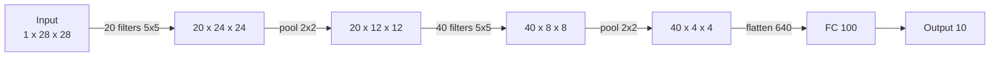

Shape tracing: $20 \times 12 \times 12 \to$ (5x5 conv, no padding: $12 - 5 + 1 = 8$) $\to 40 \times 8 \times 8 \to$ (pool) $\to 40 \times 4 \times 4 = 640$.

**Accuracy: 98.78% -> 99.06%.**

### How a second-layer filter works (multi-channel filters)

The first pooling layer outputs **20 feature maps** of size $12 \times 12$. A second-layer filter looks at a $5 \times 5$ region **across all 20 maps at once**, so its weight block is $20 \times 5 \times 5 = 500$ weights, plus 1 bias.

$$\text{params} = 40 \times (20 \times 5 \times 5 + 1) = 40 \times 501 = 20{,}040$$

General formula for a conv layer:

$$\text{params} = C_{\text{out}} \times (C_{\text{in}} \times k \times k + 1)$$

> **Key idea:** each filter spans **all input channels** but only a **local $k \times k$** spatial region. This lets deeper layers build complex features from simpler ones.
> **Exception:** grouped and depthwise convolutions restrict which input channels each filter can use.

**Reading `nn.Conv2d(20, 40, kernel_size=5)`:** 20 = input channels (feature maps coming in), 40 = output channels (number of filters). `nn.Conv2d(3, 20, ...)` would be used for the first layer when the input is a **colour (RGB) image** (3 channels).

## 2.3 Network 3: ReLU instead of sigmoid

Same architecture, but sigmoid -> **ReLU**, i.e. $f(z) = \max(0, z)$.

Hyperparameters also changed:

| | Sigmoid net | ReLU net |
|---|---|---|
| Learning rate $\eta$ | 0.1 | 0.03 |
| L2 regularization $\lambda$ | none | 0.1 |

Why ReLU might help: a saturated sigmoid has $\sigma'(z)$ close to 0, so gradients vanish and learning crawls. ReLU does not saturate for large positive $z$.

(Reasoning for the changes: the activation function changes the scale of activations and gradients, so the learning rate must be re-tuned; L2 regularization is added to limit overfitting.)

**Accuracy: 99.06% -> 99.23%.** Note: learning rate and regularization changed too, so the gain is not purely from ReLU.

## 2.4 Network 4: expanded training data (data augmentation)

Create 4 extra copies of each training image by shifting it **up, down, left, right by 1 pixel**.

- Training set: $50{,}000 \to 5 \times 50{,}000 = 250{,}000$ images.
- This is a **label-preserving transformation**: a shifted 7 is still a 7.

**Why it helps:**
- The network sees the same digit at slightly different positions, so it becomes less sensitive to exact location.
- A bigger effective training set reduces overfitting.
- Forces robust features instead of memorizing the originals.

**Accuracy: 99.23% -> 99.37%.**

Training note: with 5x data, Nielsen first considered fewer epochs (each epoch is 5x longer), but augmentation cut overfitting enough that he went back to 60 epochs.

Richer augmentation: small rotations, skewing, elastic distortions. Simard, Steinkraus, Platt used these and got about **99.6%** on MNIST.

## 2.5 Network 5: bigger FC layers (width and depth)

Starting point: one FC layer of 100 neurons, 99.37%.

| Change | Accuracy |
|---|---|
| FC layer widened to 300 | 99.46% |
| FC layer widened to 1000 | 99.43% |
| Extra FC layer ($640 \to 100 \to 100 \to 10$) | 99.43% |
| Two FC layers of 300 | 99.48% |
| Two FC layers of 1000 | 99.47% |

Lesson: simply adding capacity gives **little** improvement. The slides ask whether the problem is too little capacity or failing to use capacity because of overfitting. The answer motivates stronger regularization.

## 2.6 Network 6: bigger FC layers + dropout

```python
model = nn.Sequential(
    nn.Conv2d(1, 20, kernel_size=5), nn.ReLU(), nn.MaxPool2d(2, stride=2),
    nn.Conv2d(20, 40, kernel_size=5), nn.ReLU(), nn.MaxPool2d(2, stride=2),
    nn.Flatten(),
    nn.Linear(40*4*4, 1000), nn.ReLU(), nn.Dropout(p=0.5),
    nn.Linear(1000, 1000), nn.ReLU(), nn.Dropout(p=0.5),
    nn.Linear(1000, 10)
)
```

**Accuracy: 99.37% -> 99.60%.**

- Dropout is applied only to the FC layers, not the conv layers. Reason: **weight sharing already gives conv layers built-in resistance to overfitting.**
- Takeaway: more capacity became useful once combined with stronger regularization.

## 2.7 Network 7: ensemble of 5 networks

Train 5 networks independently (each about 99.6%). They do **not** make exactly the same mistakes (different random initializations -> different errors). Let them **vote** on the class.

- Single network: about 99.60%
- Ensemble: **99.67%**, only **33 of 10,000** test images misclassified.

> **Key idea:** an ensemble beats its members when their errors are not identical.

## 2.8 Summary table of the whole ladder

| Step | What changed | Accuracy |
|---|---|---|
| 1 | 1 conv-pool + FC 100 (sigmoid) | 98.78% |
| 2 | add 2nd conv-pool layer | 99.06% |
| 3 | sigmoid -> ReLU (+ retuned $\eta$, L2) | 99.23% |
| 4 | augmented data (shifts, 5x data) | 99.37% |
| 5 | wider FC (300 / 1000) | 99.46% / 99.43% |
| 6 | 2 FC layers of 1000 + dropout 0.5 | 99.60% |
| 7 | ensemble of 5 nets | 99.67% |

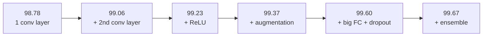

---

# PART 3: From MNIST to ImageNet [Slides]

MNIST is no longer a frontier problem: modern hardware makes training and experimenting on it fast.

**ImageNet (2011 version):** about 16 million colour images, about 20,000 categories, many visually similar (fine-grained). Much harder than MNIST.

**Le et al. (2012):** improved large-scale ImageNet classification from 9.3% to 15.8%. Message: large neural networks can learn useful high-level visual features from huge image datasets, so they might handle problems far harder than MNIST.

Later in 2012, **Krizhevsky, Sutskever, Hinton (KSH)** entered a deep CNN in the ImageNet competition. This network is called **AlexNet** (after first author Alex Krizhevsky).

## ILSVRC-2012 results (slide view)

- About 1.2 million training images, 1000 categories.
- Some images contain several plausible objects (e.g. a Labrador and a soccer ball), so judging only the single best guess is unfair. Hence **top-5 accuracy**: correct if the true class is among the 5 most likely classes.

| Measure | KSH | Next best entry |
|---|---|---|
| Top-5 accuracy | 84.7% | 73.8% |
| Top-1 accuracy | 63.3% | (not given) |

KSH showed a **large advantage** for deep CNNs on a hard large-scale benchmark.

---

# PART 4: The AlexNet paper [Paper]

**Title:** ImageNet Classification with Deep Convolutional Neural Networks (NIPS 2012).

## 4.1 Headline claims

- Trained on the 1.2M-image ILSVRC-2010 set (1000 classes).
- **ILSVRC-2010 test:** top-1 error **37.5%**, top-5 error **17.0%** (previous best: 45.7% / 25.7%).
- **ILSVRC-2012 competition:** top-5 test error **15.3%** vs **26.2%** for the second best.
- Network: **60 million parameters, 650,000 neurons**, 5 conv layers (some followed by max-pooling) + 3 FC layers + final 1000-way softmax.
- Speed tricks: non-saturating neurons (ReLU), very efficient GPU convolution.
- Overfitting fix: **dropout** (and data augmentation).

**Error vs accuracy:** error = 100% - accuracy. So top-5 error 15.3% is top-5 accuracy 84.7%, matching the slide.

## 4.2 Why this approach (paper's motivation)

- Realistic images vary a lot, so we need **much larger training sets** (ImageNet: 15M+ images, 22,000+ categories).
- Even ImageNet is not enough to fully specify the task, so the model needs **prior knowledge** built in.
- CNNs supply that prior: they assume **stationarity of statistics** (the same kind of pattern can appear anywhere) and **locality of pixel dependencies** (nearby pixels matter most).
- Compared with a normal FC network of similar size, a CNN has far fewer connections and parameters, so it is easier to train, with only slightly worse theoretical best performance.
- Depth matters: removing any conv layer hurt performance (each conv layer holds no more than 1% of the parameters, yet removing a middle one costs about 2% top-1).
- Limits: GPU memory and training time. It trains in **5 to 6 days on two GTX 580 3GB GPUs**.

## 4.3 The dataset

- **ImageNet:** over 15 million labelled high-resolution images, about 22,000 categories, labelled by humans via Amazon Mechanical Turk.
- **ILSVRC** uses a subset: about 1000 images in each of 1000 categories = about **1.2M training, 50,000 validation, 150,000 test** images.
- ILSVRC-2010 is the only version with public test labels, so most experiments use it.

**Top-1 vs top-5 error:**
- Top-1 error: fraction of test images where the model's single best guess is wrong.
- Top-5 error: fraction of test images where the correct label is **not** among the 5 labels the model rates most probable.

**Preprocessing:**
1. Images have variable size, but the network needs fixed size. Rescale so the **shorter side = 256**, then crop the **central $256 \times 256$** patch.
2. Subtract the **mean activity over the training set** from each pixel.
3. Nothing else. The network trains on (centered) raw RGB values.

## 4.4 Architecture overview

8 learned layers: **5 conv + 3 FC**. Output of the last FC layer goes to a **1000-way softmax**.

Training objective: maximize the multinomial logistic regression objective, which equals maximizing the average **log-probability of the correct label**.

```mermaid
flowchart LR
    IN["Input<br/>3 x 224 x 224"] --> C1["Conv1<br/>96 kernels 11x11x3<br/>stride 4"]
    C1 --> N1["ReLU + LRN<br/>+ MaxPool 3x3 s2"]
    N1 --> C2["Conv2<br/>256 kernels 5x5x48"]
    C2 --> N2["ReLU + LRN<br/>+ MaxPool 3x3 s2"]
    N2 --> C3["Conv3<br/>384 kernels 3x3x256"]
    C3 --> C4["Conv4<br/>384 kernels 3x3x192"]
    C4 --> C5["Conv5<br/>256 kernels 3x3x192<br/>+ MaxPool 3x3 s2"]
    C5 --> F6["FC6<br/>4096 + dropout"]
    F6 --> F7["FC7<br/>4096 + dropout"]
    F7 --> F8["FC8<br/>1000 softmax"]
```

ReLU is applied after **every** conv and FC layer. LRN = local response normalization (section 4.7). Pooling here is overlapping pooling (section 4.8).

### Layer by layer

| Layer | Details | Connected to |
|---|---|---|
| Conv1 | 96 kernels, $11 \times 11 \times 3$, stride 4, on $224 \times 224 \times 3$ input | input |
| Conv2 | 256 kernels, $5 \times 5 \times 48$ | pooled, normalized output of Conv1 (same-GPU maps only) |
| Conv3 | 384 kernels, $3 \times 3 \times 256$ | **all** maps of Conv2 (cross-GPU) |
| Conv4 | 384 kernels, $3 \times 3 \times 192$ | Conv3 maps on the same GPU only |
| Conv5 | 256 kernels, $3 \times 3 \times 192$ | Conv4 maps on the same GPU only |
| FC6, FC7 | 4096 neurons each | all neurons of previous layer |
| FC8 | 1000 neurons + softmax | all of FC7 |

- Response-normalization layers follow Conv1 and Conv2.
- Max-pooling layers follow both normalization layers **and** Conv5.
- Conv3, Conv4, Conv5 are stacked directly (no pooling or normalization between them).
- Kernel depths such as 48 and 192 are half of 96 and 384 because the maps are split across two GPUs (see 4.6).

### Layer sizes (feature map shapes)

| Stage | Shape (channels x height x width) |
|---|---|
| Conv1 output | $96 \times 55 \times 55$ |
| after pool1 | $96 \times 27 \times 27$ |
| Conv2 output | $256 \times 27 \times 27$ |
| after pool2 | $256 \times 13 \times 13$ |
| Conv3 / Conv4 | $384 \times 13 \times 13$ |
| Conv5 | $256 \times 13 \times 13$ |
| after pool5 | $256 \times 6 \times 6 = 9216$ |
| FC6 / FC7 / FC8 | 4096 / 4096 / 1000 |

Input is $150{,}528$-dimensional ($224 \times 224 \times 3$). The paper's Figure 2 lists neurons per layer as 253,440 - 186,624 - 64,896 - 64,896 - 43,264 - 4096 - 4096 - 1000. (The first number does not equal $96 \times 55 \times 55$; do not rely on it for calculations.)

Pooling size check [Computed]: $(55-3)/2 + 1 = 27$, $(27-3)/2 + 1 = 13$, $(13-3)/2 + 1 = 6$.

Padding note: with plain $224$ input and no padding, Conv1 gives $54.25$, not 55 (people usually say 227 input, or padding, is what really makes the numbers work). The paper text does not state padding, so do not worry about this in an exam.

### Parameter count [Computed]

| Layer | Calculation | Params |
|---|---|---|
| Conv1 | $96(11 \cdot 11 \cdot 3 + 1)$ | 34,944 |
| Conv2 | $256(5 \cdot 5 \cdot 48 + 1)$ | 307,456 |
| Conv3 | $384(3 \cdot 3 \cdot 256 + 1)$ | 885,120 |
| Conv4 | $384(3 \cdot 3 \cdot 192 + 1)$ | 663,936 |
| Conv5 | $256(3 \cdot 3 \cdot 192 + 1)$ | 442,624 |
| FC6 | $9216 \cdot 4096 + 4096$ | 37,752,832 |
| FC7 | $4096 \cdot 4096 + 4096$ | 16,781,312 |
| FC8 | $4096 \cdot 1000 + 1000$ | 4,097,000 |
| **Total** | | **about 61 million** (paper says 60M) |

**Big observation:** conv layers hold only about 2.3M parameters. The **FC layers hold about 58.6M**, mostly FC6. This is why dropout is applied to FC layers.

---

## 4.5 Innovation 1: ReLU nonlinearity (paper's most important)

Old standard neurons: $f(x) = \tanh(x)$ or $f(x) = (1 + e^{-x})^{-1}$ (sigmoid). These **saturate**: for large $|x|$ the curve is flat, the gradient is near 0, and gradient descent crawls.

ReLU (Rectified Linear Unit):

$$f(x) = \max(0, x)$$

- Non-saturating for positive inputs, so learning is much faster.
- Paper's Figure 1: on CIFAR-10, a 4-layer CNN with ReLU reaches 25% training error **6 times faster** than the same net with tanh.
- Without ReLU, experimenting with networks this large would not have been feasible.

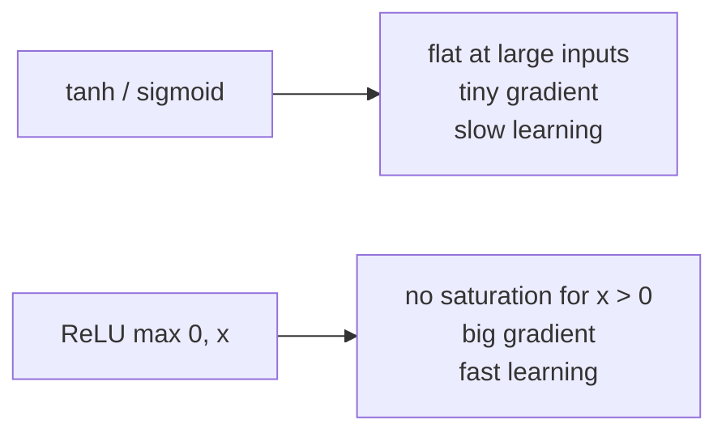

Note: the paper's concern is **faster fitting of the training set** (training speed), not better regularization (a different effect from the one seen with $|\tanh|$ in Jarrett et al.).

## 4.6 Innovation 2: training on two GPUs

- A GTX 580 has only **3 GB** memory, which limits network size. 1.2M examples are enough to train a net too big for one GPU, so the net is **split across two GPUs**.
- GPUs can read and write each other's memory directly (no detour via the host computer), which makes this cheap.
- Scheme: half of the kernels (neurons) on each GPU, **plus a trick: the GPUs communicate only in certain layers.**
  - Conv3 takes input from **all** Conv2 maps (cross-GPU talk).
  - Conv4 takes input only from Conv3 maps on **its own** GPU.
- The connectivity pattern was chosen by cross-validation, tuning communication until it is an acceptable fraction of the computation.
- Result: reduces top-1 and top-5 error by **1.7% and 1.2%** vs a one-GPU net with half as many kernels per conv layer. The two-GPU net also trains slightly faster.

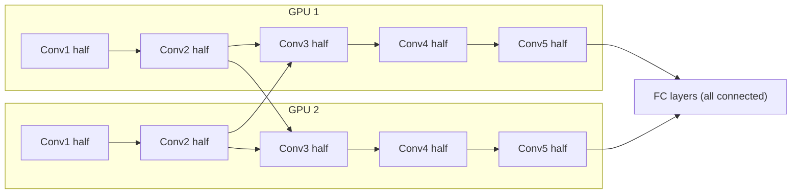

Cross arrows appear only at Conv3 (and the FC layers). Everywhere else each GPU works alone.

Qualitative result (Figure 3): GPU 1's first-layer kernels are mostly **colour-agnostic** (edges, orientation, frequency), GPU 2's are mostly **colour-specific** (colour blobs). This specialization happens on every run regardless of random initialization.

## 4.7 Innovation 3: Local Response Normalization (LRN)

ReLU does not need input normalization to avoid saturating, but this scheme still helps generalization.

Let $a^i_{x,y}$ = activity of the neuron from kernel $i$ at position $(x,y)$ after ReLU. The normalized activity is:

$$b^i_{x,y} = \frac{a^i_{x,y}}{\left( k + \alpha \displaystyle\sum_{j=\max(0,\, i-n/2)}^{\min(N-1,\, i+n/2)} \left(a^j_{x,y}\right)^2 \right)^{\beta}}$$

- Sum runs over $n$ "adjacent" kernel maps at the **same spatial position**; $N$ = total kernels in the layer.
- Kernel order is arbitrary, fixed before training.
- Hyperparameters (chosen on a validation set): $k = 2,\; n = 5,\; \alpha = 10^{-4},\; \beta = 0.75$.
- Applied **after ReLU** in certain layers (after Conv1 and Conv2).

**Intuition:** a neuron's output gets divided by how active its neighbouring kernels are at that spot. If neighbours are very active, the output shrinks. This is **lateral inhibition** (inspired by real neurons): kernels compete, and big activities stand out.

Differs from Jarrett et al.'s local contrast normalization because it does not subtract the mean, so "brightness normalization" is a better name.

Effect: reduces top-1 / top-5 error by **1.4% / 1.2%**. On CIFAR-10: 13% -> 11% test error.

(Note: LRN is rarely used in modern networks; for this course it is still part of the paper.)

## 4.8 Innovation 4: overlapping pooling

A pooling layer = grid of pooling units spaced $s$ pixels apart, each summarizing a $z \times z$ neighbourhood.

- $s = z$: traditional (non-overlapping) pooling.
- $s < z$: **overlapping pooling**.
- AlexNet uses $s = 2,\; z = 3$.
- Versus non-overlapping $s = 2,\; z = 2$ (same output size): reduces top-1 / top-5 error by **0.4% / 0.3%**.
- Models with overlapping pooling find it slightly harder to overfit.

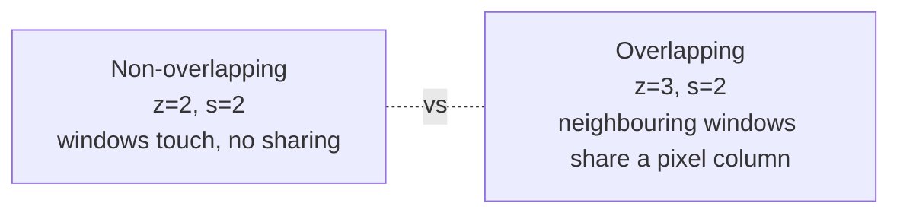

---

## 4.9 Reducing overfitting

60M parameters is a lot. Each training image gives only about 10 bits of constraint (1000 classes = $\log_2 1000 \approx 10$ bits), not enough to pin down 60M parameters. Two main defences:

### A) Data augmentation (label-preserving transformations)

Generated on the CPU in Python while the GPU trains on the previous batch, so it is "computationally free" and nothing is stored on disk.

**Form 1: translations and horizontal reflections**
- Training: take random $224 \times 224$ patches (and their mirror images) from the $256 \times 256$ images.
- Increases the training set by a factor of **2048** (examples are highly inter-dependent, though).
- Without this, heavy overfitting would force a much smaller network.
- **Test time:** take 5 patches (4 corners + centre) and their reflections = **10 patches**, and **average the softmax predictions**.
- (This is why the network input is $224 \times 224 \times 3$.)

**Form 2: altering RGB intensities (PCA colour augmentation)**
- Do PCA on the set of RGB pixel values over the whole training set.
- For each training image, add multiples of the principal components, scaled by eigenvalues times a random number:

$$\text{added to each pixel} = [\mathbf{p}_1, \mathbf{p}_2, \mathbf{p}_3]\,[\alpha_1 \lambda_1,\; \alpha_2 \lambda_2,\; \alpha_3 \lambda_3]^T$$

- $\mathbf{p}_i, \lambda_i$ = $i$th eigenvector and eigenvalue of the $3 \times 3$ RGB covariance matrix.
- $\alpha_i \sim \mathcal{N}(0, 0.1^2)$ (mean 0, std 0.1), drawn **once per image per use** (redrawn when that image is used again).
- **Idea:** object identity does not change with lighting colour or intensity.
- Reduces top-1 error by over **1%**.

### B) Dropout

Combining predictions of many models works well but is too expensive for big nets. Dropout is a cheap version, costing only about a factor of 2 in training.

- During training: set each hidden neuron's output to **0 with probability 0.5**.
- Dropped neurons do nothing in the forward pass and get no backprop update.
- Every input effectively sees a **different architecture**, but all share weights.
- Effect: neurons cannot rely on specific partner neurons (**no co-adaptation**), so each must learn robust features useful with many random subsets of others.
- **Test time:** use all neurons but **multiply outputs by 0.5**. This approximates the geometric mean of the predictions of the exponentially many dropout networks.
- Used in the **first two FC layers**. Without it: substantial overfitting. Cost: roughly **doubles** the iterations needed to converge.

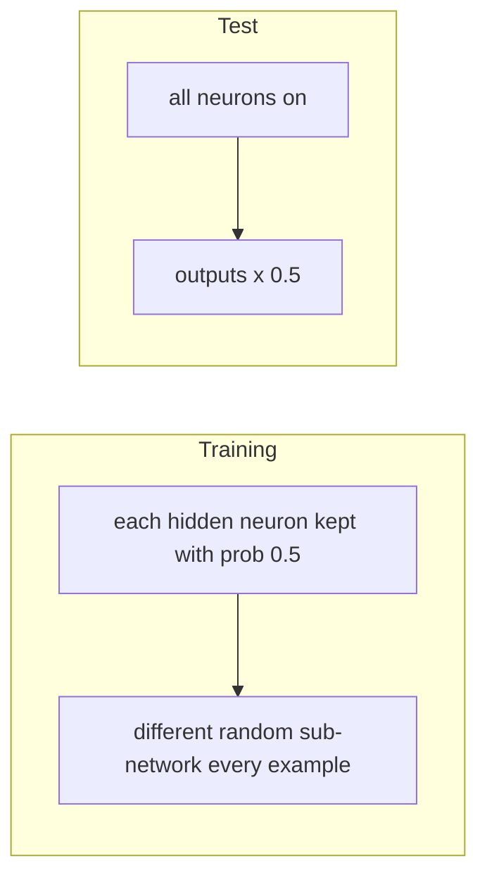

PyTorch note: `nn.Dropout(p=0.5)` instead scales the kept neurons by 2 **during training**, so no change is needed at test time. Same net effect.

---

## 4.10 Details of learning

- **Optimizer:** stochastic gradient descent, batch size **128**, momentum **0.9**, weight decay **0.0005**.
- Weight decay here is not just a regularizer: it also **reduces training error** (it was important for the model to learn).

Update rule for weight $w$:

$$v_{i+1} := 0.9\, v_i - 0.0005\, \epsilon\, w_i - \epsilon \left\langle \frac{\partial L}{\partial w}\bigg|_{w_i} \right\rangle_{D_i}$$

$$w_{i+1} := w_i + v_{i+1}$$

- $i$ = iteration, $v$ = momentum variable (running "velocity"), $\epsilon$ = learning rate.
- $\langle \cdot \rangle_{D_i}$ = gradient averaged over the $i$th mini-batch $D_i$.
- The $-0.0005\,\epsilon\, w_i$ term pulls weights toward zero (weight decay).
- $0.9\, v_i$ keeps part of the previous direction (momentum).

**Initialization:**
- Weights: zero-mean Gaussian, std **0.01**.
- Biases = **1** in Conv2, Conv4, Conv5 and the hidden FC layers (gives ReLUs positive inputs, which speeds up early learning).
- Biases = **0** in the remaining layers.

**Learning rate:** same for all layers, adjusted by hand. Rule: **divide by 10 when validation error stops improving.** Started at **0.01**, reduced **3 times**.

**Training length:** about **90 passes (epochs)** over the 1.2M images, 5 to 6 days on two GTX 580 GPUs.

---

## 4.11 Results

### ILSVRC-2010 test set (Table 1)

| Model | Top-1 error | Top-5 error |
|---|---|---|
| Sparse coding (best in 2010 contest) | 47.1% | 28.2% |
| SIFT + Fisher Vectors (best published since) | 45.7% | 25.7% |
| **CNN (AlexNet)** | **37.5%** | **17.0%** |

Without averaging over 10 patches: 39.0% / 18.3%.

### ILSVRC-2012 (Table 2)

| Model | Top-1 (val) | Top-5 (val) | Top-5 (test) |
|---|---|---|---|
| SIFT + FVs (2nd best) | - | - | 26.2% |
| 1 CNN | 40.7% | 18.2% | - |
| 5 CNNs (averaged) | 38.1% | 16.4% | 16.4% |
| 1 CNN* | 39.0% | 16.6% | - |
| 7 CNNs* | 36.7% | 15.4% | **15.3%** |

`*` = pre-trained on the whole ImageNet Fall 2011 release (15M images, 22K classes) with an extra 6th conv layer, then **fine-tuned** on ILSVRC-2012.

- Validation and test errors differ by no more than 0.1% in their experience, so they are used interchangeably.
- **Ensembling** (averaging predictions of several CNNs) helps, just like the 5-net vote on MNIST.

### ImageNet Fall 2009 (10,184 categories, 8.9M images)

Half for training, half for testing. Net with an extra 6th conv layer: top-1 **67.4%**, top-5 **40.9%** error (previous best: 78.1% / 60.9%).

## 4.12 Qualitative evaluation

- **Learned kernels (Figure 3):** frequency- and orientation-selective kernels plus coloured blobs.
- **Top-5 predictions (Figure 4 left):** even off-centre objects (like a mite) get recognized. Wrong guesses are reasonable (the leopard's alternatives are other cats). Some images are genuinely ambiguous (grille, cherry).
- **Feature-space similarity (Figure 4 right):** take the 4096-dimensional vector from the last hidden layer (FC7). If two images have a small **Euclidean distance** between these vectors, the network thinks they are similar.
  - Retrieved training images are semantically similar but **not close at pixel level** (e.g. dogs and elephants in many poses).
- Euclidean distance on 4096-d vectors is inefficient, but it could be made efficient by training an **auto-encoder** to compress these to short binary codes. This would beat applying auto-encoders to raw pixels, which ignores labels and tends to retrieve images with similar edge patterns whether or not they are semantically similar.

## 4.13 Discussion (paper's conclusions)

- A large, deep CNN can achieve record-breaking results on a hard dataset using **purely supervised learning**.
- **Depth really matters:** removing any single conv layer degrades performance. Removing a middle layer costs about 2% top-1.
- No unsupervised pre-training was used (to keep experiments simple), though they expect it would help, especially with much more compute.
- Results improved as the net got larger and trained longer. Still many orders of magnitude short of the human infero-temporal visual pathway.
- Future goal: very large, deep conv nets on **video**, where temporal structure gives extra information.

---

# PART 5: Slides vs paper, and why AlexNet mattered

**Techniques in AlexNet that you already know from the course:**

- Conv layers and local receptive fields
- Max-pooling
- ReLU
- Data augmentation (random crops and reflections)
- Dropout
- L2 / weight decay
- Momentum-based mini-batch SGD

**Why was it a landmark then?**
1. Showed a deep CNN can work at **ImageNet scale**.
2. **Substantially outperformed** other methods in ILSVRC-2012 (84.7% vs 73.8% top-5 accuracy).
3. **GPU computation** made training a roughly **60M-parameter** network practical.
4. Established deep CNNs as the powerful approach for large-scale computer vision.

**How the MNIST net and AlexNet compare:**

| | Nielsen MNIST net | AlexNet |
|---|---|---|
| Input | $1 \times 28 \times 28$ | $3 \times 224 \times 224$ |
| Conv layers | 2 | 5 |
| FC layers | 1 to 2 | 3 |
| Classes | 10 | 1000 |
| Activation | sigmoid then ReLU | ReLU |
| Pooling | $2 \times 2$ max, stride 2 | $3 \times 3$ max, stride 2 (overlapping) |
| Dropout | $p = 0.5$ on FC (best net) | $p = 0.5$ on first 2 FC |
| Augmentation | 1-pixel shifts | random crops, flips, PCA colour |
| Ensemble | 5 nets vote | up to 7 nets averaged |
| Hardware | ordinary | 2 GPUs, 5 to 6 days |

---

# PART 6: Exam cheat sheet

## Formulas

| What | Formula |
|---|---|
| Conv output size | $\lfloor (N - F)/S \rfloor + 1$ |
| Conv neuron | $a_{j,k} = \sigma\big(b + \sum_{l,m} w_{l,m}\, a_{j+l,k+m}\big)$ |
| Params, 1 input channel, $F \times F$, $K$ filters | $K(F^2 + 1)$ |
| Params, general conv | $C_{\text{out}}(C_{\text{in}} k^2 + 1)$ |
| Params, FC | $n_{\text{in}} n_{\text{out}} + n_{\text{out}}$ |
| Pooling params | 0 |
| Max-pool backprop | gradient to the argmax only, 0 elsewhere |
| Shared weight gradient | $\sum_{j,k} a_{j+l,k+m}\,\delta_{j,k}$ |
| Shared bias gradient | $\sum_{j,k} \delta_{j,k}$ |
| L2 pool | $\sqrt{\sum a_i^2}$ |
| ReLU | $\max(0, x)$ |
| LRN | $b = a / (k + \alpha \sum a_j^2)^\beta$, $k=2,n=5,\alpha=10^{-4},\beta=0.75$ |
| SGD + momentum + decay | $v \leftarrow 0.9v - 0.0005\epsilon w - \epsilon\langle\nabla L\rangle$, $w \leftarrow w + v$ |

## Key numbers to remember

- MNIST: $28 \to 24$ (5x5 conv) $\to 12$ (pool) $\to 8$ (5x5 conv) $\to 4$ (pool). Flatten: 2880 (net 1), 640 (net 2).
- Parameter counts: 78, 520, 299,520 (no sharing), factor 576, 4408, 20,040.
- Accuracy ladder: 98.78, 99.06, 99.23, 99.37, 99.60, 99.67 (33 errors).
- AlexNet: 8 layers, 60M params, 650K neurons, 1.2M images, 1000 classes.
- AlexNet errors: 37.5/17.0 (2010), 15.3 top-5 (2012) vs 26.2.
- Dropout 0.5, batch 128, momentum 0.9, decay 0.0005, lr 0.01 divided by 10 three times, about 90 epochs, 5 to 6 days, 2 GTX 580 (3GB).
- Input 256 -> random 224 crops; augmentation factor 2048; test uses 10 patches.

## Quick conceptual Q and A

**Why do FC layers fail for images?** They ignore spatial layout; near and far pixels are treated alike, and they need huge parameter counts.

**Why does weight sharing help?** Same feature detector at every location, so far fewer parameters, faster training, less overfitting.

**What does pooling do?** Shrinks feature maps and summarizes local regions, with no parameters.

**Why no dropout on conv layers?** Weight sharing already protects them from overfitting.

**Why did ReLU help?** It does not saturate for positive inputs, so gradients stay large and learning is faster.

**Why augmentation?** It enlarges the effective dataset with label-preserving changes and teaches robustness.

**Why top-5?** Images can contain several valid objects, so one guess is too strict.

**Why an ensemble?** Different networks make different mistakes; voting or averaging cancels some errors.

**Why two GPUs?** One GTX 580 (3GB) could not hold the whole network. Communication happens only at selected layers to keep the cost low.

## Practice questions (with answers)

1. Input $32 \times 32$, filter $5 \times 5$, stride 1. Output? **$28 \times 28$.**
2. Input $28 \times 28$, filter $5 \times 5$, stride 2. Output? **$12 \times 12$.**
3. A layer has 6 filters of $5 \times 5$ on a 1-channel input. Params? **$6 \times 26 = 156$.**
4. Conv with 40 filters of $5 \times 5$ on 20 input channels. Params? **$40 \times 501 = 20{,}040$.**
5. After $4 \times 4 \times 40$ feature maps, FC to 100 neurons. Params? **$640 \times 100 + 100 = 64{,}100$.**
6. Region $\begin{pmatrix} 5 & 1 \\ 2 & 7 \end{pmatrix}$: max pool and L2 pool? **Max = 7; L2 = $\sqrt{25+1+4+49} = \sqrt{79} \approx 8.89$.**
7. In the same region, which entry receives the gradient in backprop? **The entry 7 (the max); the others get 0.**
8. What does 3 -> 20 mean in `nn.Conv2d(3, 20, 5)`? **3 input channels (RGB), 20 filters.**
9. Why is the AlexNet FC6 layer so large? **It takes $256 \times 6 \times 6 = 9216$ inputs and has 4096 neurons: about 37.7M weights.**
10. How does AlexNet predict at test time? **Averages the softmax outputs over 10 patches (4 corners + centre, plus their flips).**
