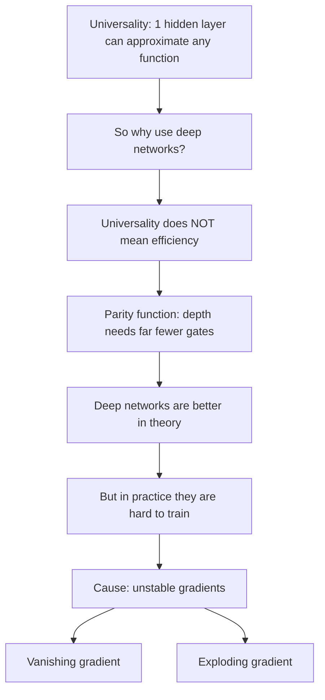
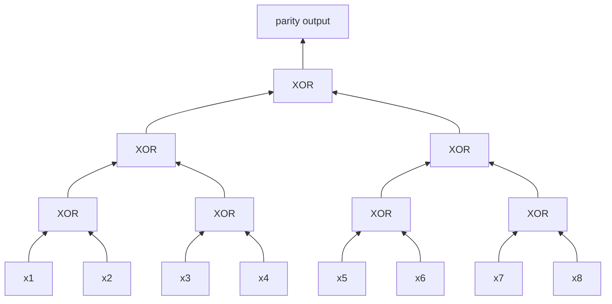
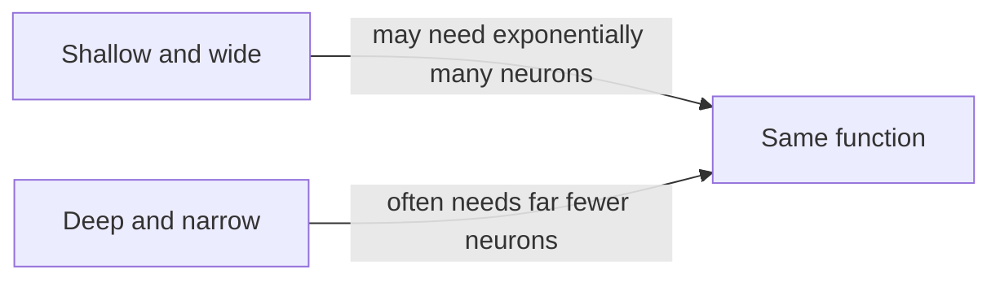
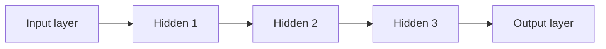
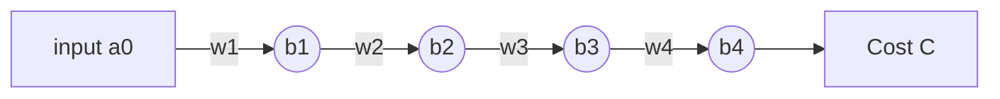
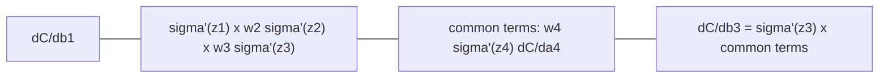
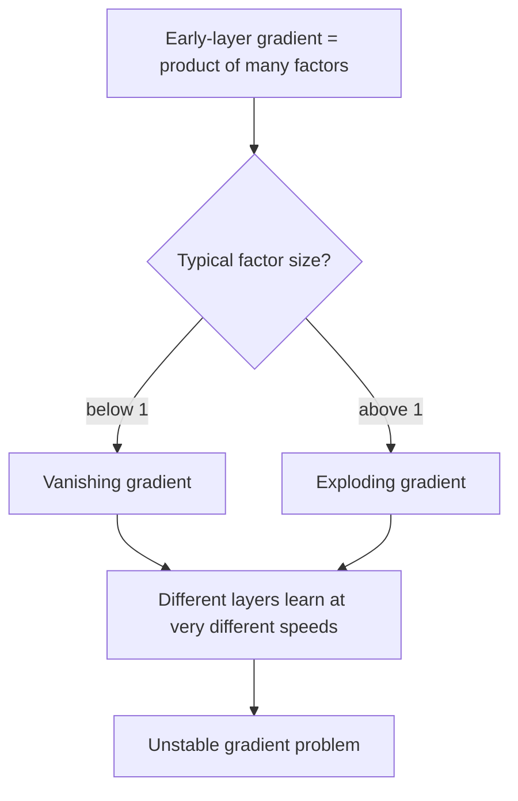
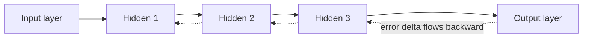

## 0. Big Picture



---

## 1. The Paradox of Universality

- **Fact (universality theorem):** a network with a **single hidden layer** can approximate any function $\mathbf{f}:\mathbb{R}^d \to \mathbb{R}^n$ as closely as we want.
- **Question:** if one layer is enough, why bother with many hidden layers?
- **Answer:** $\text{Universality} \neq \text{Efficiency}$.

In simple terms:
- "Can represent" only says a solution **exists**.
- It does not say the solution is **small, fast, or easy to find**.
- A shallow network may need an enormous number of neurons to do what a deep network does with few.

**Analogy:** you can answer any question by memorising a giant lookup table (shallow, huge). Or you can learn a rule and apply it step by step (deep, small). Both give correct answers, but one is far cheaper.

---

## 2. Case Study: The Parity Function

### 2.1 Problem

Given $n$ bits, output whether the number of 1s is **odd or even**.

- Input `1 0 1 1` has three 1s, so parity is odd (output 1).
- Input `1 1 0 0` has two 1s, so parity is even (output 0).

Parity equals the XOR of all bits:

$$
\text{parity}(x_1,\dots,x_n) = x_1 \oplus x_2 \oplus \dots \oplus x_n
$$

### 2.2 Shallow approach (depth 2)

A depth-2 circuit (one hidden layer) has only two levels: a layer of AND-type gates feeding one OR-type gate.

- It must **list every input pattern that gives odd parity** (each pattern is called a **minterm**).
- Number of odd-parity patterns out of $2^n$ total patterns is $2^{n-1}$.
- So gates needed:

$$
O(2^n) \quad \text{(exponential in } n\text{)}
$$

Why? With only two levels, no gate can reuse partial work. Each odd pattern needs its own detector.

### 2.3 Deep approach (depth $\log n$)

Pair up the bits and XOR each pair. Then pair up the results and XOR again. Repeat until one bit remains.



For $n = 8$:
- Level 1: 4 XOR gates, level 2: 2 XOR gates, level 3: 1 XOR gate.
- Total $= 4+2+1 = 7 = n-1$ gates.
- Depth $= 3 = \log_2 8$.

General case:

$$
\text{depth} = \log_2 n, \qquad \text{gates} = n-1 = O(n)
$$

### 2.4 Comparison

| | Shallow (depth 2) | Deep (depth $\log n$) |
|---|---|---|
| Idea | list all odd patterns | tree of XORs |
| Gates | $O(2^n)$ | $O(n)$ |
| Growth | exponential | linear |

### 2.5 Theoretical backing

**Furst, Saxe, and Sipser (1984):** parity needs **exponential size** if the circuit has **constant depth**. So the blow-up for shallow circuits is not a flaw of one design. It is unavoidable.

---

## 3. Summary: Width vs Depth

- **Shallow** network: *mathematically* able to represent any function (but may need huge width).
- **Deep** network: often *computationally* more efficient (far fewer neurons for the same function).



---

## 4. Training Deep Networks Is Hard

- Depth looks great on paper, but **training** a deep network is difficult.
- **Core problem:** different layers learn at **vastly different rates**.

Example architecture with 3 hidden layers (slide figure): input layer, hidden layer 1, hidden layer 2, hidden layer 3, output layer.



---

## 5. Experiment: Shallow vs Deep on MNIST

Uses Michael Nielsen's `network2.py` on MNIST (handwritten digits, 784 input pixels, 10 output classes).

**Shallow network (one hidden layer of 30 neurons):**

```python
import network2
net = network2.Network([784, 30, 10])
net.SGD(training_data, 30, 10, 0.1, lmbda=5.0,
        evaluation_data=validation_data,
        monitor_evaluation_accuracy=True)
```

**Deep network (four hidden layers of 30 neurons each):**

```python
net = network2.Network([784, 30, 30, 30, 30, 10])
net.SGD(training_data, 30, 10, 0.1, lmbda=5.0,
        evaluation_data=validation_data,
        monitor_evaluation_accuracy=True)
```

### What the arguments mean

| Argument | Meaning |
|---|---|
| `[784, 30, 30, 30, 30, 10]` | neurons per layer: input, 4 hidden, output |
| `training_data` | data used to update weights |
| `30` | number of epochs (full passes over the data) |
| `10` | mini-batch size for SGD |
| `0.1` | learning rate $\eta$ |
| `lmbda=5.0` | L2 regularisation strength $\lambda$ |
| `evaluation_data` | validation set to measure accuracy |
| `monitor_evaluation_accuracy=True` | print validation accuracy each epoch |

Only difference between the two runs: **3 extra hidden layers**. Everything else is the same.

---

## 6. The Puzzle: Results of the Deep Network

You would expect the deeper network to do better. Instead:

1. **Erratic accuracy:** accuracy rises at first, then often **plateaus or even drops** while training continues.
2. **Failure of learning:** despite more "representational power", the deep network often does **worse** than the shallow one.
3. **Observation:** layers are not learning equally. The early layers barely change, so they pass nearly useless features forward, and the later layers have nothing good to work with.

> **Big question:** why does adding layers, which should make the network more capable, make it much harder to train?

Answer in one line: **unstable gradients** (Sections 7 to 11).

---

## 7. Understanding Gradient Backpropagation

Recall: weights and biases are updated by gradient descent.

$$
b \leftarrow b - \eta \frac{\partial C}{\partial b}, \qquad
w \leftarrow w - \eta \frac{\partial C}{\partial w}
$$

- The **size of the gradient** $\left|\frac{\partial C}{\partial b}\right|$ decides how fast that neuron learns.
- Big gradient means fast learning. Tiny gradient means almost no learning.

**Slide figure (hidden layer 1 vs hidden layer 2):** each neuron has an orange bar. Bar height is the gradient magnitude for that neuron.
- Hidden layer 2 (closer to output) has **tall bars**.
- Hidden layer 1 (closer to input) has **very short bars**.

So the **earlier layer learns much slower than the later layer**.


Gradients are computed **backwards** from the output, which is why layers near the input suffer most.

---

## 8. Simplest Case: Single Input, Single Output Chain

To see why, take the simplest deep network: **one neuron per layer, 4 layers, in a chain**.



### 8.1 Notation

For layer $j$:

$$
z_j = w_j\, a_{j-1} + b_j, \qquad a_j = \sigma(z_j)
$$

- $a_0$ is the input.
- $\sigma$ is the sigmoid: $\sigma(z) = \dfrac{1}{1+e^{-z}}$.
- The cost $C$ depends only on the last activation $a_4$.

### 8.2 Gradient of the cost w.r.t. the first bias

Use the chain rule. Follow how $b_1$ affects $C$:

$$
b_1 \to z_1 \to a_1 \to z_2 \to a_2 \to z_3 \to a_3 \to z_4 \to a_4 \to C
$$

Multiply the derivative of every link:

$$
\frac{\partial C}{\partial b_1}
= \underbrace{\frac{\partial z_1}{\partial b_1}}_{=1}
\cdot \sigma'(z_1)\cdot w_2 \cdot \sigma'(z_2)\cdot w_3 \cdot \sigma'(z_3)\cdot w_4 \cdot \sigma'(z_4)\cdot \frac{\partial C}{\partial a_4}
$$

So:

$$
\boxed{\frac{\partial C}{\partial b_1}
= \sigma'(z_1)\; w_2\,\sigma'(z_2)\; w_3\,\sigma'(z_3)\; w_4\,\sigma'(z_4)\;\frac{\partial C}{\partial a_4}}
$$

Where each term comes from:
- $\sigma'(z_j)$: from $a_j = \sigma(z_j)$.
- $w_{j+1}$: from $z_{j+1} = w_{j+1} a_j + b_{j+1}$, since $\frac{\partial z_{j+1}}{\partial a_j} = w_{j+1}$.
- $\frac{\partial C}{\partial a_4}$: how the cost changes with the output.

Similarly, for a weight: $\dfrac{\partial C}{\partial w_1} = a_0 \cdot \dfrac{\partial C}{\partial b_1}$ (same product, times the input).

### 8.3 Compare with a later bias

$$
\frac{\partial C}{\partial b_3} = \sigma'(z_3)\; w_4\,\sigma'(z_4)\;\frac{\partial C}{\partial a_4}
$$

The tail $w_4\,\sigma'(z_4)\,\frac{\partial C}{\partial a_4}$ is a **common term** in both expressions. The gradient for $b_1$ simply has **extra factors multiplied in**.



Each extra pair $w_j\,\sigma'(z_j)$ is a multiplier. This is the whole story. Next: what size are those multipliers?

---

## 9. Why Does $\frac{\partial C}{\partial b_1}$ Become Small?

### 9.1 Derivative of the sigmoid

$$
\sigma'(z) = \sigma(z)\bigl(1-\sigma(z)\bigr)
$$

Let $s=\sigma(z) \in (0,1)$. Then $s(1-s)$ is largest at $s = \tfrac12$, which gives $\tfrac12\cdot\tfrac12$:

$$
\max \sigma'(z) = \frac14 \quad \text{at } z = 0
$$

(The slide graph: a bell shape, peak $0.25$ at $z=0$, falling towards $0$ for large $|z|$.)

**Answer to "At what point is the derivative of sigmoid maximum?"** at $z=0$, with value $1/4$.

So always:

$$
|\sigma'(z)| \le \frac14
$$

### 9.2 How weights are initialised in `network2`

- Weights are drawn from a **Gaussian with mean 0**.
- Biases are drawn from a standard Gaussian (mean 0, std 1).
- In Nielsen's analysis, weights are typically $|w_j| < 1$ (with standard deviation 1 about 68 percent of weights are below 1 in magnitude, and `network2`'s default initialiser uses an even smaller std of $1/\sqrt{n_\text{in}}$, so $|w|<1$ is even more likely).

### 9.3 Combine the two facts

$$
|w_j| < 1 \quad \text{and} \quad |\sigma'(z_j)| \le \tfrac14
\;\;\Longrightarrow\;\;
|w_j\,\sigma'(z_j)| < \frac14
$$

So in

$$
\frac{\partial C}{\partial b_1} = \sigma'(z_1)\,\overbrace{w_2\sigma'(z_2)}^{<1/4}\;\overbrace{w_3\sigma'(z_3)}^{<1/4}\; w_4\sigma'(z_4)\frac{\partial C}{\partial a_4}
$$

every bracket is less than $\tfrac14$. Each extra layer **multiplies the gradient by something less than $1/4$**.

- Gradient at $b_1$ is at least about $16$ times smaller than at $b_3$ (two extra brackets, each $<\tfrac14$).
- With more layers it shrinks like $\left(\tfrac14\right)^{\text{number of layers}}$, which goes to $0$ exponentially fast.

### 9.4 Worked numeric example (best case)

Take $\sigma'(z_j) = 0.25$ for all $j$ (the maximum) and $w_j = 0.8$.

- Each bracket: $w\,\sigma' = 0.8 \times 0.25 = 0.2$.
- $\dfrac{\partial C}{\partial b_4} = 0.25\,\dfrac{\partial C}{\partial a_4}$.
- $\dfrac{\partial C}{\partial b_1} = \sigma'(z_1)\,(w_2\sigma'_2)(w_3\sigma'_3)(w_4\sigma'_4)\,\dfrac{\partial C}{\partial a_4} = 0.25 \times 0.2^3 \times \dfrac{\partial C}{\partial a_4} = 0.002\,\dfrac{\partial C}{\partial a_4}$.
- Ratio: $\dfrac{0.002}{0.25} = 0.008$, so layer 1 learns about **125 times slower** than layer 4, even in the best case.

---

## 10. Vanishing, Exploding, and Unstable Gradients

### 10.1 Vanishing gradient

- Factors $|w\,\sigma'(z)| < 1$ get multiplied many times.
- Gradient in early layers $\to 0$. Early layers barely learn.
- This is what usually happens with sigmoid and small initial weights.

### 10.2 Exploding gradient

The opposite can also happen. Suppose weights are **large**.

Example: $w_1=w_2=w_3=w_4=100$, and biases chosen so that $z_j = 0$ (so $\sigma'(z_j) = \tfrac14$, its maximum).

- Each bracket: $w\,\sigma' = 100 \times \tfrac14 = 25 > 1$.
- $\dfrac{\partial C}{\partial b_1} = \tfrac14 \cdot 25^3 \cdot \dfrac{\partial C}{\partial a_4} \approx 3906\,\dfrac{\partial C}{\partial a_4}$.
- Gradient in early layers is **huge**, updates overshoot, training blows up.

Catch: for large $w$, $z = wa+b$ changes quickly with $a$, so staying at $z\approx0$ (where $\sigma'$ is big) is delicate. Exploding is therefore rarer than vanishing with sigmoids, but it can happen.

### 10.3 Unstable gradient problem (the real name)

Gradient in an early layer is a **product of many terms** coming from all later layers. A long product of numbers is unstable: if typical factors are below 1 it vanishes, if above 1 it explodes. Getting all factors near 1 is very unlikely.



Key point: the problem is not specifically "vanishing". It is that layers in a deep network are in an **unstable** situation, so they learn at wildly different rates.

---

## 11. Exercise 1: Conditions for Gradient Stability

**Problem.** The term $|w\,\sigma'(wa+b)|$ controls how the gradient scales through a sigmoid layer. Suppose we want it to be $\ge 1$. Argue that this can only occur if $|w| \ge 4$.

**Solution.**

1. For the sigmoid, $|\sigma'(z)| \le \dfrac14$ for every $z$ (max at $z=0$, Section 9.1).
2. Therefore

$$
|w\,\sigma'(wa+b)| = |w|\,|\sigma'(wa+b)| \le |w|\cdot\frac14 = \frac{|w|}{4}
$$

3. We want the left side to be $\ge 1$. Since it is at most $\tfrac{|w|}{4}$:

$$
1 \le |w\,\sigma'(wa+b)| \le \frac{|w|}{4}
\;\;\Longrightarrow\;\;
\frac{|w|}{4} \ge 1
\;\;\Longrightarrow\;\;
|w| \ge 4
$$

4. So $|w|\ge4$ is **necessary**. It is not sufficient: even with $|w| \ge 4$, we also need $z=wa+b$ to be close to $0$, so that $\sigma'$ is near its peak.

**Takeaway:** to stop gradients shrinking, weights must be large (at least 4). But initial weights are small, so shrinking is the default.

---

## 12. Exercise 2: Activation Functions and Stability

**Problem.** The vanishing argument used $|\sigma'(z)| < 1/4$. What if we used an activation whose derivative can be much larger (e.g. ReLU)? Would that avoid the unstable gradient problem?

**Answer: not fully.**

- The factor is now $w\,f'(z)$ instead of $w\,\sigma'(z)$. If $f'(z)$ is large, then $|w f'(z)|$ can exceed 1, so the **vanishing** problem can go away.
- But then the factors can be **greater than 1**, so the product can **explode**. We replaced one instability by the other.
- The root cause remains: the early-layer gradient is a **product of many layer-wise factors**. Keeping every factor close to 1 is hard.

**About ReLU specifically:**

$$
\text{ReLU}(z)=\max(0,z), \qquad
\text{ReLU}'(z)=\begin{cases}1 & z>0\\ 0 & z\le 0\end{cases}
$$

- On active neurons the derivative is exactly 1, so it does **not** shrink the gradient by $1/4$ each layer. This helps in practice.
- On inactive neurons ($z \le 0$) the derivative is 0, so the gradient is **cut off completely** ("dead" neurons).
- The weights $w$ still multiply in, so the product can still grow or shrink depending on weight sizes.

So a different activation can **reduce** the problem, but does not remove the basic instability of multiplying many terms.

---

## 13. Unstable Gradients in More Complex Networks

Real networks have many neurons per layer, not one chain. Same issue, now with matrices.



### 13.1 Backpropagation equation

$$
\boxed{\delta^{l} = \Bigl( (w^{l+1})^{T}\,\delta^{l+1} \Bigr) \odot \sigma'(z^{l})}
$$

Meaning of each symbol:

| Symbol | Meaning |
|---|---|
| $\delta^l$ | error vector of layer $l$ (one entry per neuron): $\delta^l_j = \frac{\partial C}{\partial z^l_j}$ |
| $w^{l+1}$ | weight matrix between layer $l$ and layer $l+1$ |
| $(w^{l+1})^T \delta^{l+1}$ | send the next layer's error **backwards** through the weights |
| $\odot$ | element-wise (Hadamard) product |
| $\sigma'(z^l)$ | vector of sigmoid derivatives in layer $l$ |

Once $\delta^l$ is known:

$$
\frac{\partial C}{\partial b^l} = \delta^l, \qquad
\frac{\partial C}{\partial w^l} = \delta^l\,(a^{l-1})^T
$$

So the **size of $\delta^l$ controls how fast layer $l$ learns**.

### 13.2 Unroll the recursion

Each step multiplies by a weight matrix and a derivative. Repeating this from the output $L$ back to layer $l$:

$$
\delta^{l} = \Sigma'(z^{l})\,(w^{l+1})^{T}\,\Sigma'(z^{l+1})\,(w^{l+2})^{T}\cdots\Sigma'(z^{L})\,\nabla_a C
$$

where $\Sigma'(z^l)$ is a diagonal matrix with $\sigma'(z^l_j)$ on the diagonal.

This is the matrix version of the chain-of-neurons product:

| Single chain | Many neurons |
|---|---|
| $w_j$ | matrix $(w^j)^T$ |
| $\sigma'(z_j)$ | diagonal matrix $\Sigma'(z^j)$ |
| product of numbers | product of matrices |

### 13.3 Why it is still unstable

- Each $\Sigma'$ has entries $\le \tfrac14$, which pushes things **smaller**.
- Each $(w)^T$ with typical initial values tends to be modest in size, so the product usually **vanishes** for sigmoids.
- A product of many matrices can also **explode** if their combined stretching exceeds 1 in some direction.
- Same conclusion: early layers get gradients that are exponentially smaller (or larger) than later ones.

---

## 14. Key Takeaways

1. **Universality does not imply efficiency.** Deeper networks can represent some functions much more efficiently than shallow ones.
2. **Parity function:** depth 2 needs $O(2^n)$ gates, depth $\log n$ needs $O(n)$ gates. Depth can dramatically cut resources.
3. **Deep networks are hard to train** because of **unstable gradients**: gradients shrink or grow dramatically as they propagate through many layers.
4. Cause: gradient of an early layer is a **product of many factors** $w_j\,\sigma'(z_j)$.

---

## 15. Quick Revision Sheet

**Formulas**

- Sigmoid: $\sigma(z)=\dfrac{1}{1+e^{-z}}$, $\sigma'(z)=\sigma(z)(1-\sigma(z))$, $\max\sigma' = \dfrac14$ at $z=0$.
- Chain of 4 neurons:
$$\frac{\partial C}{\partial b_1}=\sigma'(z_1)\,w_2\sigma'(z_2)\,w_3\sigma'(z_3)\,w_4\sigma'(z_4)\,\frac{\partial C}{\partial a_4}$$
- General layers: $\delta^l = ((w^{l+1})^T\delta^{l+1})\odot\sigma'(z^l)$.
- Parity: $O(2^n)$ gates at depth 2 vs $O(n)$ gates at depth $\log n$.

**Likely exam questions**

- *Why use deep networks if one hidden layer is universal?* Efficiency: parity needs exponential gates in shallow circuits, linear in deep ones.
- *What is the vanishing gradient problem?* Early-layer gradients shrink exponentially because each layer multiplies by $w\sigma'(z)$ with $|w\sigma'|<\tfrac14$ typically.
- *Why is the max of $\sigma'$ equal to $1/4$?* $\sigma'=s(1-s)$, maximised at $s=\tfrac12$.
- *When can $|w\sigma'(wa+b)|\ge1$?* Only if $|w|\ge4$ (since $|\sigma'|\le\tfrac14$), plus $z$ must be near 0.
- *What is the exploding gradient problem?* Large weights (e.g. $w=100$ with $z\approx0$) give factors greater than 1, so the product grows.
- *Does ReLU solve it?* Reduces it (derivative is 1 when active) but does not remove it: products of many factors still shrink or grow, and dead ReLUs give zero gradient.
- *Why is it called "unstable"?* Early-layer gradient is a long product of terms, so it tends to either vanish or explode instead of staying stable.
