# Theory of Computation (CS F351): Context Free Grammars and Pushdown Automata (Lectures CFG-1 to CFG-8)

> Notation used in these notes: `e` (or $\varepsilon$) is the empty string. `=>` means "derives in one step". `=>*` means "derives in zero or more steps". For PDAs, $\vdash$ means "yields in one move" and $\vdash^*$ means "yields in zero or more moves".

## Contents
1. [[#1. Idea of a Grammar]]
2. [[#2. Formal Definition of CFG]]
3. [[#3. Derivations and Language of a Grammar]]
4. [[#4. Standard Examples]]
5. [[#5. Every Regular Language is a CFL]]
6. [[#6. Parse Trees]]
7. [[#7. Equivalent (Similar) Derivations, Leftmost and Rightmost]]
8. [[#8. Ambiguity]]
9. [[#9. Removing Ambiguity]]
10. [[#10. Computational Problems on Ambiguity]]
11. [[#11. Closure Properties of CFLs]]
12. [[#12. Practice Problems with Solutions]]
13. [[#13. Pushdown Automata and Why a Stack]]
14. [[#14. Informal Picture of a PDA]]
15. [[#15. Formal Definition of a PDA]]
16. [[#16. Configurations, Moves and Acceptance]]
17. [[#17. PDA Examples]]
18. [[#18. Every Regular Language Is Accepted by a PDA]]
19. [[#19. PDAs and CFLs Are Equivalent]]
20. [[#20. From CFG to PDA]]
21. [[#21. From PDA to CFG]]
22. [[#22. More Closure Properties of CFLs]]
23. [[#23. Pumping Lemma for CFLs]]
24. [[#24. Practice Problems on PDAs and Pumping Lemma]]
25. [[#25. Quick Revision Sheet]]

---

## 1. Idea of a Grammar

A grammar is a **set of rules that generate strings**. You start from one special symbol and keep replacing symbols using rules until only real alphabet letters remain.

### Building a grammar from a regular expression
Take the regular expression $a(a^* \cup b^*)b$.

Any string in it looks like: a leading `a`, then a **middle part** (either only a's or only b's), then a trailing `b`.

- Let `S` stand for "a string of the language". Then:
  $$S \to aMb$$
  Read $\to$ as "**can be**". This is called a **rule**.
- Let `M` stand for the middle part. It is either a string of a's or a string of b's. Introduce `A` (string of a's) and `B` (string of b's):
  $$M \to A \qquad M \to B$$
- A string of a's is either empty, or one `a` followed by a string of a's (recursion):
  $$A \to e \qquad A \to aA$$
- Similarly for b's:
  $$B \to e \qquad B \to bB$$

Full grammar:

```
S -> aMb
M -> A | B
A -> e | aA
B -> e | bB
```

Example: derive `aaab`
```
S => aMb => aAb => aaAb => aaaAb => aaab      (last step used A -> e)
```

### Key points
- CFGs describe languages with a **recursive structure** (a thing defined in terms of a smaller copy of itself, like `A -> aA`).
- The definition is **non-deterministic**: when a symbol has several rules (like `M -> A | B`), you may pick any one.
- The symbols that get replaced (`S, M, A, B`) are **non-terminals**. The real letters (`a, b`) are **terminals**.
- `|` is shorthand for "or". `S -> e | aSb` means two rules: `S -> e` and `S -> aSb`.

---

## 2. Formal Definition of CFG

A **context free grammar** is a 4-tuple
$$G = (V, \Sigma, R, S)$$

| Symbol | Meaning |
|---|---|
| $V$ | Finite set of all symbols (terminals + non-terminals) |
| $\Sigma \subseteq V$ | The **terminals** (the actual alphabet) |
| $V - \Sigma$ | The **non-terminals** (helper symbols that get replaced) |
| $S \in V - \Sigma$ | The **start symbol** |
| $R$ | Finite set of **rules**, $R \subseteq (V - \Sigma) \times V^*$ |

- A rule is a pair $(A, u)$ with $A$ a non-terminal and $u$ any string over $V$ (possibly empty).
- We write $(A,u) \in R$ as $A \to_G u$.
- "Context free" means the left side is **always a single non-terminal**. `A` can be replaced no matter what surrounds it (no context needed).

---

## 3. Derivations and Language of a Grammar

### One step
For $u, v \in V^*$, we write $u \Rightarrow_G v$ if there exist strings $x, y \in V^*$ and a non-terminal $A \in V - \Sigma$ such that
$$u = xAy, \qquad v = xv'y, \qquad A \to_G v'$$
In words: pick one non-terminal `A` inside `u`, replace it by the right side of one of its rules, leaving the rest unchanged.

### Many steps
$\Rightarrow^*_G$ is the **reflexive transitive closure** of $\Rightarrow_G$. It means "derives in 0 or more steps" (0 steps means $u \Rightarrow^* u$).

### Derivation
A sequence
$$w_0 \Rightarrow_G w_1 \Rightarrow_G \dots \Rightarrow_G w_n, \quad w_i \in V^*$$
is a **derivation** of $w_n$ from $w_0$. It has **$n$ steps**.

### Language generated
$$L(G) = \{\, w \in \Sigma^* : S \Rightarrow^*_G w \,\}$$
All terminal-only strings reachable from the start symbol.

### Context free language (CFL)
A language $L$ is a CFL if $L = L(G)$ for some CFG $G$.

---

## 4. Standard Examples

### 4.1 $L = \{a^n b^n : n \ge 0\}$

$G = (V,\Sigma,R,S)$ with $V=\{S,a,b\}$, $\Sigma=\{a,b\}$, rules:
```
S -> e | aSb
```
**Why it works:** each use of `S -> aSb` adds one `a` on the left and one `b` on the right, so counts stay equal. `S -> e` stops.

Derivation of $a^2b^2$:
```
S => aSb => aaSbb => aabb
```
First two steps use `S -> aSb`, the last uses `S -> e`.

### 4.2 $L = \{a^n b^n\} \cup \{b^n a^n\}$ (union of two CFLs)

Let $L_1 = \{a^nb^n\}$ and $L_2 = \{b^na^n\}$. Use a new start symbol that chooses one of them:
```
S  -> S1 | S2
S1 -> e | aS1b
S2 -> e | bS2a
```
$V = \{S, S_1, S_2, a, b\}$.

### 4.3 Balanced parentheses
Strings like `()(())`.
```
S -> e | SS | (S)
```
- `(S)`: wrap a balanced string.
- `SS`: put two balanced strings side by side.
- `e`: empty string is balanced.

Derivation of `()(())`:
```
S => SS => S(S) => S((S)) => S(()) => (S)(()) => ()(())
```
(Here each step replaced one `S`. Order is free.)

### 4.3b Think "S = arbitrary element" approach: $L = \{a,b\}^*$
Think of `S` as a variable standing for any string in $L$. Observe:
- $e \in L$
- if $w \in L$ then $wa \in L$ and $wb \in L$

So:
```
S -> e | Sa | Sb
```
**Another valid grammar** (shows a language has many grammars). Observe: if $x \in L$ and $y \in L$ then $xy \in L$.
```
S -> e | a | b | SS
```

### 4.4 Palindromes over $\{a,b\}$
Observations:
- $e$, `a`, `b` are palindromes (base cases).
- A palindrome longer than 1 starts and ends with the same symbol, and the middle is again a palindrome.
```
S -> e | a | b | aSa | bSb
```

### 4.5 Non-palindromes over $\{a,b\}$
**Warning:** the complement of a regular language is regular, but the complement of a CFL is **in general not** a CFL.

Here, though, $L'$ (non-palindromes) is a CFL. Idea: peel matching ends off from outside in. At some point the two ends **differ** (that is what makes it a non-palindrome). Whatever is in the middle then does not matter.

- Matching ends: `S -> aSa | bSb`
- First mismatch: `S -> aAb | bAa`, where `A` is any string over $\{a,b\}$: `A -> Aa | Ab | e`

```
S -> aSa | bSb | aAb | bAa
A -> Aa | Ab | e
```

---

## 5. Every Regular Language is a CFL

Let $L$ be regular, with DFA $M = (K, \Sigma, \delta, s, F)$ and $L = L(M)$.

Build $G = (V, \Sigma, R, S)$:
- $V = K \cup \Sigma$ (**states become non-terminals**)
- $S = s$ (**start state becomes start symbol**)
- Rules:
$$R = \{\, q \to ap : \delta(q,a) = p \,\} \;\cup\; \{\, q \to e : q \in F \,\}$$

In words:
- For each transition from $q$ to $p$ on input $a$, add the rule $q \to ap$. (Read `a`, move on to state `p`.)
- For each **final state** $q$, add $q \to e$. (Stop here.)

So the grammar "simulates" the DFA. Hence regular languages $\subseteq$ CFLs.

### Example: DFA for "even number of a's"

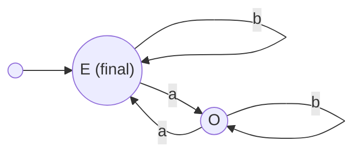

Rules:
```
E -> aO | bE | e      (E is final, so E -> e)
O -> aE | bO
```
Check `aa`: `E => aO => aaE => aa`. Good.

---

## 6. Parse Trees

### The problem
Take the balanced-parentheses grammar `S -> e | SS | (S)` and the string `()()`.

Derivation 1 (always replace leftmost `S`):
```
S => SS => (S)S => ()S => ()(S) => ()()
```
Derivation 2 (always replace rightmost `S`):
```
S => SS => S(S) => S() => (S)() => ()()
```
**Observation:** both use exactly the same rules. Only the **order** of applying them differs. We want one picture that ignores this irrelevant order. That picture is a **parse tree**.

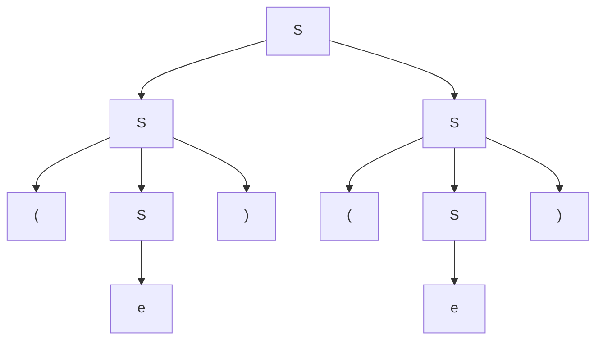

### Terms
| Term | Meaning |
|---|---|
| **Node** | Each point in the tree |
| **Root** | Topmost node |
| **Leaves** | Nodes along the bottom (no children) |
| **Yield** | Concatenate leaf labels left to right. This is the derived string. Here: `()()` |

### Formal definition (3 rules)
For a CFG $G = (V, \Sigma, R, S)$, parse trees are built like this:

**Rule 1.** For each $a \in \Sigma$, a single node labeled $a$ is a parse tree. That node is the root and a leaf. Yield $= a$.

**Rule 2.** If $A \to e$ is in $R$, then a node $A$ with one child $e$ is a parse tree. Root $= A$, sole leaf $= e$, yield $= e$.

**Rule 3.** Let $T_1, \dots, T_n$ ($n \ge 1$) be parse trees with roots labeled $A_1,\dots,A_n$ and yields $y_1,\dots,y_n$. If $A \to A_1A_2\dots A_n$ is a rule in $R$, then a **new root $A$** whose children are the roots of $T_1,\dots,T_n$ (in order) is a parse tree. Its leaves are the leaves of $T_1,\dots,T_n$, and its yield is
$$y_1 y_2 \dots y_n$$

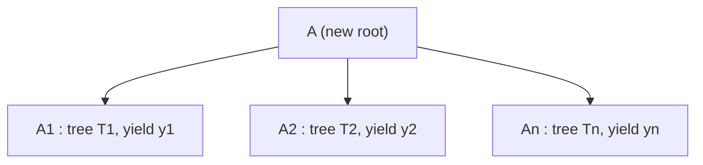

**Easy summary:** a parse tree is just "apply a rule, and hang the sub-trees of its right-hand symbols below it". Terminals and `e` are the base trees.

---

## 7. Equivalent (Similar) Derivations, Leftmost and Rightmost

**Big idea:** parse trees represent **equivalent derivations**, i.e. derivations that differ only in the order of rule application.

### 7.1 "Precedes" relation
Let $D: x_1 \Rightarrow x_2 \Rightarrow \dots \Rightarrow x_n$ and $D': x'_1 \Rightarrow \dots \Rightarrow x'_n$ be two derivations in $G$, where $x_i, x'_i \in V^*$, $x_1, x'_1 \in V - \Sigma$ and $x_n, x'_n \in \Sigma^*$.

$D$ **precedes** $D'$, written $D < D'$, if $n > 2$ and there is $k$ with $1 < k < n$ such that:

1. $x_i = x'_i$ for all $i \neq k$ (identical except at step $k$)
2. $x_{k-1} = x'_{k-1} = uAvBw$, where $u,v,w \in V^*$ and $A, B \in V - \Sigma$
3. $x_k = uyvBw$, where $A \to y \in R$ (**$D$ expands the left one, $A$, first**)
4. $x'_k = uAvzw$, where $B \to z \in R$ (**$D'$ expands the right one, $B$, first**)
5. $x_{k+1} = x'_{k+1} = uyvzw$ (both end up at the same string)

In plain words: two derivations are identical except for **two consecutive steps** where the same two non-terminals are replaced by the same two strings, but **in opposite orders**. The one that replaces the **leftmost** of the two first is said to **precede** the other.

### 7.2 Example (balanced parentheses, string `(())()`)
```
D1 = S => SS => (S)S => ((S))S => (())S    => (())(S) => (())()
D2 = S => SS => (S)S => ((S))S => ((S))(S) => (())(S) => (())()
D3 = S => SS => (S)S => ((S))S => ((S))(S) => ((S))()  => (())()
```
- $D_1 < D_2$ (they differ at step 5: $D_1$ expands the left inner `S` first, $D_2$ expands the right `S` first).
- $D_2 < D_3$ (same idea one step later).
- But $D_1$ does **not directly** precede $D_3$ (they differ in more than one swap).
- Still, $D_1$ and $D_3$ are **similar**.

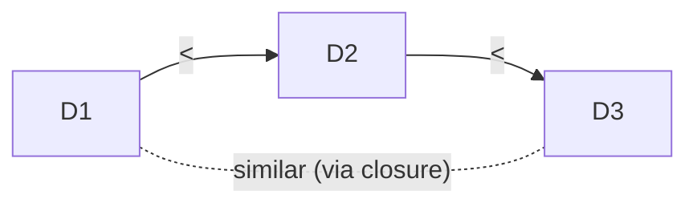

### 7.3 Similar derivations
$D$ and $D'$ are **similar** if they are related by the **reflexive transitive closure** of $<$ (a chain of such swaps, in either direction). Similar derivations produce the **same parse tree**.

### 7.4 Leftmost and rightmost derivations
| Type | How it is built | Special property |
|---|---|---|
| **Leftmost derivation** | Always replace the **leftmost** non-terminal, following the rule the parse tree suggests | Not preceded by any other derivation (it is the "first" in its similar class) |
| **Rightmost derivation** | Always replace the **rightmost** non-terminal | Does not precede any other derivation (it is the "last" in its similar class) |

In the example above, $D_1$ is the leftmost derivation.

> **Useful fact:** every parse tree has exactly one leftmost and one rightmost derivation. So "a string has two different parse trees" is the same as "it has two different leftmost derivations".

---

## 8. Ambiguity

### Example grammar
CFG for algebraic expressions with binary `+` and `*`, parentheses, and a single identifier `id`:
```
E -> id | E + E | E * E | (E)
```

String: `id + id * id`. It has **two parse trees**.

**Tree (a):** `id + (id * id)`. This is the natural meaning, because `*` has higher precedence than `+`.
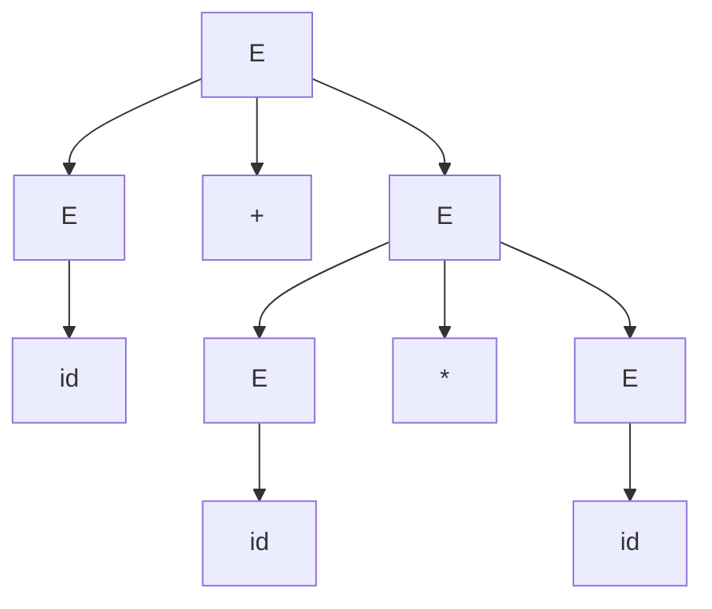

**Tree (b):** `(id + id) * id`. Wrong meaning.
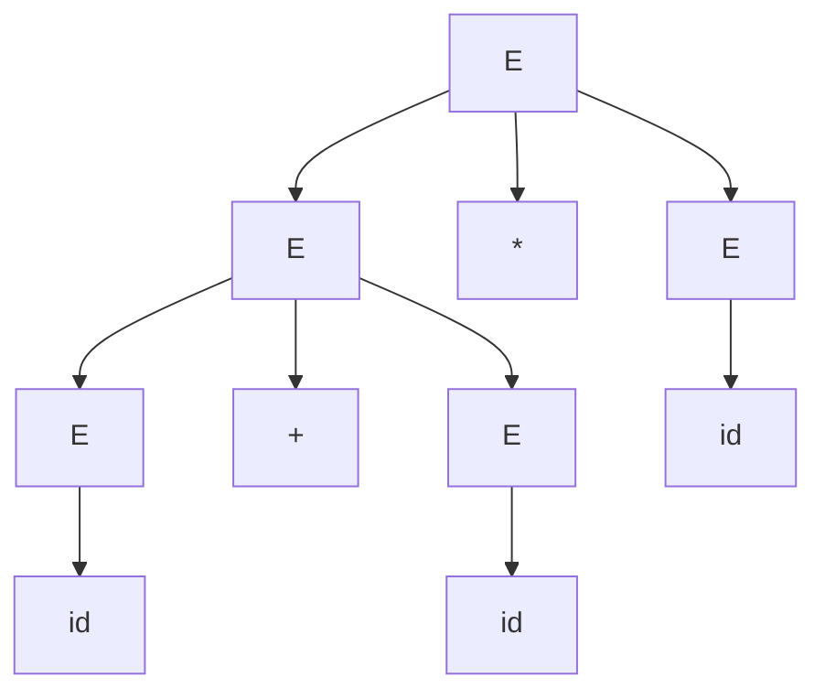

### Definition
A grammar with **at least one string having two or more distinct parse trees** is **ambiguous**.

Why it matters: the parse tree gives the **meaning** of a string. Two trees means two meanings, and a compiler cannot tolerate that.

---

## 9. Removing Ambiguity

### 9.1 Unambiguous grammar for expressions

Two problems in the ambiguous grammar:
1. **Precedence:** `*` must bind tighter than `+`.
2. **Associativity:** `id + id + id` must mean `(id + id) + id` (left to right), not `id + (id + id)`.

**Step 1 (handle `+`, left associative).** Think of an expression as "everything except the last term, plus the last term".
Replace `E -> E + E` by `E -> E + T`, where `T` is a **term**: something that cannot itself be written as a sum. An expression can also be a single term:
```
E -> E + T | T
```

**Step 2 (handle `*`).** Apply the same idea to terms. A term is "all but the last factor, times the last factor", where `F` is a **factor**: something that cannot be written as a product:
```
T -> T * F | F
```

**Step 3 (factors).** Evaluated first, so a factor is either a parenthesised **whole expression** or an identifier:
```
F -> (E) | id
```

### Final unambiguous grammar
```
E -> E + T | T
T -> T * F | F
F -> (E) | id
```

- Expression = sum of one or more terms.
- Term = product of one or more factors.
- This hierarchy forces `*` to be grouped before `+` (precedence), and both operators group left to right (left associativity).
- Parentheses are factors, so they reset everything inside.

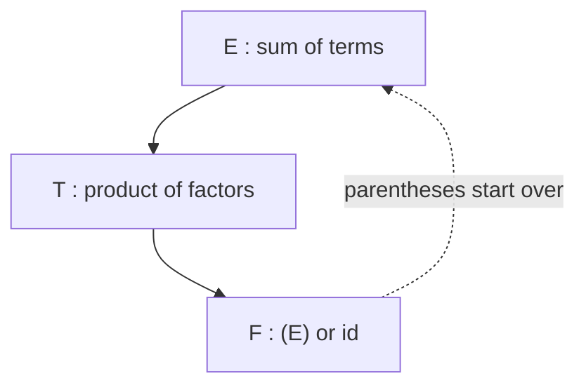

(The lecture leaves the formal proof of equivalence and unambiguity as an intuition exercise.)

### Unique derivation of `id + id * id`
```
E => E+T => E+T*F => E+T*id => E+F*id => E+id*id => T+id*id => F+id*id => id+id*id
```
(This is a rightmost derivation.) This is the **only** parse tree for this string.

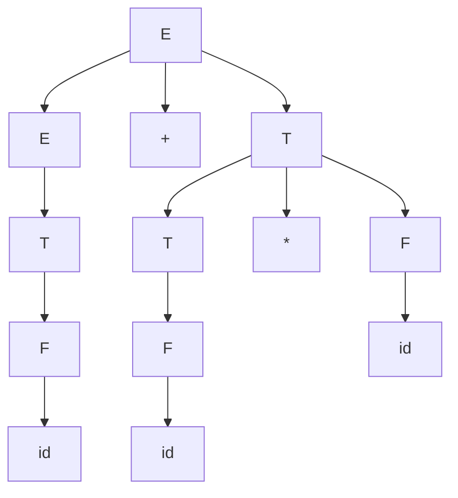
The `*` sits lower in the tree than `+`, so `id * id` is computed first.

### 9.2 Dangling else

C-style if statements (`OS` = any other statement):
```
S -> if ( E ) S
   | if ( E ) S else S
   | OS
```
Consider: `if (e1) if (e2) f(); else g();`

C says the `else` goes with the **nearest** `if` (the second one):
```
if (e1) { if (e2) f(); else g(); }
```
But the grammar also allows the other reading:
```
if (e1) { if (e2) f(); } else g();
```
Nothing in the rules prevents it, so the grammar is **ambiguous**.

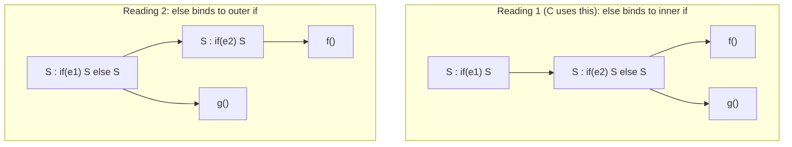

### Unambiguous version
Idea: split statements into two kinds.
- `S1`: **matched** statements. Every `if` has its own `else`.
- `S2`: statements with an **unmatched** `if`.

```
S  -> S1 | S2
S1 -> if ( E ) S1 else S1 | OS
S2 -> if ( E ) S
    | if ( E ) S1 else S2
```
Why it works: between `if (E)` and its `else` only a **matched** statement `S1` is allowed. So an `else` can never "jump over" a complete inner `if`. It always pairs with the nearest unmatched `if`.

---

## 10. Computational Problems on Ambiguity

| Problem | Question | Answer |
|---|---|---|
| **1** | Given CFG $G$, build an unambiguous CFG $G'$ with $L(G) = L(G')$. | **No algorithm** exists. |
| **2** | Given CFG $G$, decide whether $G$ is ambiguous. | **Undecidable.** |
| **3** | Does every CFG have an equivalent unambiguous grammar (even if we cannot construct it by algorithm)? | **No.** Some CFLs are inherently ambiguous. |

### Inherently ambiguous language
A CFL $L$ is **inherently ambiguous** if **every** grammar for $L$ is ambiguous. (Ambiguity is a property of the language itself, not of one badly written grammar.)

- Fortunately, **programming languages are never inherently ambiguous**.
- Example of a provably inherently ambiguous language:
$$L = \{a^n b^n c^m d^m \mid n,m \ge 1\} \;\cup\; \{a^n b^m c^m d^n \mid n,m \ge 1\}$$

A grammar for it:
```
S -> AB | C
A -> aAb | ab
B -> cBd | cd
C -> aCd | aDd
D -> bDc | bc
```
- `AB` generates $a^nb^n c^md^m$ (first part).
- `C` generates $a^n b^m c^m d^n$ (second part).
- **Why ambiguous:** strings with $n = m$, like $a^nb^nc^nd^n$, belong to **both** parts, so they have two parse trees. The claim (proved in the course texts) is that no other grammar can avoid this overlap.

---

## 11. Closure Properties of CFLs

**Theorem.** The class of CFLs is closed under **union, concatenation, and Kleene star**.

Let $L_1, L_2$ be CFLs with grammars $G_1 = (V_1, \Sigma_1, R_1, S_1)$ and $G_2 = (V_2, \Sigma_2, R_2, S_2)$. Assume their non-terminals are renamed so they do not clash. Let $S$ be a **new** start symbol.

| Operation | Grammar | New rules |
|---|---|---|
| **Union** $L_1 \cup L_2$ | $G = (V_1 \cup V_2 \cup \{S\},\ \Sigma_1 \cup \Sigma_2,\ R,\ S)$ | $R = R_1 \cup R_2 \cup \{S \to S_1,\ S \to S_2\}$ |
| **Concatenation** $L_1L_2$ | $G = (V_1 \cup V_2 \cup \{S\},\ \Sigma_1 \cup \Sigma_2,\ R,\ S)$ | $R = R_1 \cup R_2 \cup \{S \to S_1S_2\}$ |
| **Kleene star** $L_1^*$ | $G = (V_1 \cup \{S\},\ \Sigma_1,\ R,\ S)$ | $R = R_1 \cup \{S \to e,\ S \to SS_1\}$ |

and one can show $L(G) = L(G_1) \cup L(G_2)$, $L(G_1)L(G_2)$, $L(G_1)^*$ respectively.

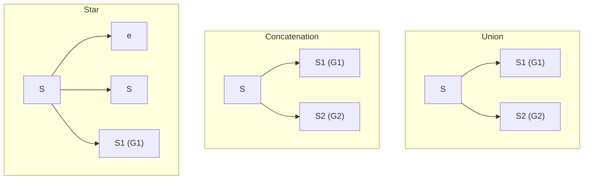
- **Union:** choose which grammar to use.
- **Concatenation:** generate a string from $G_1$ then one from $G_2$, side by side.
- **Star:** `S => S S1 => S S1 S1 => ... => e S1 S1 ... S1`, i.e. zero or more strings from $G_1$ in a row.

Note: CFLs are **not** closed under complement in general (contrast with regular languages).

---

## 12. Practice Problems with Solutions

(Slide shows the symbols with some characters lost; read problem 4 as $m \neq 2n$ and problem 5 as $n \neq 2m$.)

### Problem 1: $L = \{a^m b^n \mid m \ge n\}$
Matched pairs `a...b` nested, plus extra a's.
```
S -> aSb | A
A -> aA | e
```
Gives $a^n \cdot a^k \cdot b^n$ with $k \ge 0$, so $m = n + k \ge n$.

### Problem 2: $L = \{a^{2n} b^n \mid n \ge 0\}$
Every `b` needs two `a`s.
```
S -> aaSb | e
```

### Problem 3: $L = \{a^m b^n \mid m \ge 2n\}$
Pairs of two a's per b, plus any number of extra a's.
```
S -> aaSb | A
A -> aA | e
```

### Problem 4: $L = \{a^m b^n \mid m \neq 2n\}$
Split into $m > 2n$ **or** $m < 2n$.

**Case $m > 2n$:** same as problem 3 but force at least one extra `a`.
```
S1 -> aaS1b | A
A  -> aA | a
```
**Case $m < 2n$:** match `aa` with `b` as long as possible. What remains is either `b^+` or `a b^+` (at least one extra `b` is left because $m < 2n$).
```
S2 -> aaS2b | D | aD
D  -> bD | b
```
**Combine:**
```
S -> S1 | S2
```
Check $S_2$: $a^{2k}(a \text{ or } e)\, b^s b^k$ with $s \ge 1$ gives $m \in \{2k, 2k+1\}$ and $n = k + s$, so $m < 2n$. Good.

### Problem 5: $L = \{a^m b^n \mid n \neq 2m\}$
Now each `a` is paired with **two** b's. Split into $n > 2m$ **or** $n < 2m$.

**Case $n > 2m$:** nest `a ... bb`, then at least one extra `b` in the middle.
```
S1 -> aS1bb | B
B  -> bB | b
```
**Case $n < 2m$:** nest `a ... bb` as long as possible. What remains is `a^+` or `a^+ b` (at least one `a` is left over because $n < 2m$).
```
S2 -> aS2bb | A | Ab
A  -> aA | a
```
**Combine:**
```
S -> S1 | S2
```
Check $S_2$: $a^k\, a^j (b \text{ or } e)\, b^{2k}$ with $j \ge 1$: $m = k+j$, $n \in \{2k, 2k+1\}$, so $n < 2(k+j) = 2m$. Good.

### Problem 6: $n_a(w) = n_b(w)$ (equal number of a's and b's), and derive `aababb`
```
S -> aSbS | bSaS | e
```
**Intuition:** look at the first symbol. If it is `a`, find the point where the count of b's catches up; the part between is balanced (`S`), the matching `b` closes it, and the rest is balanced (`S`). Same for starting with `b`.

Why this splits: `aababb` = `a` + `abab` + `b` + `e`, where `abab` is balanced and the tail is empty.

**Leftmost derivation of `aababb`:**
```
S => aSbS             (S -> aSbS)
  => aaSbSbS          (first S -> aSbS)
  => aabSbS           (S -> e)
  => aabaSbSbS        (S -> aSbS)
  => aababSbS         (S -> e)
  => aababbS          (S -> e)
  => aababb           (S -> e)
```

### Problem 7: $n_a(w) \neq n_b(w)$
Split into **more a's** or **more b's**.

Let `T` generate all balanced strings (from problem 6):
```
T -> aTbT | bTaT | e
```
**More a's** (call it `U`): any string with excess $d \ge 1$ of a's can be cut at the **first** point where the a-excess becomes 1. The part before is balanced, then comes that `a`, and the remainder has excess $d-1$ (balanced if $d=1$, otherwise again of type `U`).
```
U -> TaT | TaU
```
**More b's** (call it `V`), symmetric:
```
V -> TbT | TbV
```
**Final:**
```
S -> U | V
T -> aTbT | bTaT | e
U -> TaT | TaU
V -> TbT | TbV
```

### Problem 8: $L = \{a^m b^n c^p d^q \mid m + n = p + q\}$
**Idea:** the total number of a's and b's equals the total of c's and d's. Think of the string as nested matching: outer `a`'s match with outer `d`'s, inner `b`'s match with inner `c`'s. Compare $m$ and $q$:

- **Case $m \ge q$:** the $q$ outermost a's pair with the d's. The $m - q$ leftover a's must pair with c's (these c's are the outer c's), and the b's pair with the inner c's. Shape: $a^q\; a^i\; b^n c^n\; c^i\; d^q$.
- **Case $m < q$:** the $m$ outermost a's pair with $m$ of the d's. The $q-m$ leftover d's must pair with b's (the outer b's), and the remaining b's pair with c's. Shape: $a^m\; b^j\; b^p c^p\; d^j\; d^m$.

Grammar:
```
S -> aSd | A | C       (pair a with d, then pick a case)
A -> aAc | B           (leftover a's pair with c's)
C -> bCd | B           (leftover b's pair with d's)
B -> bBc | e           (b's pair with c's in the middle)
```
Check:
- Via `A`: $a^{k+i} b^n c^{n+i} d^k$, so $m+n = k+i+n$ and $p+q = n+i+k$. Equal.
- Via `C`: $a^k b^{j+p} c^p d^{j+k}$, so $m+n = k+j+p$ and $p+q = p+j+k$. Equal.

---

## 13. Pushdown Automata and Why a Stack

A finite automaton has only a **fixed** amount of memory (its states). Some languages need memory that grows with the input.

- $L = \{ww^R : w \in \{a,b\}^*\}$ ($w^R$ = $w$ written backwards). To check the second half, the machine must **remember the whole first half** and compare it in reverse order.
- $L = \{a^nb^n : n \ge 0\}$. The machine must **remember how many a's** it saw, to match them with the b's that follow.

In both cases the memory only needs to work like a **stack**: last in, first out. The last symbol of $w$ is exactly the first one needed when reading $w^R$.

> **Pushdown automaton (PDA) = finite automaton + a stack.**
> The stack has unlimited size. Later sections prove that PDAs accept **exactly the CFLs**.

| Stack operation | Meaning |
|---|---|
| **Push** | Put a symbol on top of the stack |
| **Pop** | Remove the top symbol |
| **Read** | Look at the top symbol (only the top is visible, never deeper) |

---

## 14. Informal Picture of a PDA

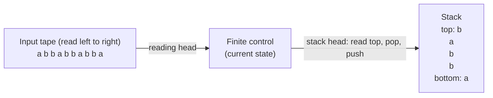

A PDA has five parts:

1. **Tape.** Divided into cells. Each cell holds one symbol from the finite input alphabet $\Sigma$.
2. **Tape head.** Moves **one cell to the right per move** and reads the cell it is on. It never moves left and never writes.
3. **Stack.** Holds symbols from a finite **stack alphabet** $\Gamma$ (this can be different from $\Sigma$).
4. **Stack head.** Reads the **top** symbol, can **pop** it, and can **push** symbols of $\Gamma$.
5. **Finite state control.** The machine is always in one of finitely many states.

---

## 15. Formal Definition of a PDA

A PDA is a 6-tuple
$$M = (K, \Sigma, \Gamma, \Delta, s, F)$$

| Symbol | Meaning |
|---|---|
| $K$ | Finite set of **states** |
| $\Sigma$ | Finite **input alphabet** |
| $\Gamma$ | Finite **stack alphabet** |
| $s \in K$ | **Start state** |
| $F \subseteq K$ | Set of **final (accepting) states** |
| $\Delta$ | The **transition relation**, a finite subset of $(K \times (\Sigma \cup \{e\}) \times \Gamma^*) \times (K \times \Gamma^*)$ |

### Reading a transition
$$((p, a, \beta),\ (q, \gamma)) \in \Delta$$

In words: the machine is in state $p$, the **next input symbol is $a$**, and the **top of the stack is the string $\beta$**. It then **replaces $\beta$ by $\gamma$** on top of the stack and **moves to state $q$**.

- **$a = e$:** the input is **not consulted** (no input symbol is read).
- **$\beta = e$:** the stack is **not looked at** (nothing is popped, and the move works whatever is on the stack).
- **$\gamma = e$:** nothing is pushed.
- **Stack strings are written top first.** In $\gamma = xyz$, the symbol $x$ ends up on top.

### Special cases (most transitions are one of these)

| Operation | Typical transition | Effect |
|---|---|---|
| **Push** $a$ | $((p, u, e), (q, a))$ | Read $u$, push $a$ |
| **Pop** $a$ | $((p, u, a), (q, e))$ | Read $u$, top must be $a$, remove it |
| **Replace** top $a$ by $b$ | $((p, u, a), (q, b))$ | Pop $a$, push $b$ |
| **Ignore stack** | $((p, u, e), (q, e))$ | Only changes state (and consumes $u$) |

Here $u \in \Sigma \cup \{e\}$ is the input part.

### Key points
- The PDA defined here is **nondeterministic**: in a given situation several transitions may apply, and the machine may pick any one.
- Nondeterminism is **essential** for some languages. For $ww^R$ the machine has to **guess** where the middle is (see 17.2). No deterministic PDA can accept $ww^R$ (standard fact).

---

## 16. Configurations, Moves and Acceptance

### Configuration
A **configuration** describes the machine at one instant. It is an element of
$$K \times \Sigma^* \times \Gamma^*$$

| Component | Meaning |
|---|---|
| 1st | Current **state** |
| 2nd | **Unread** part of the input |
| 3rd | **Stack contents, read top-down** |

Example: $(q, w, abc)$ means state $q$, unread input $w$, and the stack has $a$ on **top** and $c$ at the **bottom**.

### One move (yields in one step)
$$(p, x, \alpha) \vdash_M (q, y, \beta)$$
holds if there is a transition $((p, a, \gamma), (q, \delta)) \in \Delta$ and some $\eta \in \Gamma^*$ such that
$$x = ay, \qquad \alpha = \gamma\eta, \qquad \beta = \delta\eta$$

In words: strip $a$ from the front of the input, strip $\gamma$ from the top of the stack, put $\delta$ in its place, and change state. The rest of the stack ($\eta$) is untouched.

$\vdash_M^*$ is the **reflexive transitive closure** of $\vdash_M$ (zero or more moves).

### Acceptance
$$w \in L(M) \iff (s, w, e) \vdash_M^* (f, e, e) \text{ for some } f \in F$$

Starting in $(s, w, e)$ (start state, all input unread, **empty stack**), the machine must reach a configuration where **all three** hold:
1. the state is **final**,
2. the **whole input has been read**,
3. the **stack is empty**.

$L(M)$ is the set of all accepted strings.

**Nondeterminism:** $w$ is accepted if **at least one** sequence of choices reaches such a configuration. A branch with no applicable transition simply **dies** (gets stuck). $w$ is rejected only if **every** branch fails.

> **Exam warning:** many textbooks accept by final state alone or by empty stack alone. In this course you need **final state AND input finished AND stack empty**.

---

## 17. PDA Examples

### 17.1 $L = \{wcw^R : w \in \{a,b\}^*\}$ (with a marker)

The marker $c$ tells the machine exactly where $w$ ends.

**Idea**
1. In state $s$: **push** every symbol of $w$ (state does not change).
2. On reading $c$: switch to state $f$, push nothing.
3. In state $f$: each input symbol must **equal the top of the stack**. Pop and continue.

Because the stack reverses order, the symbols come out as $w^R$.

**Formal PDA:** $K = \{s, f\}$, $\Sigma = \{a,b,c\}$, $\Gamma = \{a,b\}$, $F = \{f\}$.

```
T1  ((s, a, e), (s, a))     push a
T2  ((s, b, e), (s, b))     push b
T3  ((s, c, e), (f, e))     see marker, switch state
T4  ((f, a, a), (f, e))     match a, pop
T5  ((f, b, b), (f, e))     match b, pop
```

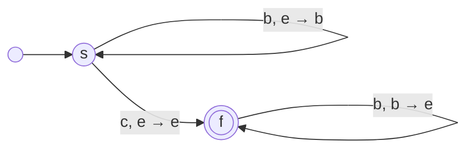
Edge label format: **read, pop → push**.

**Trace on `abbcbba`** (stack written top first):

| Step | State | Unread input | Stack | Transition used |
|---|---|---|---|---|
| 0 | s | abbcbba | e | start |
| 1 | s | bbcbba | a | T1 |
| 2 | s | bcbba | ba | T2 |
| 3 | s | cbba | bba | T2 |
| 4 | f | bba | bba | T3 |
| 5 | f | ba | ba | T5 |
| 6 | f | a | a | T5 |
| 7 | f | e | e | T4 |

State $f$ (final), input empty, stack empty. **Accepted.**

### 17.2 $L = \{ww^R : w \in \{a,b\}^*\}$ (no marker)

Same language idea, but there is **no $c$**. The machine does not know where the middle is, so it **guesses**: at any moment it may switch from "pushing" to "matching" using an $e$-transition.

```
K = {s, f}, Σ = {a, b}, Γ = {a, b}, F = {f}

T1  ((s, a, e), (s, a))
T2  ((s, b, e), (s, b))
T3  ((s, e, e), (f, e))     GUESS: the middle is here (reads nothing)
T4  ((f, a, a), (f, e))
T5  ((f, b, b), (f, e))
```

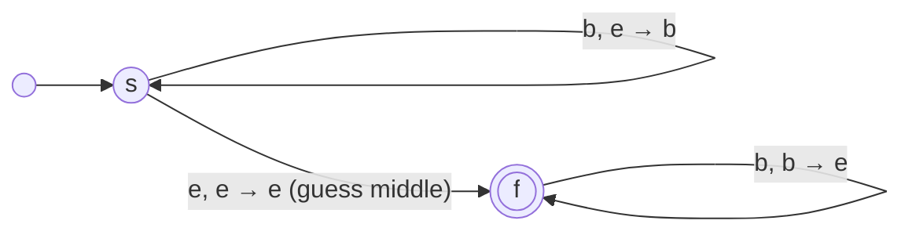

**Trace on `abba`** ($w = ab$): push a, push b, guess middle, pop b, pop a.

| State | Unread | Stack | Transition |
|---|---|---|---|
| s | abba | e | start |
| s | bba | a | T1 |
| s | ba | ba | T2 |
| f | ba | ba | T3 |
| f | a | a | T5 |
| f | e | e | T4 |

**Why it works:** the machine accepts only if **some** guess of the middle makes everything match. A wrong guess leaves a mismatch or a non-empty stack, so that branch dies, which is fine because only one successful branch is needed.

### 17.3 $L = \{w : w = w^R\}$ (all palindromes, even and odd length)
This is an exercise in the slides. The solution is in Section 24 (P4).

### 17.4 $L = \{w \in \{a,b\}^* : \text{number of a's} = \text{number of b's}\}$

Here the **middle does not matter**, so no guessing is needed. What matters is deciding **when to push and when to pop**.

**Idea:** the stack stores the **current excess**. It holds only a's or only b's.
- Input symbol **same** as the top symbol (or stack is empty): **push** (excess grows).
- Input symbol **different** from the top symbol: **pop** (the two cancel).

**Problem:** a transition cannot test "is the stack empty?". **Fix:** put a **bottom marker** $c$ on the stack first. "Top is $c$" means "no excess".

**Formal PDA:** $K = \{s, q, f\}$, $\Sigma = \{a,b\}$, $\Gamma = \{a,b,c\}$, $F = \{f\}$.

| # | Transition | Purpose |
|---|---|---|
| T1 | $((s,e,e),(q,c))$ | Push bottom marker, go to $q$ |
| T2 | $((q,a,c),(q,ac))$ | Read a, no excess: push a |
| T3 | $((q,a,a),(q,aa))$ | Read a, excess of a's: push a |
| T4 | $((q,a,b),(q,e))$ | Read a, excess of b's: cancel |
| T5 | $((q,b,c),(q,bc))$ | Read b, no excess: push b |
| T6 | $((q,b,b),(q,bb))$ | Read b, excess of b's: push b |
| T7 | $((q,b,a),(q,e))$ | Read b, excess of a's: cancel |
| T8 | $((q,e,c),(f,e))$ | Marker on top: remove it, go to final $f$ |

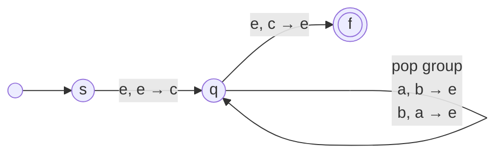

**Trace on `abbbabaa`:**

| State | Unread | Stack | Transition | Comment |
|---|---|---|---|---|
| s | abbbabaa | e | start | |
| q | abbbabaa | c | T1 | Bottom marker |
| q | bbbabaa | ac | T2 | Start stack of a's |
| q | bbabaa | c | T7 | b cancels one a |
| q | babaa | bc | T5 | Start stack of b's |
| q | abaa | bbc | T6 | |
| q | baa | bc | T4 | a cancels one b |
| q | aa | bbc | T6 | |
| q | a | bc | T4 | |
| q | e | c | T4 | |
| f | e | e | T8 | **Accepts** |

**Why T8 is safe:** $T8$ can fire any time $c$ is on top, but it empties the stack. If input is still unread the machine has no way to finish (no transition from $f$), so that branch dies. If the string has extra a's or b's, the top is not $c$ at the end, so T8 never applies and the string is rejected.

### 17.5 How to design a PDA (checklist)
1. Decide **what the stack should remember** (the first half, a count, an excess, a pending grammar symbol).
2. Decide **when to push** and **when to pop**.
3. If you need to detect "stack empty", **push a bottom marker** first.
4. If you must detect a **point you cannot see** (middle of $ww^R$), use an **$e$-transition as a guess**.
5. Finish by making sure the final state is reached with **input read and stack empty**.

---

## 18. Every Regular Language Is Accepted by a PDA

**Result:** every FSA can be viewed as a PDA.

**Idea:** a PDA that **never touches its stack** and otherwise copies the FSA's transitions.

**Formal.** Let $M = (K, \Sigma, \Delta, s, F)$ be an NFA, so $\Delta \subseteq K \times (\Sigma \cup \{e\}) \times K$. Build
$$M' = (K, \Sigma, \Gamma, \Delta', s, F), \qquad \Delta' = \{\, ((p, a, e), (q, e)) : (p, a, q) \in \Delta \,\}$$
No stack symbols are ever used, so the stack alphabet is irrelevant (it can be empty).

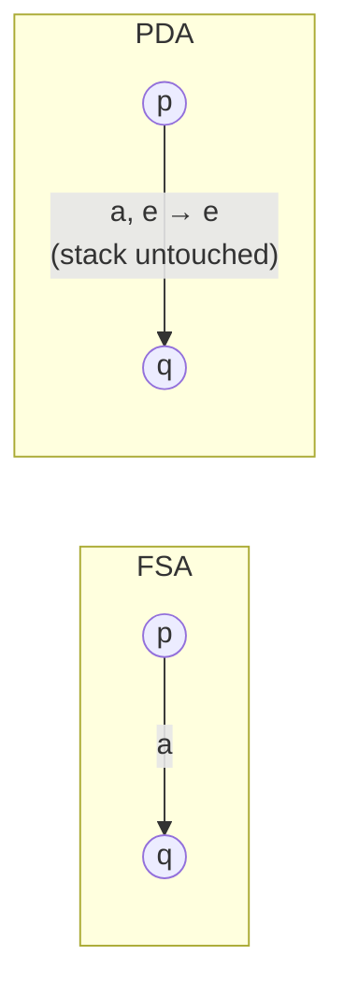

Since the stack is always empty, "final state and input finished" already gives acceptance. So $L(M) = L(M')$.

**Consequence:** Regular $\subseteq$ PDA languages. Together with Section 19 this gives a second proof of Regular $\subseteq$ CFL (the first was in Section 5). The inclusion is **strict**: $a^nb^n$ is a CFL but not regular.

---

## 19. PDAs and CFLs Are Equivalent

> **Theorem.** The class of languages accepted by PDAs is **exactly** the class of context free languages.

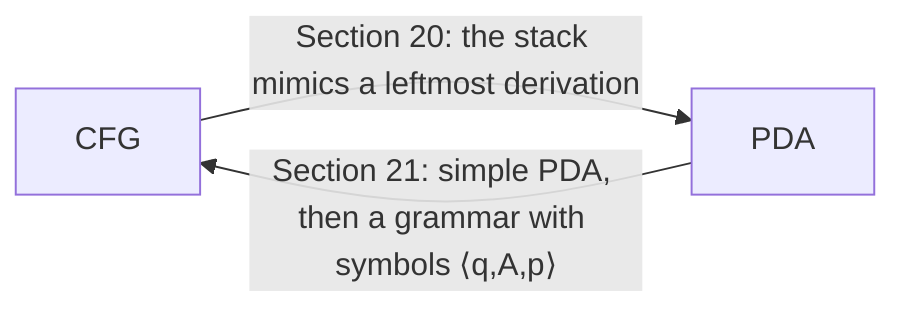

Two directions to prove:
1. **Every CFL is accepted by some PDA** (Section 20).
2. **Every language accepted by a PDA is a CFL** (Section 21).

---

## 20. From CFG to PDA

Let $G = (V, \Sigma, R, S)$ be a CFG. We build a PDA $M$ with $L(M) = L(G)$.

### Idea
The **stack mimics a leftmost derivation** of the input.
- The stack holds the part of the current sentential form that is **still to be matched**, with the **leftmost** symbol on top.
- If the top is a **non-terminal** $A$, replace it by the right side of one of its rules (this is a derivation step).
- If the top is a **terminal**, it must **equal the next input symbol**. Pop both (this is matching).

### Construction
$$M = (\{p, q\},\ \Sigma,\ V,\ \Delta,\ p,\ \{q\})$$
The stack alphabet is **all of $V$** (terminals and non-terminals). $\Delta$ has three kinds of transitions:

| Type | Transition | Meaning |
|---|---|---|
| **1** | $((p, e, e), (q, S))$ | Push the start symbol $S$ on the empty stack |
| **2** | $((q, e, A), (q, x))$ for each rule $A \to x$ in $R$ | Replace non-terminal $A$ on top by $x$ (no input read) |
| **3** | $((q, a, a), (q, e))$ for each $a \in \Sigma$ | Top terminal matches the input: pop it, advance |

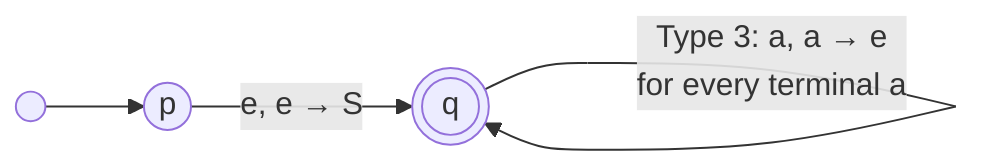

**Nondeterminism:** if $A$ has several rules, the PDA **guesses** which to use. Wrong guesses eventually put a terminal on top that does not match the input, and that branch dies.

### Example
$G$: $V = \{S, a, b, c\}$, $\Sigma = \{a,b,c\}$, rules $S \to aSa \mid bSb \mid c$ (this generates $wcw^R$).

```
T1  ((p, e, e), (q, S))
T2  ((q, e, S), (q, aSa))
T3  ((q, e, S), (q, bSb))
T4  ((q, e, S), (q, c))
T5  ((q, a, a), (q, e))
T6  ((q, b, b), (q, e))
T7  ((q, c, c), (q, e))
```

**Trace on `abbcbba`:**

| State | Unread input | Stack (top first) | Transition used |
|---|---|---|---|
| p | abbcbba | e | start |
| q | abbcbba | S | T1 |
| q | abbcbba | aSa | T2 |
| q | bbcbba | Sa | T5 |
| q | bbcbba | bSba | T3 |
| q | bcbba | Sba | T6 |
| q | bcbba | bSbba | T3 |
| q | cbba | Sbba | T6 |
| q | cbba | cbba | T4 |
| q | bba | bba | T7 |
| q | ba | ba | T6 |
| q | a | a | T6 |
| q | e | e | T5 |

The matching leftmost derivation is
```
S => aSa => abSba => abbSbba => abbcbba
```
Compare: whenever the stack top is `S`, the PDA picks the same rule as the derivation. Whenever the top is a terminal, it pops it against the input.

### Proof that $L(G) \subseteq L(M)$ (as in the lecture)

**Claim.** For $w \in \Sigma^*$ and $\alpha \in (V - \Sigma)V^* \cup \{e\}$ (so $\alpha$ is empty or **starts with a non-terminal**):
$$S \Rightarrow^*_L w\alpha \iff (q, w, S) \vdash^*_M (q, e, \alpha)$$
($\Rightarrow_L$ = leftmost derivation step.)

Taking $\alpha = e$: $S \Rightarrow^*_L w \iff (q, w, S) \vdash^*_M (q, e, e)$. Adding the Type 1 move from $p$ gives $w \in L(G) \iff w \in L(M)$.

**($\Rightarrow$ direction) by induction on the length of the leftmost derivation.**

- **Base case (length 0).** Then $w = e$ and $\alpha = S$. Zero moves give $(q, e, S) \vdash^* (q, e, S)$.
- **Induction hypothesis.** The claim holds for leftmost derivations of length $\le n$.
- **Induction step.** Let $S = u_0 \Rightarrow_L u_1 \Rightarrow_L \dots \Rightarrow_L u_n \Rightarrow_L u_{n+1} = w\alpha$ be a leftmost derivation of length $n+1$.
  1. Let $A$ be the **leftmost non-terminal** of $u_n$. Then $u_n = xA\chi$ and $u_{n+1} = x\psi\chi$, where $x \in \Sigma^*$, $\chi, \psi \in V^*$ and $A \to \psi$ is a rule.
  2. The first $n$ steps are a leftmost derivation of $xA\chi$. By the induction hypothesis: $(q, x, S) \vdash^* (q, e, A\chi)$. **(1)**
  3. By a Type 2 move: $(q, e, A\chi) \vdash (q, e, \psi\chi)$. **(2)**
  4. Since $w\alpha = x\psi\chi$, there is $y \in \Sigma^*$ with $w = xy$ and $y\alpha = \psi\chi$.
  5. From (1) and (2): $(q, w, S) \vdash^* (q, y, \psi\chi) = (q, y, y\alpha)$. **(3)**
  6. The terminals $y$ on top are matched with the input $y$ by $|y|$ Type 3 moves: $(q, y, y\alpha) \vdash^* (q, e, \alpha)$. **(4)**
  7. Combining (3) and (4): $(q, w, S) \vdash^* (q, e, \alpha)$. $\blacksquare$

The lecture proves this direction only. The converse (every accepting computation of $M$ corresponds to a leftmost derivation) is proved the same way, by induction on the number of Type 2 moves.

---

## 21. From PDA to CFG

Now the harder direction: given any PDA, build a CFG for its language.

**Roadmap:**
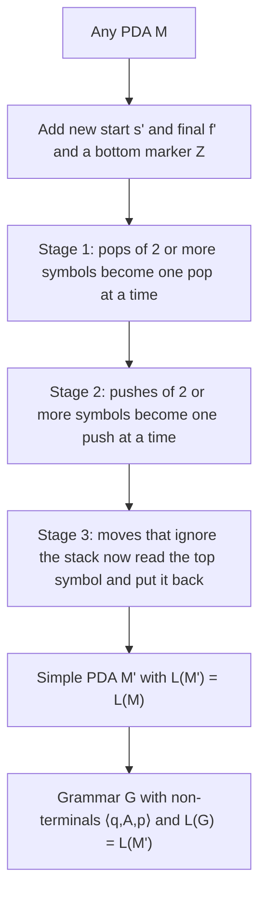

### 21.1 Simple PDA

A PDA is **simple** if for every transition $((q, a, \beta), (p, \gamma))$ with $q$ **not the start state**:
$$\beta \in \Gamma \quad \text{and} \quad \lvert\gamma\rvert \le 2$$

In words: every move **looks at exactly the top stack symbol** and replaces it by **nothing, one symbol, or two symbols**. So every move is one of: a **pop**, a **replace**, or a **replace with two**.

**Claim.** If a language is accepted by a PDA, it is accepted by a simple PDA.

### 21.2 Making a PDA simple

Let $M = (K, \Sigma, \Gamma, \Delta, s, F)$ be any PDA. Build
$$M' = (K', \Sigma, \Gamma \cup \{Z\}, \Delta', s', \{f'\})$$
where $s'$ and $f'$ are **new** states (not in $K$) and $Z$ is a **new stack symbol** (not in $\Gamma$), used as a **bottom marker**.

**Start and end of every computation.** Add to $\Delta'$:
$$((s', e, e), (s, Z)) \qquad\text{and}\qquad ((f, e, Z), (f', e)) \text{ for each } f \in F$$
- First move: put $Z$ at the bottom of the stack. It stays there for the whole computation.
- Last move: remove $Z$ and enter the single new final state $f'$.

(Moves out of the start state $s'$ are exempt from the simplicity condition.)

Then fix every transition that violates simplicity, in three stages.

#### Stage 1: remove transitions with $\lvert\beta\rvert \ge 2$ (pop one at a time)
Take $((q, a, \beta), (p, \gamma))$ with $\beta = B_1B_2\dots B_n$, $n > 1$. Replace it by moves that pop $B_1, B_2, \dots$ **sequentially**, using new states:

```
((q, e, B1), (q_B1, e))
((q_B1, e, B2), (q_B1B2, e))
   ...
((q_B1...Bn-2, e, Bn-1), (q_B1...Bn-1, e))
((q_B1...Bn-1, a, Bn), (p, γ))
```
$q_{B_1\dots B_i}$ is a new state meaning "we were in $q$ and $B_1\dots B_i$ have been popped".

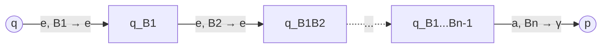
The input $a$ is read in the last step.

#### Stage 2: remove transitions that push more than one symbol
Take $((q, a, \beta), (p, \gamma))$ with $\gamma = C_1C_2\dots C_m$, $m \ge 2$. Push **sequentially**, **last symbol first**, so that $C_1$ ends on top:

```
((q, a, β), (r1, Cm))
((r1, e, e), (r2, Cm-1))
   ...
((r_m-2, e, e), (r_m-1, C2))
((r_m-1, e, e), (p, C1))
```
where $r_1, \dots, r_{m-1}$ are new states.

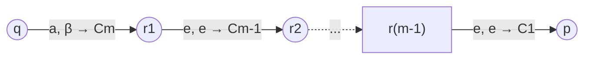
After this stage every move pushes **at most one** symbol. (Strictly only $m \ge 3$ must be fixed for simplicity, but making every push single is what keeps Stage 3 within the limit $\lvert\gamma\rvert \le 2$.)

#### Stage 3: remove transitions with $\beta = e$
Take any $((q, a, e), (p, \gamma))$ with $q \ne s'$. These ignore the stack. Replace them by
$$((q, a, A), (p, \gamma A)) \quad \text{for every } A \in \Gamma \cup \{Z\}$$
Read the top symbol $A$, do what the old move did on top, and **put $A$ back**. This is always possible because $Z$ (at least) is on the stack for the whole main computation, so there is always a top symbol to read. Since $\lvert\gamma\rvert \le 1$ after Stage 2, the new push $\gamma A$ has at most 2 symbols.

#### Quick examples of the stages
| Original | After the stage |
|---|---|
| $((q,a,AB),(p,e))$ (Stage 1) | $((q,e,A),(q_A,e))$, $((q_A,a,B),(p,e))$ |
| $((q,a,A),(p,CD))$ (Stage 2) | $((q,a,A),(r_1,D))$, $((r_1,e,e),(p,C))$ |
| $((r_1,e,e),(p,C))$ (Stage 3) | $((r_1,e,X),(p,CX))$ for every $X \in \Gamma \cup \{Z\}$ |

The lecture leaves the proof that $L(M) = L(M')$ as an exercise. It is clear from the construction: each new group of moves does exactly what the old move did, in smaller steps.

### 21.3 The grammar for a simple PDA

Let $M' = (K', \Sigma, \Gamma \cup \{Z\}, \Delta', s', \{f'\})$ be the simple PDA. Build $G = (V, \Sigma, R, S)$ where $V$ contains:
- a start symbol $S$,
- all symbols of $\Sigma$,
- a **new non-terminal $\langle q, A, p\rangle$** for every $q, p \in K'$ and every $A \in \Gamma \cup \{e, Z\}$.

#### What $\langle q, A, p\rangle$ means
> $\langle q, A, p\rangle$ generates **every input string that $M'$ can read while going from state $q$ (with $A$ on top of the stack) to state $p$, at the moment $A$ is removed from the stack.**

Whatever is **below** $A$ is never touched. For $A = e$ it means "go from $q$ to $p$ with the stack unchanged".

```mermaid
graph LR
    Q["state q<br/>A on top of stack"] -- "input x is read, A is removed" --> P["state p<br/>A gone"]
```

#### The four types of rules

| Type | For | Rule | Meaning |
|---|---|---|---|
| **1** | once | $S \to \langle s, Z, f'\rangle$ | Whole computation: start with just $Z$ on the stack in $s$, finish by removing $Z$ in $f'$ |
| **2** | each $((q,a,B),(r,C))$ with $a \in \Sigma \cup \{e\}$, $B, C \in \Gamma \cup \{e\}$, and each $p \in K'$ | $\langle q, B, p\rangle \to a\,\langle r, C, p\rangle$ | $B$ is replaced by $C$ (or just popped if $C = e$). To remove $B$ ending in $p$: read $a$, then remove $C$ from $r$ ending in $p$ |
| **3** | each $((q,a,B),(r,C_1C_2))$ with $B \in \Gamma \cup \{e\}$, $C_1, C_2 \in \Gamma$, and each $p, p' \in K'$ | $\langle q, B, p\rangle \to a\,\langle r, C_1, p'\rangle\,\langle p', C_2, p\rangle$ | $B$ is replaced by $C_1$ sitting on $C_2$. First remove $C_1$ (ending in some state $p'$), then remove $C_2$ (ending in $p$) |
| **4** | each $q \in K'$ | $\langle q, e, q\rangle \to e$ | Staying in a state without changing the stack needs no input |

(In Type 1, $s$ is the start state of the original $M$ and $f'$ the new final state. Starting from $\langle s', e, f'\rangle$ gives the same language, because the first move $((s', e, e), (s, Z))$ is forced.)

```mermaid
graph LR
    q["q, B on top"] -- "read a, replace B by C1 C2" --> r["r, C1 on top of C2"]
    r -- "⟨r,C1,p'⟩ removes C1" --> pp["p', C2 on top"]
    pp -- "⟨p',C2,p⟩ removes C2" --> p["p, B fully dealt with"]
```

**Reading the types in practice**
- **Pop move** $((q,a,B),(r,e))$: Type 2 gives $\langle q,B,p\rangle \to a\langle r,e,p\rangle$. Nothing is left to remove, so only $p = r$ works (via Type 4, $\langle r,e,r\rangle \to e$). Effectively $\langle q, B, r\rangle \Rightarrow^* a$.
- **Replace move** $((q,a,B),(r,C))$: Type 2 with $C \in \Gamma$. "Removing $B$" becomes "read $a$, then remove $C$".
- **Replace with two** $((q,a,B),(r,C_1C_2))$: Type 3. This is the only place where a rule has two non-terminals on the right. It models "remove $C_1$, then $C_2$", where the middle state $p'$ is **guessed** by trying all of $K'$.

#### The key claim
For all $q, p \in K'$, $A \in \Gamma \cup \{e\}$ and $x \in \Sigma^*$:
$$\langle q, A, p\rangle \Rightarrow^*_G x \iff (q, x, A) \vdash^*_{M'} (p, e, e)$$

The configuration $(q, x, A)$ has stack **exactly $A$**: this is the "$A$ on top, nothing relevant below" situation.

**Finishing the proof.** Take $q = s$, $A = Z$, $p = f'$:
$$S \Rightarrow \langle s, Z, f'\rangle \Rightarrow^* x \iff (s, x, Z) \vdash^*_{M'} (f', e, e) \iff x \in L(M') = L(M)$$
So $L(G) = L(M)$ and the language of any PDA is a CFL. $\blacksquare$

The lecture states the claim without a full proof. The idea of each direction:
- **Grammar to PDA ($\Rightarrow$):** induction on the number of derivation steps. Each rule type corresponds to one kind of move (read and replace, read and replace by two, or nothing).
- **PDA to grammar ($\Leftarrow$):** induction on the number of moves. Look at the first move of the computation and see which rule type it matches. For Type 3, the computation splits at the moment $C_1$ is removed.

---

## 22. More Closure Properties of CFLs

### Closed under
- **Union, concatenation, Kleene star.** Proved in Section 11 (new start symbol and rules $S \to S_1 \mid S_2$, $S \to S_1S_2$, $S \to e \mid SS_1$).
- **Intersection with a regular language.** If $L$ is context free and $R$ is regular, then $L \cap R$ is context free.

**Why intersection with a regular language works (idea).** Run the PDA for $L$ and the DFA for $R$ **side by side**. The new machine's states are **pairs** (PDA state, DFA state). The stack is used only by the PDA part. Accept when both parts accept. Only one stack is needed, so the result is still a PDA.

### NOT closed under
- **Intersection** of two CFLs.
- **Complement.**

Both are proved in Section 23.6 using the pumping lemma.

**Intuition for why intersection fails:** two CFLs need two stacks to check together. For $\{a^nb^nc^n\}$ you would have to compare $a$'s with $b$'s **and** $b$'s with $c$'s. One stack loses the count when you use it for the first comparison.

### Summary table

| Operation | Regular | CFL |
|---|---|---|
| Union | Yes | Yes |
| Concatenation | Yes | Yes |
| Kleene star | Yes | Yes |
| Intersection | Yes | **No** |
| Complement | Yes | **No** |
| Intersection with a regular language | Yes | Yes |

---

## 23. Pumping Lemma for CFLs

The pumping lemma is a tool to prove that a language is **not** context free.

### 23.1 Statement (lecture version)
Let $L$ be a CFL. Then there is a **pumping length** $p$ such that any string $w \in L$ with $\lvert w\rvert \ge p$ can be written as
$$w = uvxyz$$
with **$v$ or $y$ non-empty**, and
$$uv^kxy^kz \in L \quad \text{for every } k \ge 0$$

(The slides call the pumping length $n$. These notes use $p$ so it does not clash with the $n$ in $a^nb^n$.)

### 23.2 Equivalent (stronger) form
For every CFL $L$ there is an integer $p$ such that every $w \in L$ with $\lvert w\rvert \ge p$ can be written $w = uvxyz$ with
$$\lvert vy\rvert > 0, \qquad \lvert vxy\rvert \le p, \qquad uv^kxy^kz \in L \ \ \forall k \ge 0$$

- $\lvert vy\rvert > 0$: at least one of $v, y$ is non-empty.
- $\lvert vxy\rvert \le p$: the pumped part is **short** and sits in one small window of $w$. This extra condition makes proofs much easier.
- $v$ and $y$ are pumped **together, the same number of times $k$**.

### 23.3 Why it is true (intuition; the lecture defers the proof)
A very long string needs a very tall parse tree. On a long root-to-leaf path some **non-terminal $A$ must repeat**.

```mermaid
graph TD
    S["S"] --> u["u"]
    S --> A1["A (upper)"]
    S --> z["z"]
    A1 --> v["v"]
    A1 --> A2["A (lower)"]
    A1 --> y["y"]
    A2 --> x["x"]
```

- Lower $A$ yields $x$. Upper $A$ yields $vxy$. Whole string $= uvxyz$.
- So $A \Rightarrow^* vAy$ and $A \Rightarrow^* x$.
- Repeat the loop $k$ times: $A \Rightarrow^* v^kAy^k \Rightarrow^* v^kxy^k$. Hence $uv^kxy^kz \in L$.
- $k = 0$ replaces the upper $A$ by the lower one and gives $uxz$.

### 23.4 How to prove a language is NOT context free
Think of a game against an adversary.

1. Assume $L$ is a CFL. The adversary picks the pumping length $p$.
2. **You** choose a string $w \in L$ with $\lvert w\rvert \ge p$. (Write it in terms of $p$.)
3. The adversary splits $w = uvxyz$ obeying the lemma's conditions. You must handle **every possible split** (case analysis).
4. **You** choose a $k$ (usually $0$ or $2$) so that $uv^kxy^kz \notin L$.
5. Contradiction, so $L$ is not context free.

In logic form: $L$ CFL $\Rightarrow$ $\exists p\ \forall w\ \exists$ split $\forall k$ (pumped string in $L$). To show non-CFL, you show the **negation**: $\forall p\ \exists w\ \forall$ splits $\exists k$ (pumped string not in $L$).

> **The lemma can only prove a language is NOT a CFL.** Passing the pumping condition does not prove a language is context free.

### 23.5 Example: $L = \{a^nb^nc^n : n \ge 0\}$ is not a CFL

Suppose $L$ is a CFL with pumping length $p$. Choose
$$w = a^pb^pc^p, \qquad \lvert w\rvert = 3p \ge p$$
Then $w = uvxyz$ with $v$ or $y$ non-empty and $uv^kxy^kz \in L$ for all $k$.

**Case 1: $vy$ contains all three letters $a, b, c$.**
Then $v$ or $y$ itself contains **at least two different letters** (if both had only one letter each, $vy$ would have at most two). Say it contains $a$ and $b$. In $v^2$ (or $y^2$) a $b$ appears **before** an $a$ (for example $v = ab$ gives $abab$). So $uv^2xy^2z$ has letters **out of order**, and is not of the form $a^*b^*c^*$. Not in $L$.

**Case 2: $vy$ contains some but not all of $a, b, c$.**
Pumping with $k = 2$ **increases** the count of the letters in $vy$ but **not** of the missing letter. So $uv^2xy^2z$ has **unequal** numbers of $a$'s, $b$'s, $c$'s. Not in $L$.

Both cases contradict the lemma, so $L$ is **not context free**. $\blacksquare$

*Shortcut with the equivalent form:* $\lvert vxy\rvert \le p$ means $vxy$ cannot touch both the $a$'s and the $c$'s (there are $p$ b's between them). So Case 1 never happens. Only Case 2 remains.

### 23.6 Exercises from the slides, solved

#### (a) $L = \{a^m : m \text{ is prime}\}$ is not a CFL
Suppose it is, with pumping length $p$. Choose a prime $q \ge p$ (there are infinitely many primes) and $w = a^q$. Write $w = uvxyz$ and let $m = \lvert vy\rvert \ge 1$. All letters are $a$, so
$$\lvert uv^kxy^kz\rvert = q + (k-1)m$$
Choose $k = q + 1$:
$$q + qm = q(m+1)$$
Here $q \ge 2$ and $m + 1 \ge 2$, so this is a product of two numbers $\ge 2$, which is **composite**. So $uv^kxy^kz \notin L$. Contradiction. $\blacksquare$

#### (b) CFLs are not closed under intersection
Let
$$L_1 = \{a^nb^nc^m : n, m \ge 0\}, \qquad L_2 = \{a^mb^nc^n : n, m \ge 0\}$$
Both are CFLs:
```
L1:  S -> XC,  X -> aXb | e,  C -> cC | e
L2:  S -> AY,  A -> aA | e,  Y -> bYc | e
```
(L1 = concatenation of $a^nb^n$ and $c^*$; L2 = concatenation of $a^*$ and $b^nc^n$.)

But
$$L_1 \cap L_2 = \{a^nb^nc^n : n \ge 0\}$$
which is **not** a CFL (23.5). So the intersection of two CFLs need not be a CFL. $\blacksquare$

#### (c) CFLs are not closed under complement
Suppose they were. CFLs are closed under union, so for CFLs $L_1, L_2$ the language
$$\overline{\,\overline{L_1} \cup \overline{L_2}\,}$$
would be a CFL. By De Morgan this equals $L_1 \cap L_2$. That would make CFLs closed under intersection, contradicting (b). So CFLs are **not** closed under complement. $\blacksquare$

### 23.7 Common mistakes and known non-CFLs
- Do not pump only $v$ or only $y$. Both are pumped together with the same $k$.
- Handle **all** splits of $w$, not just one convenient one.
- Choose $w$ in terms of $p$, and choose a $w$ that actually makes every split fail.
- A failed attempt proves nothing. It does not show $L$ is a CFL.

Languages that are **not** CFLs (standard, proved by the same method): $\{a^nb^nc^n\}$, $\{ww : w \in \{a,b\}^*\}$, $\{a^p : p \text{ prime}\}$, $\{a^{n^2} : n \ge 0\}$, $\{a^{2^n} : n \ge 0\}$.
Do not confuse $\{ww\}$ (not CFL) with $\{ww^R\}$ (CFL).

---

## 24. Practice Problems on PDAs and Pumping Lemma

### P1: Trace the PDA of 17.1 on `abcba` and `abcab`
**`abcba`** (accepted):
```
(s, abcba, e) |- (s, bcba, a)  |- (s, cba, ba)  |- (f, ba, ba) |- (f, a, a) |- (f, e, e)
                  T1              T2               T3            T5           T4
```
**`abcab`** (rejected):
```
(s, abcab, e) |- (s, bcab, a) |- (s, cab, ba) |- (f, ab, ba)
```
Now the input is `a` but the top of the stack is `b`. T4 needs top `a` and T5 needs input `b`, so **no move applies**. The branch dies, so `abcab` is rejected.
(Also, `abc` would end with input finished but stack `ba`, which is non-empty. Rejected.)

### P2: PDA for $\{a^nb^n : n \ge 0\}$
Push each a, then guess the switch and pop one a per b.
```
M = ({s, f}, {a, b}, {a}, Δ, s, {f})
((s, a, e), (s, a))     push a
((s, e, e), (f, e))     switch to matching
((f, b, a), (f, e))     each b pops one a
```
- `aabb`: $(s,aabb,e) \vdash (s,abb,a) \vdash (s,bb,aa) \vdash (f,bb,aa) \vdash (f,b,a) \vdash (f,e,e)$. **Accepted.**
- `aab`: ends at $(f, e, a)$, stack not empty. **Rejected.**
- `abb`: after $(f, bb, a) \vdash (f, b, e)$ no b can be matched. **Rejected.**
- $e$: $(s,e,e) \vdash (f,e,e)$. **Accepted** ($n = 0$).

### P3: Convert the grammar $S \to aSb \mid e$ to a PDA and trace `aabb`
```
T1  ((p, e, e), (q, S))
T2  ((q, e, S), (q, aSb))
T3  ((q, e, S), (q, e))
T4  ((q, a, a), (q, e))
T5  ((q, b, b), (q, e))
```
Trace:
```
(p, aabb, e) |- (q, aabb, S)   T1
             |- (q, aabb, aSb) T2
             |- (q, abb, Sb)   T4
             |- (q, abb, aSbb) T2
             |- (q, bb, Sbb)   T4
             |- (q, bb, bb)    T3
             |- (q, b, b)      T5
             |- (q, e, e)      T5
```
Accepted. This matches $S \Rightarrow aSb \Rightarrow aaSbb \Rightarrow aabb$.

### P4: PDA for palindromes $\{w : w = w^R\}$ (odd and even length)
Same as $ww^R$, but the middle may also be **one single symbol** that is read and **not pushed**.
```
K = {s, f}, F = {f}
((s, a, e), (s, a))     push a
((s, b, e), (s, b))     push b
((s, e, e), (f, e))     even length: guess middle
((s, a, e), (f, e))     odd length: middle symbol a, not pushed
((s, b, e), (f, e))     odd length: middle symbol b, not pushed
((f, a, a), (f, e))     match
((f, b, b), (f, e))     match
```
- `aba`: $(s,aba,e) \vdash (s,ba,a) \vdash (f,a,a) \vdash (f,e,e)$. The middle `b` is read by the odd-length move. **Accepted.**
- $e$ and single letters are accepted by the middle-guess moves.

### P5: Apply the simple-PDA stages
- $((q, a, AB), (p, e))$ (Stage 1): $((q,e,A),(q_A,e))$ and $((q_A,a,B),(p,e))$.
- $((q, a, A), (p, CD))$ (Stage 2): $((q,a,A),(r_1,D))$ and $((r_1,e,e),(p,C))$. Stack ends as $C$ on top of $D$.
- $((r_1, e, e), (p, C))$ (Stage 3): $((r_1,e,X),(p,CX))$ for each $X \in \Gamma \cup \{Z\}$.

### P6: CFL or not?
| Language | CFL? | Reason |
|---|---|---|
| $a^nb^n$ | Yes | $S \to aSb \mid e$ |
| $a^nb^nc^n$ | **No** | Pumping lemma (23.5) |
| $a^nb^mc^m$ | Yes | $S \to AB$, $A \to aA \mid e$, $B \to bBc \mid e$ |
| $\{a^p : p \text{ prime}\}$ | **No** | Pumping lemma (23.6a) |
| $ww^R$ | Yes | $S \to aSa \mid bSb \mid e$ |
| $ww$ | **No** | Needs to compare two halves in the **same** order; a stack reverses order |
| $\{w : n_a(w) = n_b(w)\} \cap a^*b^*$ | Yes | It equals $a^nb^n$ (CFL intersected with regular is CFL) |

---

## 25. Quick Revision Sheet

### Definitions
- CFG: $G=(V,\Sigma,R,S)$. Rules look like (single non-terminal) $\to$ (any string).
- $L(G) = \{w \in \Sigma^* : S \Rightarrow^* w\}$.
- CFL: language generated by some CFG.
- Parse tree: picture of a derivation; yield = leaves read left to right.
- Similar derivations: same parse tree, differ only in order of rule use.
- Leftmost derivation: always expand leftmost non-terminal. Rightmost: always expand rightmost.
- Ambiguous grammar: some string has $\ge 2$ parse trees.
- Inherently ambiguous language: every grammar for it is ambiguous.

### Standard grammars
| Language | Grammar |
|---|---|
| $a^n b^n$ | `S -> e \| aSb` |
| $a^nb^n \cup b^na^n$ | `S -> S1 \| S2; S1 -> e \| aS1b; S2 -> e \| bS2a` |
| Balanced parentheses | `S -> e \| SS \| (S)` |
| $\{a,b\}^*$ | `S -> e \| Sa \| Sb` or `S -> e \| a \| b \| SS` |
| Palindromes | `S -> e \| a \| b \| aSa \| bSb` |
| Non-palindromes | `S -> aSa \| bSb \| aAb \| bAa; A -> Aa \| Ab \| e` |
| Expressions (unambiguous) | `E -> E+T \| T; T -> T*F \| F; F -> (E) \| id` |
| Equal a's and b's | `S -> aSbS \| bSaS \| e` |

### Facts to remember
- Regular $\subseteq$ CFL. DFA to CFG: state $q$ becomes non-terminal, $q \to ap$ for $\delta(q,a)=p$, $q \to e$ for final $q$.
- Closed under union, concatenation, star. Not closed under complement in general.
- Fixing ambiguity in expressions: layer the grammar as expression, term, factor (lowest precedence at the top).
- Dangling else: split into matched `S1` and unmatched `S2`.
- No algorithm can: detect ambiguity, or convert an ambiguous CFG to an unambiguous one.
- Some CFLs (like $\{a^nb^nc^md^m\} \cup \{a^nb^mc^md^n\}$) are inherently ambiguous.

### PDA essentials (CFG-5 to CFG-8)

**Definition.** $M = (K, \Sigma, \Gamma, \Delta, s, F)$. A transition $((p, a, \beta), (q, \gamma))$ means: in state $p$, reading $a$ (or nothing if $a = e$), with $\beta$ on top of the stack, replace $\beta$ by $\gamma$ and go to $q$.

| Operation | Transition |
|---|---|
| Push $x$ | $((p,u,e),(q,x))$ |
| Pop $x$ | $((p,u,x),(q,e))$ |
| Replace $x$ by $y$ | $((p,u,x),(q,y))$ |

**Acceptance:** $(s, w, e) \vdash^* (f, e, e)$ with $f \in F$. Needs **final state, input finished, stack empty**, all three.

**Nondeterminism:** accept if **some** branch succeeds. Needed for $ww^R$ (guess the middle with an $e$-transition). Use a **bottom marker** to detect an empty stack.

| Language | PDA idea |
|---|---|
| $wcw^R$ | Push $w$, see $c$, pop and match |
| $ww^R$ | Push, **guess** middle, pop and match |
| $n_a = n_b$ | Stack holds the excess. Same symbol pushes, different symbol pops. Marker $c$ at the bottom |
| $a^nb^n$ | Push a's, guess switch, each b pops one a |

### Equivalences and constructions

| Result | Construction |
|---|---|
| FSA $\to$ PDA | $\Delta' = \{((p,a,e),(q,e)) : (p,a,q) \in \Delta\}$. Stack never used |
| CFG $\to$ PDA | $M = (\{p,q\}, \Sigma, V, \Delta, p, \{q\})$. Type 1 $((p,e,e),(q,S))$. Type 2 $((q,e,A),(q,x))$ for each rule $A \to x$. Type 3 $((q,a,a),(q,e))$ for each terminal $a$. Stack mimics a **leftmost derivation** |
| PDA $\to$ CFG | Make PDA **simple** (add $s'$, $f'$, bottom marker $Z$; stages 1 to 3), then use non-terminals $\langle q,A,p\rangle$ |

**Simple PDA:** every move (except from the start state) has $\beta \in \Gamma$ and $\lvert\gamma\rvert \le 2$.

**Making it simple:** Stage 1 pops $B_1\dots B_n$ one by one. Stage 2 pushes $C_1\dots C_m$ one by one (last symbol first). Stage 3 replaces $\beta = e$ moves by $((q,a,A),(p,\gamma A))$ for all $A \in \Gamma \cup \{Z\}$.

**Grammar rules for $\langle q,A,p\rangle$:**
1. $S \to \langle s,Z,f'\rangle$
2. $\langle q,B,p\rangle \to a\langle r,C,p\rangle$ for each $((q,a,B),(r,C))$ and each $p$
3. $\langle q,B,p\rangle \to a\langle r,C_1,p'\rangle\langle p',C_2,p\rangle$ for each $((q,a,B),(r,C_1C_2))$ and each $p, p'$
4. $\langle q,e,q\rangle \to e$

**Theorem:** languages accepted by PDAs $=$ CFLs. Regular $\subsetneq$ CFL.

### Closure of CFLs
- **Closed:** union, concatenation, Kleene star, intersection with a regular language.
- **Not closed:** intersection, complement.
  - Intersection: $\{a^nb^nc^m\} \cap \{a^mb^nc^n\} = \{a^nb^nc^n\}$.
  - Complement: if closed, De Morgan plus union would give closure under intersection.

### Pumping lemma for CFLs
If $L$ is a CFL there is $p$ such that every $w \in L$ with $\lvert w\rvert \ge p$ splits as $w = uvxyz$ with
$$\lvert vy\rvert > 0, \qquad \lvert vxy\rvert \le p, \qquad uv^kxy^kz \in L \ \ \forall k \ge 0$$
- Only proves languages are **not** CFLs.
- Steps: assume CFL, pick $w$ in terms of $p$, cover **all** splits, pick $k$ ($0$ or $2$) that breaks membership, contradiction.
- Reason it works: tall parse tree, a non-terminal repeats, so $A \Rightarrow^* vAy$ and $A \Rightarrow^* x$.
- **Not CFLs:** $a^nb^nc^n$, $ww$, $a^p$ ($p$ prime), $a^{n^2}$, $a^{2^n}$.
- Primes trick: $w = a^q$, pump with $k = q+1$ to get length $q(m+1)$, which is composite.
