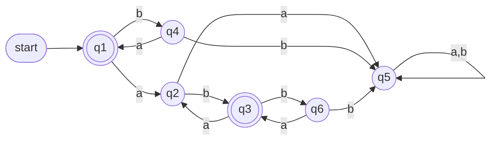
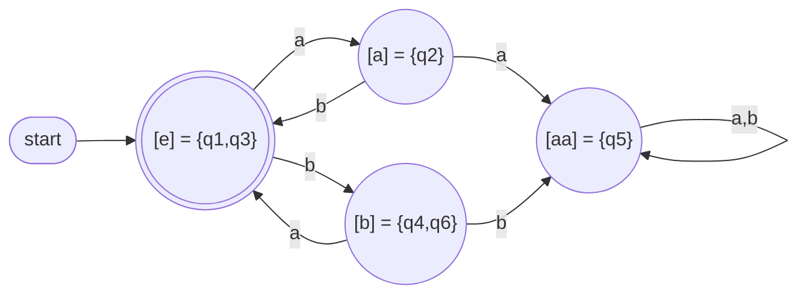
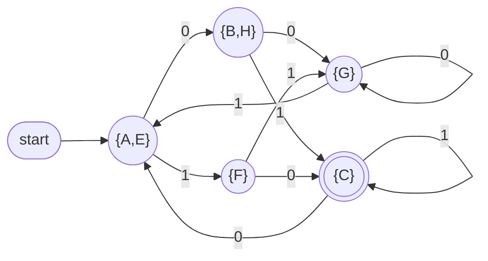

# Theory of Computation - DFA Minimization, Myhill-Nerode, CFGs

> [!info] Coverage
> Lecture 15 (FSA state minimization, Myhill-Nerode), Lecture 16 (minimization algorithm, pumping lemma limits), CFG 1-4 (definitions, examples, parse trees, ambiguity, closure, practice problems with solutions).
> Notation: slides write the empty string as $e$. These notes use $e$ too.

---

## Part 1 - DFA State Minimization (Lecture 15)

### 1.1 Why minimize?
Many DFAs accept the same language. We want the one with the **fewest states**. Two easy wins:

1. **Remove unreachable states** - states with no path from the start state. They can never affect acceptance.
2. **Merge equivalent states** - states from which *exactly the same* suffixes lead to acceptance.

### 1.2 Running example: $L = (ab \cup ba)^*$

Original DFA $M$ (q7, q8 are unreachable and already removed here; q1, q3 accepting):

- q5 is a **dead/trap state**: once there, never accept.
- q4 and q6 behave identically (on `a` go to an accepting state, on `b` go to dead) -> mergeable.
- q1 and q3 behave identically -> mergeable.

---

### 1.3 Relation 1: $\approx_L$ (defined by the **language**)

$$x \approx_L y \iff \forall z \in \Sigma^*:\ (xz \in L \iff yz \in L)$$

**In plain words:** $x$ and $y$ are indistinguishable if no suffix $z$ can "tell them apart" - appending any $z$ puts both in $L$ or both out of $L$.

- $\approx_L$ is an **equivalence relation** (reflexive, symmetric, transitive).
- **Distinguishable** = there exists at least one $z$ such that exactly one of $xz, yz$ is in $L$. That $z$ is called a **distinguishing string**.

**Classes of $\approx_L$ for $L = (ab \cup ba)^*$:**

| Class | Set | Meaning |
|---|---|---|
| $[e]$ | $L$ | already a complete string of the language |
| $[a]$ | $La$ | in $L$ but owes a `b` |
| $[b]$ | $Lb$ | in $L$ but owes an `a` |
| $[aa]$ | $L(aa \cup bb)\Sigma^*$ | broken forever, can never be fixed |

These 4 classes are disjoint and their union is $\Sigma^*$.

How you find them: start with $[e]$. Try short strings ($a$, $b$, $aa$, ...). If a string is distinguishable from every existing class representative, it starts a new class.
- $a$ vs $e$: $z = e$ distinguishes ($e \in L$, $a \notin L$) -> new class.
- $b$ vs $a$: $z = b$ distinguishes ($ab \in L$, $bb \notin L$) -> new class.
- $aa$: no suffix ever fixes it -> new class (the dead class).

---

### 1.4 Relation 2: $\sim_M$ (defined by a **machine**)

$$x \sim_M y \iff \exists q:\ (s, x) \vdash_M^* (q, e) \text{ and } (s, y) \vdash_M^* (q, e)$$

**In plain words:** $x$ and $y$ are equivalent if they drive $M$ from the start state to the **same state**.

- One class per (reachable) state: $E_q$ = all strings that end in state $q$.

For the example DFA (6 classes):

| State | $E_q$ |
|---|---|
| q1 | $(ba)^*$ |
| q2 | $La$ |
| q3 | $(ba)^*abL$ |
| q4 | $b(ba)^*$ |
| q5 | $L(aa \cup bb)\Sigma^*$ |
| q6 | $(ba)^*abLb$ |

Compare with $\approx_L$:
- $E_{q_1}, E_{q_3} \subseteq [e]$
- $E_{q_2} \subseteq [a]$
- $E_{q_4}, E_{q_6} \subseteq [b]$
- $E_{q_5} \subseteq [aa]$

### 1.5 Refinement

> [!important] Key result
> For any DFA $M$: $\ x \sim_M y \implies x \approx_{L(M)} y$

**Why:** if $x$ and $y$ reach the same state, then any suffix $z$ takes both to the same final state, so $xz$ and $yz$ are both accepted or both rejected.

So $\sim_M$ is a **refinement** of $\approx_L$: every class of $\sim_M$ sits fully inside one class of $\approx_L$ (classes of $\approx_L$ are "cut into smaller pieces").

**Consequence (lower bound):**
$$|K| \geq \text{number of classes of } \approx_{L(M)}$$
No DFA for $L$ can have fewer states than the number of $\approx_L$ classes.

---

### 1.6 Myhill-Nerode Theorem

> [!important] Theorem
> If $L$ is regular, there is a DFA accepting $L$ with **exactly** as many states as there are equivalence classes of $\approx_L$.

Combined with 1.5: this DFA is **minimal**.

**Construction** $M = (K, \Sigma, \delta, s, F)$:
- $K = \{[x] : x \in \Sigma^*\}$ - states are the classes
- $s = [e]$
- $F = \{[x] : x \in L\}$
- $\delta([x], a) = [xa]$

(Well-defined: if $x \approx_L y$ then $xa \approx_L ya$, so the choice of representative does not matter.)

Minimal DFA for $(ab \cup ba)^*$:

### 1.7 Corollary - characterization of regular languages

> [!important]
> $L$ is regular $\iff$ $\approx_L$ has **finitely many** equivalence classes.

**Exam use (proving non-regularity):** find infinitely many strings that are pairwise distinguishable.

*Example:* $L = \{a^n b^n\}$. Take $a^i, a^j$ with $i \neq j$. Suffix $z = b^i$: $a^i b^i \in L$, $a^j b^i \notin L$. So infinitely many classes -> not regular.

---

## Part 2 - Minimization Algorithm (Lecture 16)

### 2.1 State equivalence
Given DFA $M = (K, \Sigma, \delta, s, F)$:

$$(q, w) \in A_M \iff (q, w) \vdash_M^* (f, e) \text{ for some } f \in F$$
i.e. "$w$ drives $M$ from $q$ to acceptance".

$$q \equiv p \iff \forall z \in \Sigma^*:\ \big((q,z) \in A_M \iff (p,z) \in A_M\big)$$

Equivalent states get merged.

### 2.2 Approximations $\equiv_n$
Only check suffixes of length at most $n$:
$$q \equiv_n p \iff \forall z,\ |z| \le n:\ \big((q,z) \in A_M \iff (p,z) \in A_M\big)$$

- $\equiv_0$: only $z = e$, so 2 classes: $F$ and $K - F$.
- Each $\equiv_n$ is a refinement of $\equiv_{n-1}$.

### 2.3 The key lemma (how to compute $\equiv_n$ from $\equiv_{n-1}$)

$$q \equiv_n p \iff \underbrace{q \equiv_{n-1} p}_{\text{(a) were together}} \ \wedge\ \underbrace{\forall a \in \Sigma:\ \delta(q,a) \equiv_{n-1} \delta(p,a)}_{\text{(b) each symbol leads to the same old class}}$$

**Recipe:**
1. Remove unreachable states.
2. $\equiv_0 = \{F,\ K-F\}$.
3. For each class, look at each state's transitions. Write which **current class** each symbol leads to (a "signature"). States in the same class with different signatures get split.
4. Repeat until nothing splits ($\equiv_n = \equiv_{n-1}$).
5. Each final class = one state of the minimal DFA.

**Termination:** each round that changes something adds at least one class; there can be at most $|K|$ classes. So at most $|K| - 1$ rounds.

### 2.4 Worked example 1: $L = (ab \cup ba)^*$ (DFA from 1.2)

$\equiv_0$: $\{q_1, q_3\}$ (F), $\{q_2, q_4, q_5, q_6\}$ (N)

Signatures w.r.t. $\equiv_0$ (target class on `a`, on `b`):

| State | a -> | b -> |
|---|---|---|
| q1 | q2 (N) | q4 (N) |
| q3 | q2 (N) | q6 (N) |
| q2 | q5 (N) | q3 (F) |
| q4 | q1 (F) | q5 (N) |
| q5 | q5 (N) | q5 (N) |
| q6 | q3 (F) | q5 (N) |

$\equiv_1$: $\{q_1,q_3\}, \{q_2\}, \{q_4,q_6\}, \{q_5\}$

Round 2: q1, q3 both go `a`->{q2}, `b`->{q4,q6}. q4, q6 both go `a`->{q1,q3}, `b`->{q5}. No split -> **stop**. Result = the 4-state DFA in 1.6.

### 2.5 Worked example 2 (states A-H, alphabet {0,1}, accepting C)

Transitions:

| State | 0 | 1 |
|---|---|---|
| A | B | F |
| B | G | C |
| C* | A | C |
| D | C | G |
| E | H | F |
| F | C | G |
| G | G | E |
| H | G | C |

D is unreachable -> remove.

**$\equiv_0$:** $\{C\}, \{A,B,E,F,G,H\}$

**Round 1** (does 0 / 1 lead into {C}?):

| State | 0 | 1 |
|---|---|---|
| A | N | N |
| B | N | C |
| E | N | N |
| F | C | N |
| G | N | N |
| H | N | C |

$\equiv_1$: $\{C\}, \{A,E,G\}, \{B,H\}, \{F\}$

**Round 2** (check {A,E,G}):
- A: 0->B $\in\{B,H\}$, 1->F $\in\{F\}$
- E: 0->H $\in\{B,H\}$, 1->F $\in\{F\}$
- G: 0->G $\in\{A,E,G\}$, 1->E $\in\{A,E,G\}$ -> **split off**

{B,H}: both 0->G, 1->C -> stay.

$\equiv_2$: $\{C\}, \{A,E\}, \{B,H\}, \{G\}, \{F\}$

**Round 3:** A,E still same (0->{B,H}, 1->{F}); B,H same (0->{G}, 1->{C}). No split -> **stop**.

> [!warning] Common exam mistakes
> - Forgetting to remove unreachable states first (the algorithm does NOT remove them; it only merges).
> - Splitting based on the *target state* instead of the *target class*.
> - Stopping after one round without checking that the next round changes nothing.

### 2.6 Pumping Lemma cannot prove regularity

Pumping lemma = **necessary** condition for regularity, not sufficient.

$$L = \{a^i b^j c^j : i \ge 1, j \ge 0\} \cup \{b^j c^k : j,k \ge 0\}$$

**Satisfies the pumping conclusion** (take $p = 1$, pump the first symbol):
- String starts with `a`: pump the first `a`. More `a`s: still in part 1. Remove it: if $i \ge 2$ still part 1; if $i = 1$ we get $b^j c^j$, which is in part 2. OK.
- String starts with `b` or `c`: it is in $b^*c^*$; pumping the first symbol keeps it in $b^*c^*$. OK.

**But not regular:** $L \cap ab^*c^* = \{ab^jc^j\}$, which is not regular (Myhill-Nerode: $ab^i$ and $ab^j$ distinguished by $c^i$). Regular languages are closed under intersection, so $L$ cannot be regular.

**Lesson:** to *prove* regular, build a DFA/NFA/regex or use Myhill-Nerode (finitely many classes).

---

## Quick Revision Sheet

- $\approx_L$: same future w.r.t. language. $\sim_M$: same state in machine. $\sim_M$ refines $\approx_L$.
- # states of any DFA for $L$ $\ge$ # classes of $\approx_L$; Myhill-Nerode DFA achieves it.
- Regular $\iff$ finitely many $\approx_L$ classes. Infinite pairwise-distinguishable set -> not regular.
- Minimization: remove unreachable -> $\{F, K-F\}$ -> split by signatures -> repeat until stable ($\le |K|-1$ rounds).
- Pumping lemma: necessary, not sufficient.
